# 介護事業所にAIは役に立つのか

## この連載で確かめたいこと

やってみ太郎です。へんてこ商事で、中小企業の DX(デジタル化)や AI 導入の相談役をしています。

私は、いくつかの介護事業所のお客様の情報システムをお手伝いしています。
実際の業務を見ながら、業務の分析や DX、効率化をご一緒しています。
その中で、たびたびテーマにあがるのが介護報酬です。

今回から、新しい連載を始めます。テーマは「介護事業所の困りごとを、AIでどこまで解けるか」です。
現場の困りごとから逆にたどり、1回に1つずつ、AI で解けるかを試します。

対象は訪問介護に絞りました。ヘルパーが利用者の家を訪ね、食事や入浴、掃除などを手伝うサービスです。
全国に約3万7千の事業所があり、介護保険のサービスで最も数が多いからです。

1回目の今回は、3つの順に書きます。
まず、訪問介護の現場が、何に困っているのか。
次に、その困りごとを解く土台として、なぜ「ルールを探すこと」が大事なのか。
最後に、ルールを調べる AI を、いくつもの方式で作って比べた結果です。

## 訪問介護の現場で、何が起きているか

最初に、訪問介護の1か月の流れを整理しました。

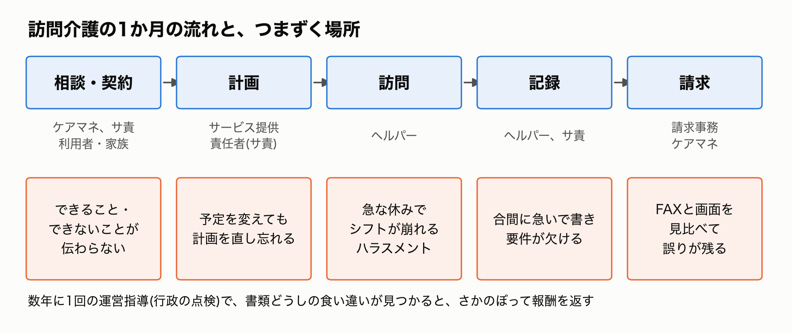

ケアマネジャー(介護の計画を立てる専門職)が、利用者の介護の全体計画を作ります。
それを受けて、事業所のサービス提供責任者(サ責)が、訪問介護の計画を作ります。
ヘルパーが訪問し、記録を書きます。月の初めには、請求事務の人が実績をまとめて請求します。

どの段にも、つまずきやすい場所があります。
なかでも重いのは、人の問題でした。

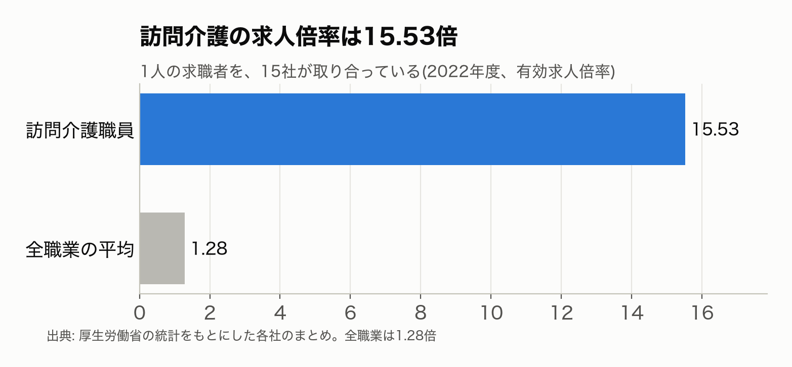

訪問介護の求人倍率は、15.53倍です(2022年度)。
1人の求職者を、15の事業所が取り合っていることになります。全職業の平均は1.28倍なので、桁が違います。

人が足りない理由は、働き方の重さにあります。
ヘルパーは、利用者の家から家へ移動しながら働きます。この移動や待機の時間に、賃金が払われないことがあります。2020年には、厚生労働省が「移動時間は原則として労働時間」とする通知を出しました。無給の扱いが、まだ指摘されていたからです。

もう1つは、1人で家に入る仕事ならではのリスクです。

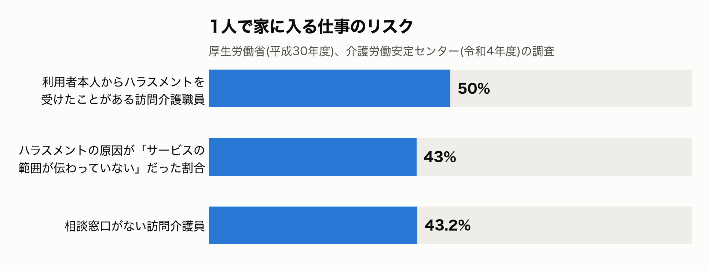

訪問介護職員の半分が、利用者本人からハラスメントを受けたと答えています。
原因で最も多いのは、「利用者や家族が、サービスの範囲を分かっていない」でした。
介護保険のヘルパーには、頼めないことがあります。たとえば、同居する家族の分の調理や掃除です。その線引きが伝わらず、トラブルになるのです。

人が採れず、経営も苦しくなっています。訪問介護の倒産は、2025年に91件で、3年続けて過去最多でした。

## 困りごとは、つながっている

困りごとを並べていくと、1本の線でつながっていることに気づきました。

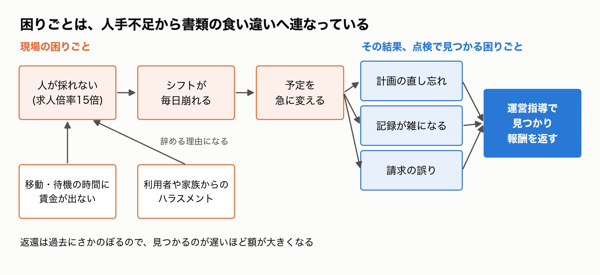

人が足りないと、シフトに余裕がなくなります。
利用者の入院やヘルパーの急な休みのたびに、サ責が代わりを探して、予定を組み直します。

予定を急に変えると、書類が追いつきません。
訪問介護の計画を直し忘れる。合間に急いで書いた記録に、必要な項目が欠ける。FAX で届く予定表と介護ソフトの実績が合わない。

この食い違いは、ふだんは誰も気づきません。
数年に1回、自治体の運営指導(行政の点検)が入ったときに、まとめて見つかります。
すると、過去にさかのぼって報酬を返すことになります。見つかるのが遅いほど、返す額は大きくなります。

2026年2月には、鹿児島県の訪問介護事業所が指定を取り消されました。記録の捏造と、減算(報酬の引き下げ)を放置したためです。

立場ごとに困りごとを数えると、集まる場所も見えてきました。

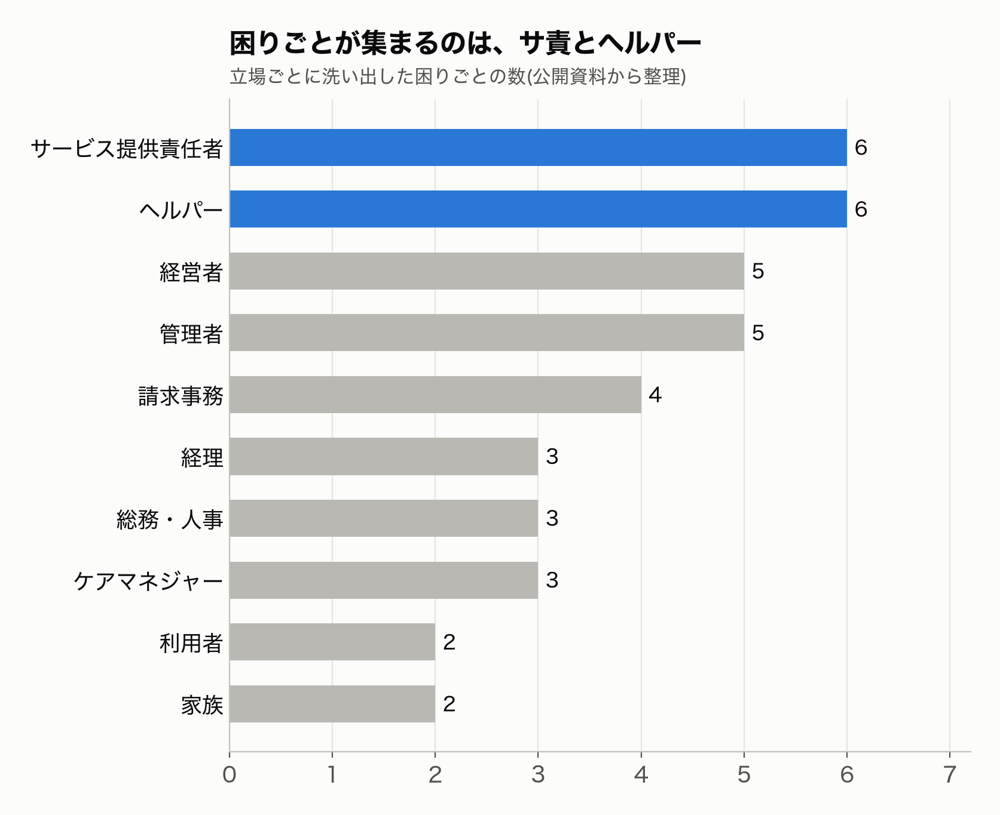

いちばん多いのは、サ責とヘルパーでした。
サ責は、シフトの調整と計画づくりの両方を背負います。ヘルパーは、1人で家に入り、合間に記録を書きます。
現場の困りごとと書類の困りごとが、同じ人に重なっているのです。

## どの困りごとにも、ルールが絡んでいる

ここまでの困りごとを、もう一度見直してみました。
すると、どれにも介護報酬のルールが絡んでいることに気づきました。

- ヘルパーが頼まれごとを断るには、それが介護保険の範囲外だという根拠が要る
- 記録が足りているかは、請求の要件に照らして初めて分かる
- 予定表と実績の突き合わせでは、2時間あけずに訪問したら合算する、といった決まりを当てはめる
- 運営指導で指摘されるのも、ルールとのずれ

介護保険のサービスは、国が決めた細かいルールに沿って提供し、請求します。
そのルールは、告示・通知・Q&A として、すべて無料で公開されています。
それなのに、事業所はルールの読み違いで報酬を返したり、取れるはずの加算(上乗せの報酬)を取りこぼしたりしています。

理由の1つは、ルールの置き場所がばらばらなことです。
報酬の単位数は告示に、その読み方は通知に、細かい場面の判断は Q&A にあります。Q&A だけでも3,700問を超え、改定のたびに増えていきます。

どれが今のルールかを見分けるのも、簡単ではありません。
実際に資料を集めてみると、厚生労働省のデータベースにあった通知の1つが、平成12年に作られたときの古い版でした。最新の版は、全国老人保健施設協会の検索システムにありました。

だからこそ、AI に手伝わせたいのです。
ただし、AI がもっともらしく答えるだけでは困ります。間違ったルールで請求すれば、数年後に返すことになるからです。
必要なのは、正しいルールの箇所を探し出し、それを根拠に答える AI です。

こうした仕組みを、RAG(ラグ)と呼びます。
資料の中から関係する箇所を検索し、その箇所を AI に渡して答えさせるやり方です。
この連載のどの回でも、この「ルールを探す AI」が土台になります。そこで1回目は、これを作り、いくつもの方式で比べることにしました。

## AIに読ませる資料を集める

ここからは、ルールを調べる AI を実際に作って比べた話です。

最初の仕事は、AI に読ませる資料を集めることでした。
使ったのは、国や公的な団体が無料で公開している文書だけです。

介護報酬のルールは、1冊の本にまとまっているわけではありません。
大きく分けて、4つの段に分かれています。

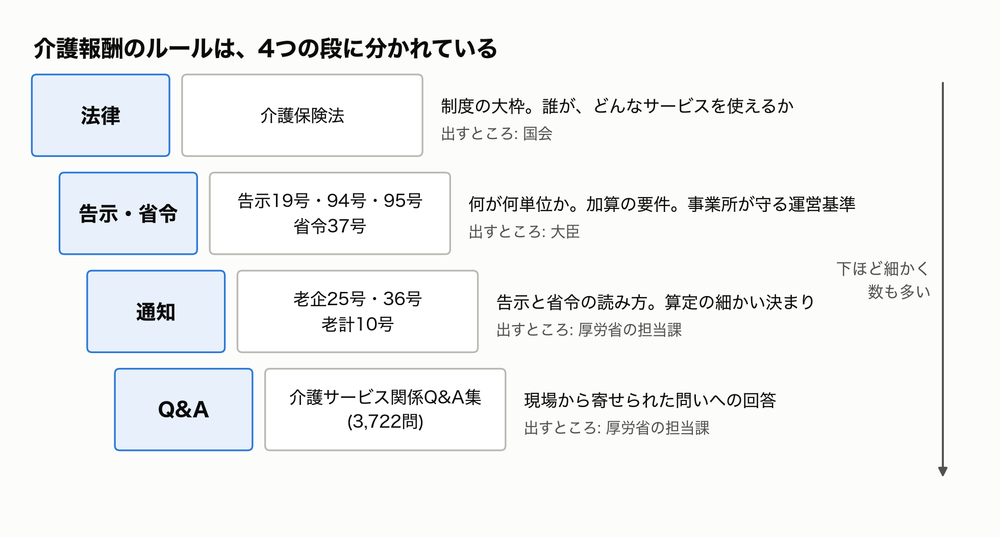

いちばん上が、介護保険法です。誰がどんなサービスを使えるか、という制度の大枠を決めています。

その下に、大臣が出す告示と省令があります。今回入れたのは4本です。

- 告示19号:介護報酬の単位数表です。「身体介護を30分以上1時間未満で何単位」といった、報酬の値段そのものが書いてあります
- 告示95号と94号:加算を取るための細かい要件と、加算の対象になる利用者の条件です
- 省令37号:事業所が守る運営基準です。人の配置、計画の作り方、記録の残し方などを決めています

たとえば、省令37号の第25条は、たった1文です。

> 指定訪問介護事業者は、訪問介護員等に、その同居の家族である利用者に対する訪問介護の提供をさせてはならない。

ヘルパーが、一緒に住む自分の家族を担当してはいけない、という決まりです。

告示と省令は短く、そのままでは現場で判断しきれません。
そこで、厚生労働省の担当課が「読み方」を通知で示します。

- 老企25号:省令37号(運営基準)の読み方です
- 老企36号:告示19号(単位数表)の読み方です。算定の細かい決まりが詰まっていて、今回の検証で根拠として最も多く引かれました
- 老計10号:訪問介護のサービス行為を、身体介護と生活援助にどう分けるかを示したものです

「老企」「老計」は、通知を出した部署の略で、その後ろが番号です。現場では、この略称で呼ぶのが普通です。

通知の文は、たとえばこうです(老企36号の「訪問介護の所要時間」から)。

> 訪問介護の所要時間については、実際に行われた指定訪問介護の時間ではなく、訪問介護計画において位置付けられた内容の指定訪問介護を行うのに要する標準的な時間とすること。

実際に何分かかったかではなく、計画に書いた標準の時間で報酬が決まる。現場の感覚と少しずれる決まりが、こうした通知に書かれています。

いちばん下の段が、Q&A です。
現場や自治体から寄せられた問いに、厚生労働省が答えたもので、「介護サービス関係Q&A集」として Excel で公開されています。
全部で3,722問あり、改定のたびに増えていきます。

Q&A は、現場の判断にいちばん近い資料です。
ただ、読み物としては少し癖があります。たとえば、こんな問答があります。

> 問:居宅サービス運営基準第25条で同居家族に対するサービス提供を禁止しているが、ここでいう同居家族とは、要介護者と同一の居宅に居住していることをいうものであり、別居の家族に対するサービス提供を禁止するものではないと解するが如何。
> 答:貴見のとおり。

答えは「貴見のとおり(お考えのとおりです)」の一言だけです。中身は、ぜんぶ問いの側に書いてあります。
答えの文だけを探しても、見つからない形です。

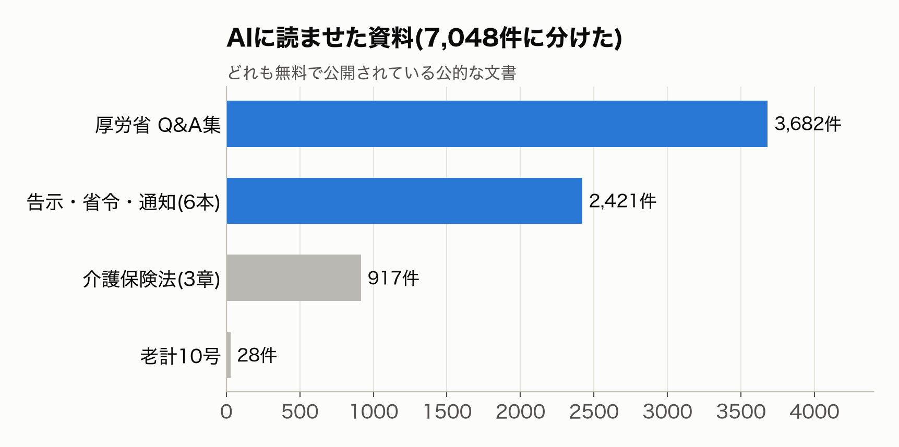

これらを集めて、AI が探しやすい大きさに切り分けました。
告示や通知は、章・節・条や「第一」「1」「(1)」といった見出しで区切りました。Q&A は1問を1件にしました。
全部で7,048件です。

告示・省令・通知は、改正を反映した最新の版を、全国老人保健施設協会の検索システムから取りました。
老計10号だけは、厚生労働省が改正の差分しか公開していませんでした。全文は、枚方市が載せている資料から取りました。

## 現場では、どんな場面でルールを探すのか

資料をそろえたところで、現場でルールを探す場面を具体的に考えてみました。
Q&A集の訪問介護の問いを読むと、どれも日々の仕事の中で出てくる疑問です。4つ挙げます。

1つ目は、利用者から頼まれごとをされた場面です。
「娘さんと同居している利用者さんから、掃除を頼まれた。生活援助で入っていいのか」。
答えは、3つの資料にまたがっています。生活援助とは何かを決めた告示19号、その読み方を示した老企36号、そして「同居家族がいるというだけで、一律に機械的に判断しない」と念を押した Q&A です。
1つだけ読んでも、正しい判断にはなりません。

2つ目は、請求できるかを迷う場面です。
「通院の付き添いで、病院での待ち時間も請求していいのか」。
Q&A の答えは、「単なる待ち時間はサービス提供時間に含まない」です。ただし、院内で具体的な見守りをしていれば、身体介護として算定できます。
現場では「付き添い」と言いますが、資料では「通院・外出介助」「自立生活支援のための見守り的援助」と書かれています。言葉が違うので、キーワードで探しても当たりません。

3つ目は、加算が取れるかを確かめる場面です。
「訪問中に利用者の具合が急に悪くなり、予定より長く対応した。緊急時訪問介護加算は取れるか」。
Q&A の答えは「対象とはならない」です。この加算は、利用者や家族の求めでケアマネジャーが認め、計画にない訪問をしたときのものだからです。
加算の名前から想像する意味と、実際の要件がずれている例です。

4つ目は、人の配置の場面です。
「ヘルパーが、別居している自分の親を担当してもいいか」。
省令37号の第25条が禁止しているのは、同居の家族です。別居ならよい、というのが先ほどの「貴見のとおり」の Q&A です。
条文と Q&A を組み合わせて、初めて答えが出ます。

4つの場面に共通するのは、次の3点です。

- 答えが、告示・通知・Q&A の複数にまたがっている
- 現場の言葉と、資料の言葉が違う
- 名前や見出しから想像する意味と、実際の決まりがずれていることがある

ルールを探す AI には、この3つを越えることが求められます。
問題集も、この3点を試せるように作りました。

## 問題集を作り、採点のしかたを決める

比べるには、同じ問題集が要ります。
Q&A集の訪問介護の部分から、2種類の問題を作りました。

1つは、現場の言葉で聞く問題です。
Q&A の固い問いを、ヘルパーがチャットで聞くような口ぶりに、AI で書き換えました。

- 元の問い:「通院等のための乗車・降車の介助の前後に連続して行われる…身体介護…は別に算定できるのか。」
- 書き換えた問い:「通院の乗降介助をする前後に、部屋での着替えや病院の中の移動介助、トイレ介助も続けてやったんですが、それって身体介護として別に請求できるんですか?」

この問いで、元の Q&A を当てられるかを見ます。

もう1つは、根拠を探す問題です。
Q&A を資料から抜き、問いだけで、答えの根拠になる告示や通知を探させます。

作っている途中で、驚いたことがありました。
Q&A集の約半分が、重複していたのです。同じ問いと答えが、別のサービスの欄にも載っていました。
これに気づくまで、AI が別の欄の同じ Q&A を引くたびに、不正解として数えていました。直すと、ある方式の点は0.65から0.82に上がりました。
採点の前に、正解の側を疑う。最初に学んだことです。

## 検索のやり方を比べる

まず、資料の引き方を比べました。
AI が答える前に、7,048件の中から、関係する資料をどう探してくるか、という部分です。

試したのは、次のようなやり方です。

- キーワードで探す(BM25 という手法)。問いを「利用者」「訪問」「2時間」のような単語に分け、同じ単語を多く含む資料を上に並べます
- 意味の近さで探す(ベクトル検索)。問いと資料を、それぞれ768個の数字の並びに変えます。数字の並びが近いものほど、意味が近いとみなします。言い回しが違っても当たるのが強みです
- その2つを混ぜる(ハイブリッド)。両方の上位100件ずつを、順位をもとに1つの順に並べ直します
- 混ぜた結果を、小さな AI でもう一度並べ直す(リランカー)。上位30件を、問いと1件ずつ組にして読み直し、関係の深い順に並べます
- AI に仮の答えを書かせ、それに似た資料を探す(HyDE)
- 資料ごとに、AI に「これは何の資料のどこか」という説明を書き足させてから探す(Contextual Retrieval)

どれも、手元のパソコンで動かしました。意味の近さを測るモデルも、並べ直しのモデルも、日本語向けに公開されている小さなもの(ruri-v3)です。

実際の問いで、違いを見てみます。
言い換え問題の1つ、「1日2回入るとき、間は2時間くらい空ければいいと聞いた。その『くらい』はどの程度まで許されるのか」です。
正解は、訪問介護の Q&A にある「『概ね2時間』の『概ね』とは」という問いでした。答えは「特に規定しておらず、利用者の状況に応じて判断されたい」です。

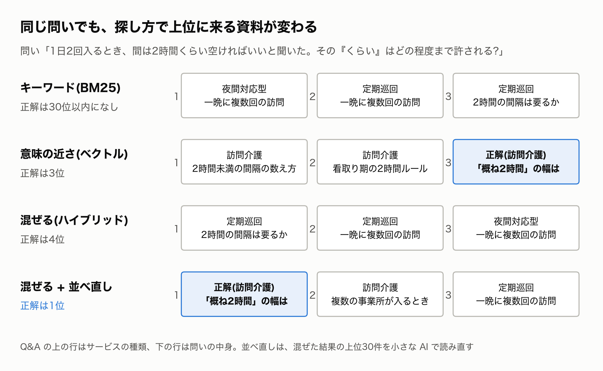

キーワードで探すと、上位は夜間対応型や定期巡回といった、別のサービスの Q&A で埋まりました。
「1日2回」「複数回」といった単語に引っぱられたのです。正解は、上位30件にも入りませんでした。

意味の近さで探すと、2時間ルールにまつわる訪問介護の Q&A が並び、正解は3位でした。
問いの言葉は「くらい」で、Q&A の言葉は「概ね」です。単語は違っても、意味の近さで拾えています。

2つを混ぜると、かえって4位に下がりました。キーワード側が上に押し上げた、別のサービスの Q&A が混ざったからです。

最後に並べ直すと、正解が1位に上がりました。
問いと資料を組にして読み直すので、「訪問介護の」「間隔の幅を聞いている」という中身まで見分けられます。

全問で測った結果も、同じ傾向でした。
下の図は、根拠を探す問題で、正解の根拠を上位10件にどれだけ拾えたか(再現率)を示しています。1.0なら、すべての根拠を拾えたことになります。

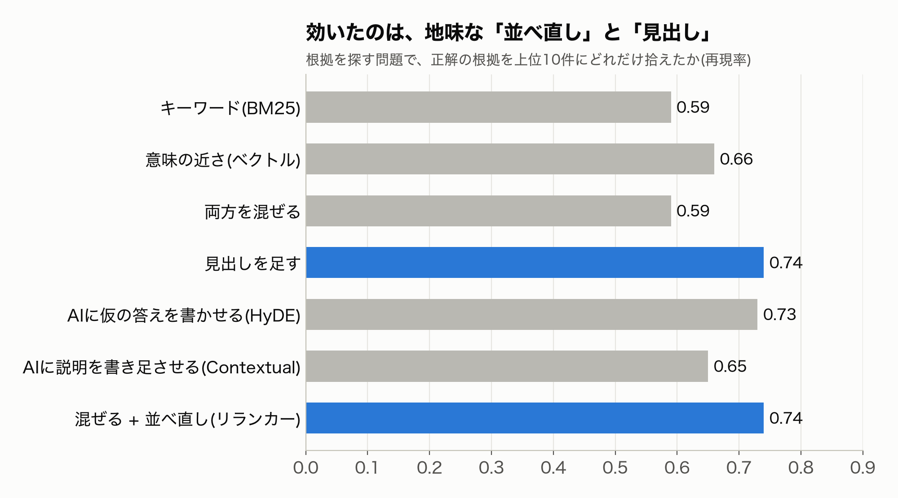

いちばん効いたのは、並べ直しでした。正解の根拠を拾えた割合は、0.59から0.74に上がりました。
言い換え問題でも、正解の Q&A が1位に来る割合が0.81から0.91に上がっています。
代わりに、1問あたり約1.7秒かかります。30件を1件ずつ読み直すからです。

意外だったのは、AI に文章を書かせる2つのやり方です。手間をかけたわりに、差が出ませんでした。
仮の答えを書かせるやり方は、言い換え問題では逆効果でした。正解が1位に来る割合が、0.40まで落ちました。AI が書いた仮の答えに引っぱられ、問いの中身から離れてしまうのです。
資料に説明を書き足させるやり方も、ほとんど変わりませんでした。それより、「老企36号 > 第2 > 2 > (4)」のような見出しの道筋を、機械的に頭に足すほうが効きました。

## AIに自分で調べさせる

次に、答えまで出させて比べました。根拠を探す問題の39問を使います。
答える役は、どれも Claude Sonnet です。比べたのは、次の4つです。

- AI だけ:資料を渡さず、そのまま聞く
- 検索して1回で答える:並べ直しまでした上位5件の全文を渡し、1回で答えさせる。いわゆる RAG の基本形
- AI が自分で何度も検索する:「検索する」「全文を読む」の2つの道具を渡し、納得するまで何度でも使わせる
- AI が目次をたどる:検索は使わせず、「目次の1段を開く」「全文を読む」の2つだけを渡す。資料の見出しから作った目次の木を、上から順にたどらせる(PageIndex という方式をまねたもの)

どの方式にも、根拠にした資料の番号を答えに添えさせました。
また、正解の Q&A そのものは、道具から見えないように隠しました。答えを写されては、比べられないからです。

答えは、国の公式の答えと照らして、別の AI に「正しい」「一部正しい」「誤り」の3段階で判定させました。
どの方式の答えかは伏せ、並び順も混ぜています。判定はぶれるので、3回取って多数決にしました。

具体的な問いで、4つの答えを並べてみます。
「遠くの病院への通院介助を頼まれた。遠いことを理由に断ってもいいか」という問いです。
公式の答えは「単に遠距離であることを理由に断ることは、正当な理由に当たらない」でした。断れるのは、人が足りずに応じきれない、住所が事業所のサービス地域の外、などの3つの場合に限られます。

AI だけの答えは、こうでした。

> 正当な拒否事由には当たりません。(中略)正当な理由は、人員不足、利用者の居住地が通常の事業の実施地域外、他の事業者との同時利用などに限られます。

結論は合っています。でも、断れる理由の3つ目が、もっともらしい作り話になっていました。判定は「一部正しい」です。

検索して1回で答える方式は、こうです。

> 資料からは、遠距離であることだけを理由とする拒否が正当かどうかは判断できません。資料[1681]は、提供を拒める正当な理由を、現員で応じきれない場合、通常の事業の実施地域外である場合、その他自ら適切な提供が困難な場合に限っています。

おもしろいことに、正しい根拠(運営基準の読み方を示した老企25号の一節)は、ちゃんと引けていました。3つの理由も正しく書いています。
それなのに、「遠距離」という言葉が資料に無いので、「判断できない」で止まってしまいました。判定は「誤り」です。

AI が自分で何度も検索する方式は、次のように動きました。

1. 「遠距離 通院 外出介助 サービス提供拒否 正当な理由」で検索する
2. 言い方を変えて、「訪問介護 正当な理由 提供拒否 通常の事業の実施地域」などでも検索する
3. 見つけた資料(老企25号の「提供拒否の禁止」)の全文を読む

そのうえで、こう答えました。

> 遠距離の病院等への通院外出介助の申込であることだけでは、正当な拒否事由にはなりません。拒否できるのは、①現員では申込に応じきれない場合、②居住地が通常の事業の実施地域外の場合、③その他自ら適切なサービス提供が困難な場合です。

1回で答える方式と、読んだ資料は同じです。違ったのは、3つの理由に当たらないなら断れない、と結論まで踏み込んだことでした。判定は「正しい」です。

目次をたどる方式は、「資料の一覧 → 老企25号 → 訪問介護 → 運営に関する基準 → 提供拒否の禁止」と目次を何度も開いて降りていき、同じ資料にたどり着いて、同じ結論を出しました。
検索を一切使わずに、見出しだけを頼りに正しい場所まで降りていけたのです。そのぶん手数はかかり、39問全体では、道具を呼ぶ回数が自分で検索する方式の3倍以上になりました。

39問全体の結果が、下の図です。

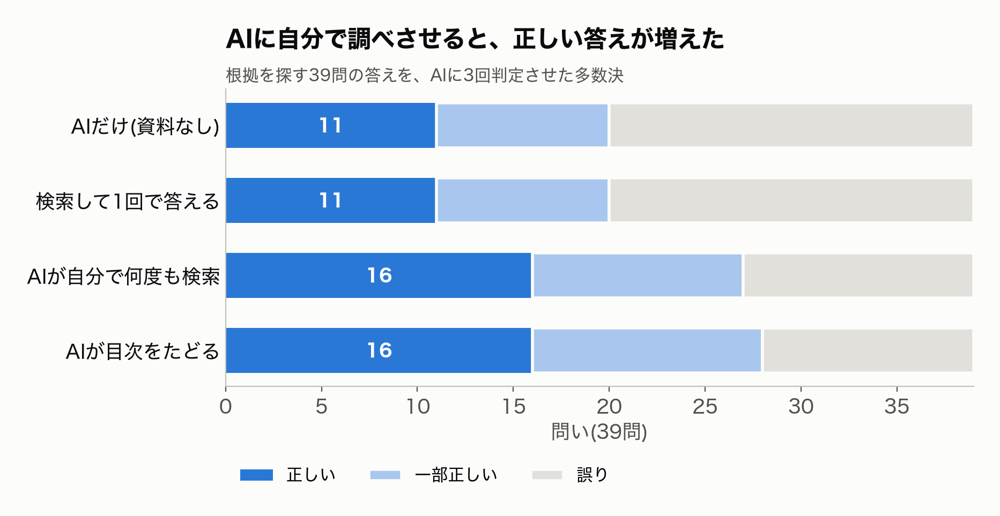

AI に自分で調べさせると、正しい答えが11問から16問に増えました。
自分で何度も検索する方式は、1問あたり平均2.7回検索し、1.3回全文を読んでいました。かかった時間は1問あたり約20秒です。

ただ、もっと気になったのは、点が同じ2つの中身です。

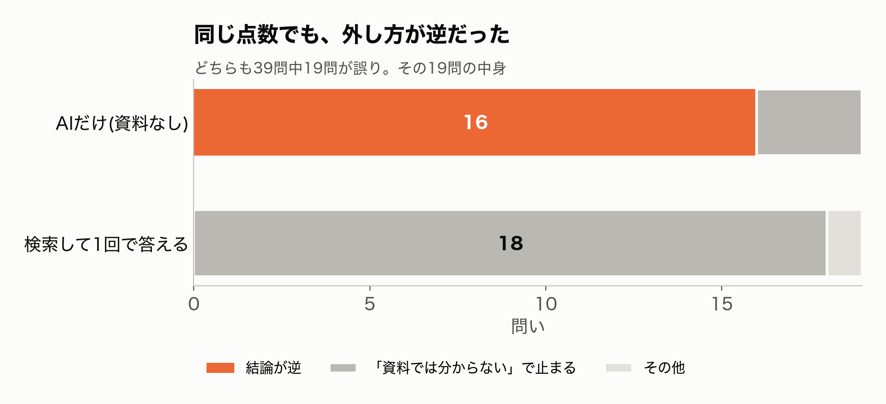

資料を渡さない AI と、1回だけ検索する AI は、どちらも19問を間違えました。
でも、間違え方が正反対でした。

資料を渡さない AI は、19問中16問で、結論が逆の答えを自信満々に返しました。
たとえば、「緊急時訪問介護加算のとき、所要時間はどう決めるのか」という問いです。AI だけの答えは「計画上の時間ではなく、実際の所要時間で算定する」でした。
資料を集める節で引用した通知を、思い出してください。正しくは、要請の内容から想定される標準的な時間です。正反対の答えを、言い切っていました。

1回だけ検索する AI は、19問中18問で「資料からは分からない」と止まりました。先ほどの遠距離の問いと同じ形です。

請求の判断で怖いのは、前者です。
「実際の時間で請求できます」と言い切られて請求し、数年後の点検で返すことになるかもしれません。
点数だけ見ていたら、この違いには気づきませんでした。

## 資料を足しても、答えは変わらなかった

全部の方式が外す問いが、7問ありました。
調べると、その答えの多くが、まだ入れていない資料に拠っていました。訪問介護のサービス行為の区分を示した「老計10号」と、介護保険法です。

資料が足りないから外れるんだ。そう考えて、2つを足しました。

結果は、何も変わりませんでした。
足した資料を根拠に挙げた答えは、1問もありません。外れていた7問も、外れたままでした。

外れた問いを1つずつ読み直すと、原因は資料ではありませんでした。
ある問いの公式の答えは、「老計10号を参照されたい」の1文だけでした。問いの言葉から、その通知にはたどり着けません。
別の問いは、問いの欄に「適切な訪問介護サービス等の提供について」と1行あるだけでした。

足して確かめるまでは、ただの思い込みだったわけです。

## 本命のGraphRAGを、3つ試した

次は、本命の GraphRAG です。
介護報酬のルールは、告示から通知、通知から Q&A へと、互いに参照し合っています。言葉どうしのつながりを網(グラフ)にしてたどれば、うまく引けるのではないか。期待していました。

まず、AI を使わずに、見出しや「〜加算」といった言葉から網を作りました。作るのにかかったのは3秒です。
続けて、よく使われるライブラリを3つ試しました。LightRAG、Microsoft GraphRAG、HippoRAG 2 です。どれも、AI に資料を読ませて言葉と関係を抜き出し、網を作ります。

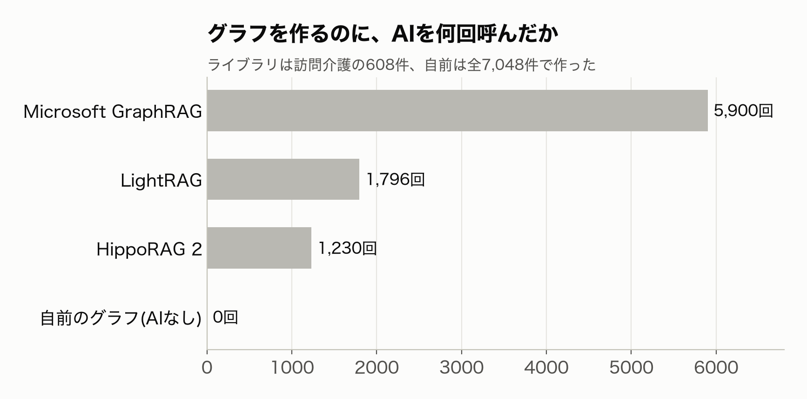

網を作るだけで、AI を千回から六千回近く呼びました。
Microsoft GraphRAG は、1時間40分かかりました。

肝心の結果です。

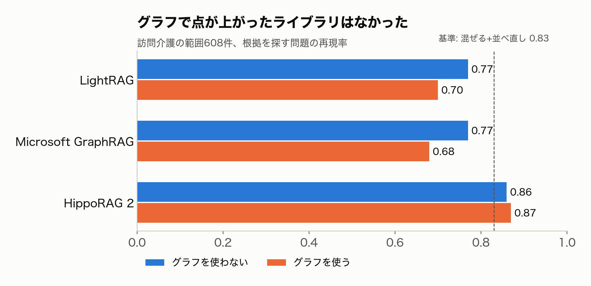

網を使って、点が上がったライブラリはありませんでした。
LightRAG と Microsoft GraphRAG は、網を使わずに意味の近さで探すほうが、点が高かったのです。

日本語の資料ならではの、落とし穴もありました。
Microsoft GraphRAG は、言葉を英語で抜き出していました。「告示19号」が「NOTICE NO. 19」になるのです。
HippoRAG 2 は、言葉をそろえる途中で、英数字以外の文字を消していました。日本語の言葉はほとんど空になり、網が1点につぶれていました。
どちらもエラーは出ません。8件で試して中身を見るまで、気づきませんでした。

一方で、網には別の使い道がありました。
AI に自分で調べさせるとき、検索の道具に加えて、網をたどる道具も渡しました。すると、正しい答えが増えた問いがあったのです。
検索の部品としては役に立たない網でも、AI が考えながら使う道具にすると、生きる場面がありました。

## 最後に見つけたのは、改行だった

3つ目の HippoRAG 2 で、気になる数字が出ました。
網を使わない引き方(0.86)が、ほかの2つのライブラリの同じ引き方(0.77)より、ずっと高かったのです。
どれも、同じ埋め込みモデル(文章を数値に変える AI)を使っています。差が出るはずがありません。

ライブラリのプログラムを読んで、理由が分かりました。
HippoRAG は、文章を数値に変える前に、改行を空白に置き換えていたのです。

本当にそれだけで変わるのか。同じ条件で、両方を作って確かめました。

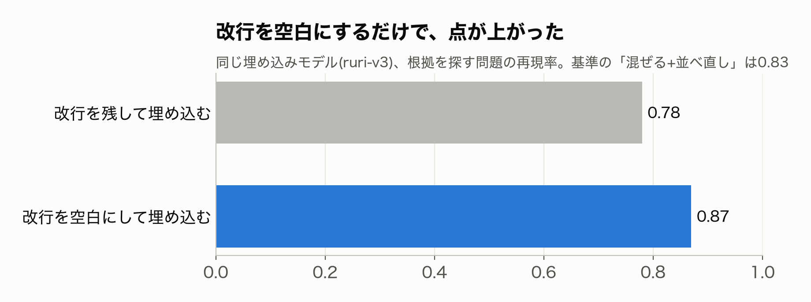

改行を残すと0.78、空白にすると0.87でした。
グラフも AI も使わず、前処理の1行で、並べ直しを使った基準(0.83)を超えてしまいました。

まだ、訪問介護の範囲の608件で確かめただけです。全部の資料で、並べ直しと組み合わせたときにも効くかは、次に測ります。

## やってみて

訪問介護の困りごとの根には、人手不足がありました。
それがシフトの崩れになり、書類の食い違いになって、数年後に返還という形で表に出ます。
どの困りごとに AI で手を打つにしても、まず正しいルールを根拠つきで引けることが土台になります。今回は、その土台を作りました。

ルールを調べる AI そのものについては、思い込みが3回崩れました。
資料が足りないと思って足したら、答えは変わらなかった。
本命の GraphRAG は、検索の点を上げなかった。
いちばん効いた工夫は、改行を空白にするという、拍子抜けするほど小さな前処理だった。

いちばん心に残ったのは、点が同じ2つの AI でした。
一方は結論を取り違え、もう一方は「分からない」と止まる。現場で使うなら、後者のほうがずっと安全です。
AI を介護の仕事に入れるときは、正解の数より、間違え方を見る必要があると感じました。

次回からは、この AI を使って、現場の困りごとに1つずつ取り組みます。
最初は、ヘルパーが頼まれごとを受けたとき、それが介護保険の範囲内かを、利用者に分かる言葉で説明させる予定です。ハラスメントの原因で最も多かった「サービスの範囲が伝わっていない」に、AI で手を打てるかを試します。

コードと記録は、ここに置いています。

https://github.com/h-takeshita-henteco-shoji-com/tried/tree/main/2026/11-08-訪問介護の困りごとをAIで解く-01-ルールを引けるRAGを複数の方式で比べる

この記事の検証は、公開資料をもとにした非公式のものです。実際の請求の判断には使わないでください。

## 参考にした資料

- 厚生労働省「介護サービス関係Q&A集」 https://www.mhlw.go.jp/stf/seisakunitsuite/bunya/hukushi_kaigo/kaigo_koureisha/qa/index.html
- 全国老人保健施設協会「法令・Q&A検索システム」(告示・通知・介護保険法の溶け込み版) https://hourei.roken.or.jp/
- 枚方市が公開している老計10号の PDF https://www.city.hirakata.osaka.jp/cmsfiles/contents/0000046/46318/tsuuchi_houmon_10.pdf
- ドクターメイト「訪問介護職員の求人倍率15.53倍に」 https://doctormate.co.jp/blog/kaigonews-96
- 東京商工リサーチ「2025年 訪問介護 倒産91件」 https://www.tsr-net.co.jp/data/detail/1202280_1527.html
- 厚生労働省「介護現場におけるハラスメントに関する調査研究 報告書」 https://www.mhlw.go.jp/content/12305000/000947359.pdf
- 介護労働安定センター「介護事業所のハラスメントに関する調査」 https://www.kaigo-center.or.jp/content/files/report/2023r01_h_chousa01.pdf
- 介護のみらいラボ「介護ヘルパーの移動時間は労働時間」 https://kaigoshoku.mynavi.jp/contents/kaigonomirailab/news/medicalnursingnews/20200122/
- 鹿児島県の訪問介護事業所の指定取消し(行政処分データベース) https://kaigo-record.jp/kagoshima-aira-kokkonoie-revocation-2026/
