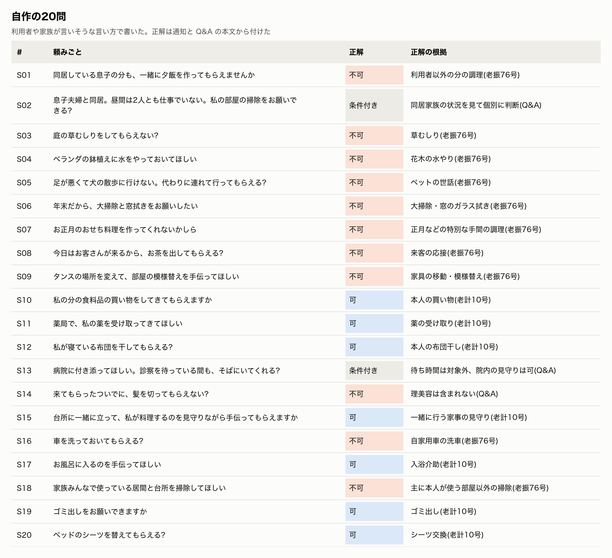
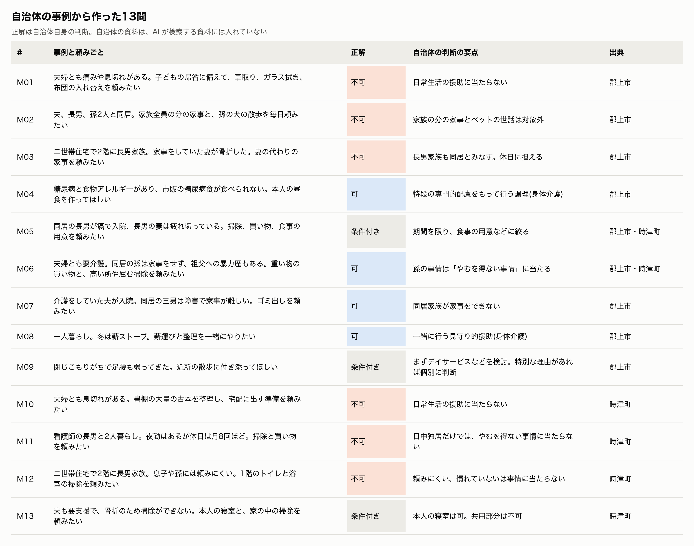
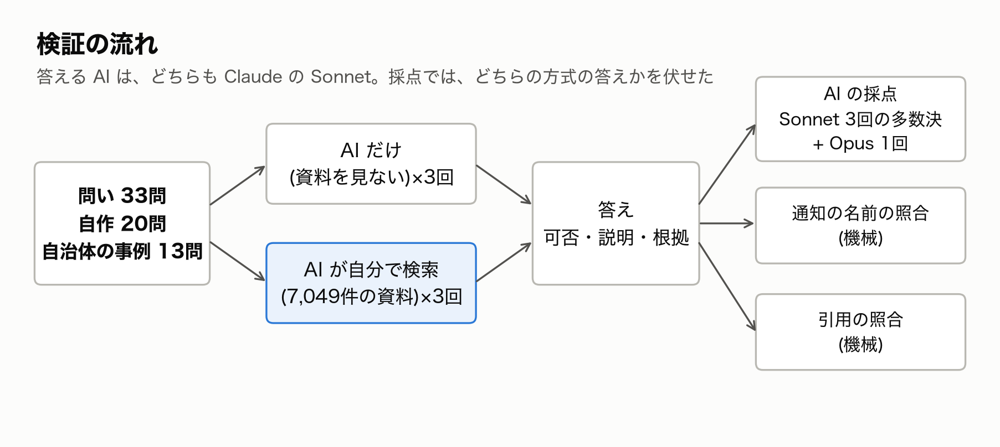
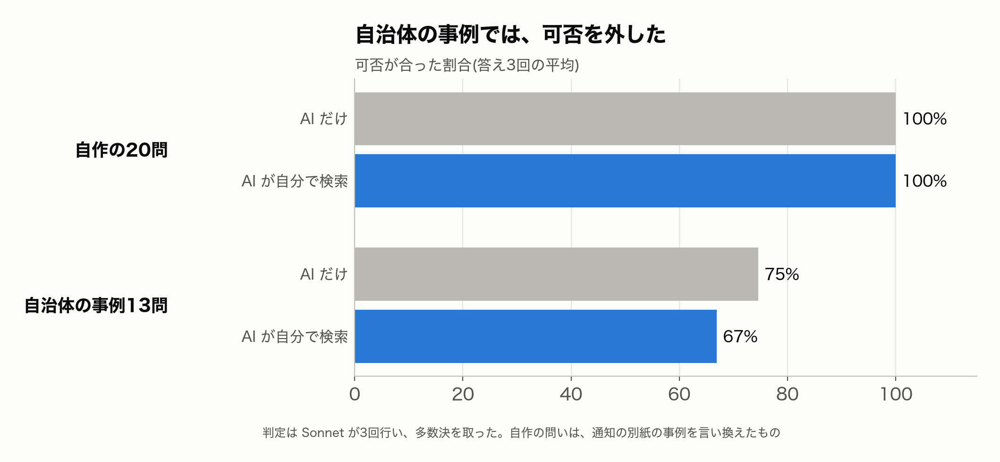
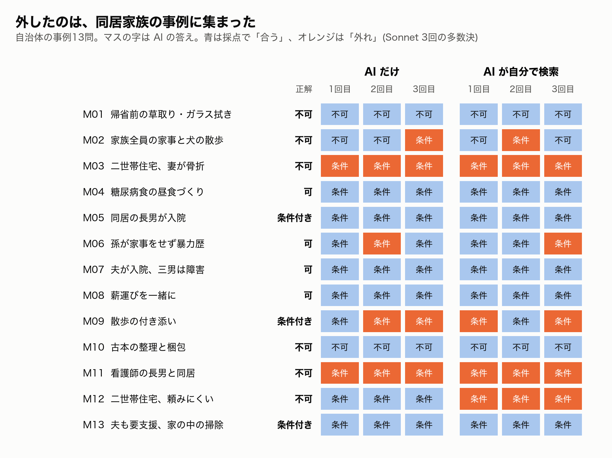
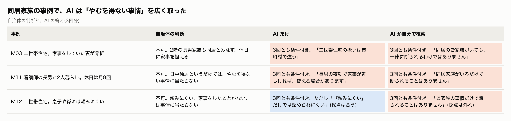
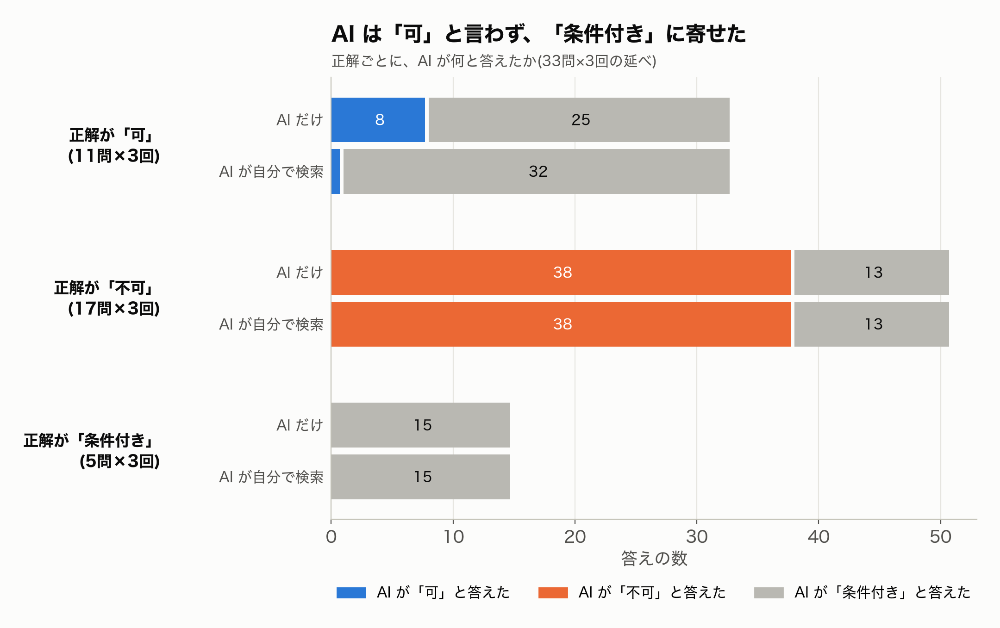
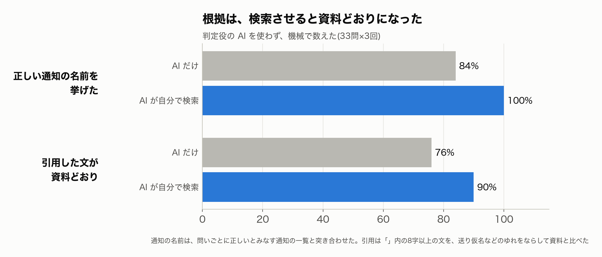
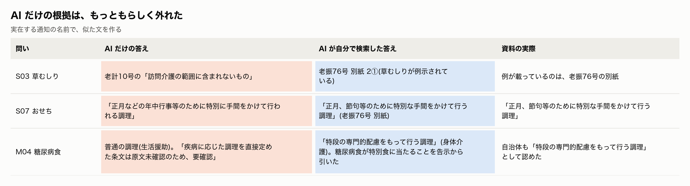
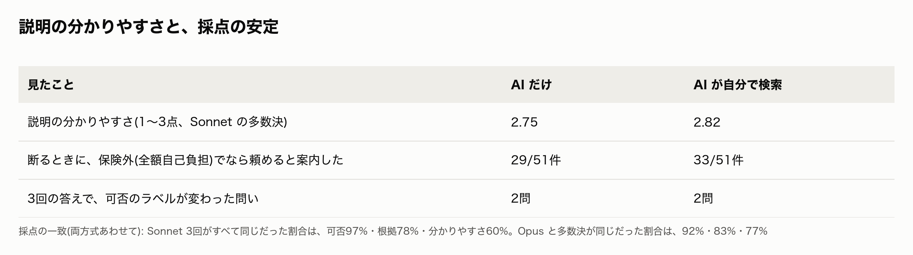

# 介護保険でヘルパーに頼めるか、AIは根拠つきで判断できるか

## 「それは、できないんです」を言うのは難しい

やってみ太郎です。連載「介護事業所の困りごとを、AIでどこまで解けるか」の2回目です。

前回は、介護報酬のルールを調べる AI を作りました。

https://note.com/tried_hs/n/nfc49b26984b6

その途中で、ずっと気になっていた数字があります。

訪問介護の職員の半分が、利用者からハラスメントを受けたと答えています。
原因で最も多いのは、「利用者や家族が、サービスの範囲を分かっていない」でした。

介護保険のヘルパーには、頼めないことがあります。
同居する家族の分の夕飯づくり、庭の草むしり、年末の大掃除などです。
ヘルパーは、利用者の家でそれを頼まれ、その場で断らなければいけません。

断るのは、つらい仕事です。
「決まりなので」だけでは、相手は納得しません。何という決まりなのか、では何なら頼めるのか。そこまで言えると、角が立ちにくくなります。

そこで今回は、AI にこの説明をさせてみました。
利用者や家族の頼みごとを渡し、介護保険でできるかどうかを、根拠つきで、分かる言葉で答えさせます。

結論から書きます。
よく知られた頼みごとなら、AI は外しませんでした。ところが、自治体が実際に迷った事例では、3つに1つ前後を外しました。
外し方には、「甘く、ぼかす」というはっきりした癖がありました。
一方で、根拠は、AI に資料を検索させると確かに正しくなりました。

## どんな問いを出したか

問いは33問です。性格の違う2組を用意しました。

1組目は、私が作った20問です。
利用者や家族が実際に言いそうな言い方で書きました。

頼めないものが11問、頼めるものが7問、条件しだいのものが2問です。
頼めない11問は、「老振76号」という通知の別紙から取りました。正式な名前は「指定訪問介護事業所の事業運営の取扱等について」です。
別紙には、「一般的に介護保険の生活援助の範囲に含まれないと考えられる事例」として、草むしり、ペットの世話、大掃除、正月の特別な調理などが並んでいます。現場の人なら誰もが知っている一覧です。
つまり1組目は、答えが資料にそのまま載っている、易しい問いです。

2組目は、自治体の事例から作った13問です。
いくつかの自治体が、ケアマネジャー(介護の計画を立てる専門職)向けに「生活援助の取扱い」を公開しています。そこには、実際に迷った事例と、自治体の判断が載っています。
岐阜県郡上市と長崎県時津町の資料から、13の事例を取りました。

どれも、同居家族の状況や体の状態しだいで答えが変わる事例です。
正解は、自治体自身が出した判断にしました。たとえば二世帯住宅の事例は、「長男家族も同居とみなし、介護保険では頼めない」です。

自治体の資料は正解に使うだけで、AI が検索する資料には入れていません。入れると、答えをそのまま読ませることになるからです。

## どう答えさせ、どう採点したか

全体の流れは、次のとおりです。

答える方式は2つです。
1つは、AI だけで答える方式。資料を見ず、AI が覚えていることだけで答えます。
もう1つは、AI が自分で資料を検索してから答える方式です。資料は、前回集めた告示・通知・厚生労働省の Q&A に、老振76号の別紙を足した7,049件です。
答える AI は、どちらも Claude の Sonnet です。同じ問いに、3回ずつ答えさせました。

答えの形は、次のように決めました。

- 可否は「可」「不可」「条件付き」の3つから選ぶ
- 利用者への説明は200字以内で、やさしい言葉にする。断るときは気持ちに配慮し、代わりの手段を添える
- 最後に根拠(どの通知の、どこか)を書く

採点は、3つの方法を重ねました。

- **AI による採点**: どちらの方式の答えかを伏せ、並び順を混ぜて、可否が合うか、根拠は正しいか、説明は分かりやすいかを付けさせる。Sonnet が3回採点して多数決を取り、別のモデルの Opus でも1回採点した
- **通知の名前の照合**: 問いごとに、正しいとみなす通知を並べておく。答えがそれを挙げたかを、機械で数える
- **引用の照合**: 答えの中のカギカッコの文を、資料の本文と機械で照らし合わせる。送り仮名のゆれ(「模様替え」と「模様替」など)はならしてから比べる

AI の採点だけに頼ると、採点役の好みが混ざります。機械で数えられるところは、機械で数えることにしました。

## 自治体の事例では、3つに1つ前後を外した

まず、可否の結果です。

自作の20問は、2つの方式とも、3回とも全問正解でした。
草むしりも、おせちも、同居家族の夕飯も、AI だけで正しく断ります。答えが資料にそのまま載っている問いは、AI がよく覚えていました。

自治体の事例13問では、AI だけの方式が75%、検索させた方式が67%に下がりました。
3回の平均で、それぞれ3.3問、4.3問を外したことになります。方式の差は小さく、問いの数も少ないので、どちらが上とは言えません。

問いごとに、6回の答えの当たり外れを並べました。

外した問いには、共通点がありました。
ほとんどが、同居家族のいる事例です(M02、M03、M06、M11、M12)。ほかに外したのは、散歩の付き添い(M09)だけでした。

介護保険では、同居家族がいると、原則として家事の援助(生活援助)は使えません。
家族が病気や障害で家事ができないなど、やむを得ない事情があるときだけ使えます。
自治体は、この「やむを得ない事情」を厳しく見ていました。とくに差が出た3つの事例を、AI の答えと並べます。

AI は、この3つの事例を、すべて「条件付きで可」と答えました。
二世帯住宅の事例と、看護師の長男の事例は、2つの方式とも3回すべてで外しています。
看護師の長男の事例で、検索させた方式はこう答えました。

> 同居家族がいるだけで断られることはありません。長男さんが夜勤などで日中不在で、家事が難しい事情をケアマネジャーが確認できれば、ご本人の居室の掃除と買い物は使える場合があります。

採点役の AI は、「根拠は的確だが、日中不在を事情に含め、不可と言えていない」と書いていました。
使う通知は合っているのに、事情の当てはめが甘いのです。

## 検索させると、かえって甘くなった問い

二世帯住宅のトイレ掃除の事例では、検索させた方式のほうが外しました。
AI だけの方式は、3回とも「『頼みにくい』だけでは認められにくい」と、自治体に近い答えを返しました。
検索させた方式は、3回とも「掃除できる」寄りの答えでした。1回目はこうです。

> 1階のトイレと浴室を主にご本人が使っているなら、ヘルパーが掃除できます。ご家族の事情だけで断られることはありません。

根拠には、厚生労働省の Q&A の一文が挙がっていました。「同居家族の有無だけで、一律に判断しない」という趣旨の文です。
AI はこれを読んで、「同居でも断られない」と受け取ったようです。
本来この文は、「同居だから一律に断る」のを戒めるものです。「同居でも頼める」とまでは言っていません。
資料を読ませても、可否が正しくなるとは限りませんでした。一般的な文を、個別の事例に広く当てはめてしまうことがあります。

## 検索が効いた問い、厳しすぎた問い

逆に、検索が効いた問いもありました。糖尿病食の事例です。

AI だけの方式は、普通の調理(生活援助)として答えました。根拠には「疾病に応じた調理を直接定めた条文は原文未確認のため、要確認」と書いています。
検索させた方式は、「特段の専門的配慮をもって行う調理」という、別の区分(身体介護)を見つけてきました。糖尿病食がこれに当たることも、告示から引いています。
自治体の判断と同じ筋道でした。覚えていない細かな区分は、検索で見つけられます。

甘いばかりでもありませんでした。
夫婦とも要介護で、孫が家事をしない事例です。自治体は、重い物の買い物と、高い所や屈んでする掃除を認めていました。
ところが AI は、6回のうち2回、「高い所の拭き掃除は保険ではできません」と答えました。大掃除と取り違えたようです。
細かな事情を当てはめる問いでは、甘くも厳しくも外れます。外し方の多くが甘い側だった、ということです。

## AI は「可」と言わなかった

可否のラベルそのものを数えると、もう1つの癖が見えました。

正解が「可」の問いは11問あり、3回分で答えは33件です。
そのうち「可」と答えたのは、AI だけの方式で8件、検索させた方式ではたった1件でした。
残りはすべて「条件付き」です。「ケアプラン(介護の計画)に入れることが前提です」「医師の指示を共有することが条件です」といった条件を付けていました。

採点役の AI は、条件の中身が正しければ、これを正解にしていました。
ラベルだけで突き合わせると、合ったのは AI だけの方式で自作の問いの73%、自治体の事例の44%です。検索させた方式では62%と44%でした。
自作の問いの「全問正解」も、採点役の寛大さに支えられていたことになります。

正解が「不可」の答えは、2つの方式とも51件中13件を「条件付き」にしました。
逆向き、つまり「不可」を「可」と言い切った誤りは、1件もありません。

AI の答えは、「甘く、ぼかす」方向に偏っていました。
利用者への説明としては、この癖は悪くないのかもしれません。断定を避けるので、角が立ちません。
ただ、事業所が判断の材料にするには困ります。同居家族の事例で「条件付きで可」と言われても、その条件が満たされるのかが一番知りたいところだからです。

## 根拠は、検索させると資料どおりになった

可否とは逆に、根拠には、はっきりした差が出ました。

正しい通知の名前を挙げた割合は、検索させた方式が100%、AI だけの方式が84%でした。
引用した文が資料どおりだった割合は、90%と76%です。
どちらも機械で数えた数字で、採点役の好みは入っていません。AI による採点でも、根拠の点(0〜2点)は検索させた方式が1.92、AI だけの方式が1.33でした。

AI だけの方式の外し方は、もっともらしいものでした。

草むしりでは、例が載っていない別の通知(老計10号)を挙げました。おせちでは、元の文を言い換えて引いています。
通知の名前も番号も実在し、文も似ています。だからこそ、気づきにくい外れ方です。
運営指導(行政による事業所の点検)や利用者に示す根拠として、そのまま使うのは危ないと感じました。

## 説明の分かりやすさと、結果の確かさ

説明の分かりやすさ(1〜3点)は、AI だけの方式が2.75、検索させた方式が2.82でした。差はほとんどありません。

断る説明は、どちらも丁寧でした。AI だけの方式は、草むしりをこう断っています。

> 庭の草むしりは、介護保険の訪問介護ではお受けできません。(中略)ご負担を減らすため、シルバー人材センターや造園業者、民間の家事代行をご紹介できます。

正解が「不可」の答え51件のうち、保険外のサービス(全額自己負担)でなら頼めると案内したのは、AI だけの方式が29件、検索させた方式が33件でした。
老振76号の本文には、「保険外のサービスとして提供することは可能」とあります。検索させた方式は、それを読んで案内に加えていました。

結果の確かさも確かめました。
Sonnet の3回の採点で、可否の判断がすべて同じだったのは97%でした。別のモデルの Opus とも、92%で一致しています。
根拠の点も、Opus は AI だけの方式を1.18、検索させた方式を1.86と付けました。向きは Sonnet と同じです。
いちばん揺れたのは分かりやすさの点で、3回すべて同じだったのは60%でした。分かりやすさは、人によっても見方が分かれるところです。

答えの揺れも小さめでした。3回で可否のラベルが変わった問いは、各方式2問です。
外した問いは、たまたまではなく、毎回同じように外していました。

## やってみて

よく知られた線引きは、AI が覚えていました。
草むしりも、おせちも、同居家族の夕飯も、資料がなくても正しく断ります。

外したのは、自治体が事情を細かく見て判断した事例でした。
同居家族がいるときの「やむを得ない事情」を、AI は広く取ります。そして「条件付きで可」に逃げます。資料を検索させても直らず、一般的な Q&A の一文に引っ張られて、かえって甘くなることもありました。
現場の判断を任せるには、まだ早いと感じます。

一方で、根拠は検索で確かに良くなりました。
AI だけだと、実在する通知の名前で、似た文をもっともらしく作ってしまいます。検索させると、通知の名前も引用も資料どおりになります。
「決まりなので」の、その決まりを正しく示す。今回の範囲で AI に任せられそうなのは、まずそこでした。

もう1つ、測り方の学びもありました。
「可」「不可」「条件付き」の3択で聞くと、条件付きが逃げ道になります。採点役の AI も、それを許します。
AI の答えを評価するときは、ラベルの突き合わせと、中身の採点の両方を見る必要があります。

次に試したいのは、自治体ごとの取扱いを資料に入れることです。
同居家族の扱いには、自治体ごとに細かな運用があります。それを読ませれば、甘さが直るのか。ただし、そのときは正解に使う事例を別に用意する必要があります。

コードと記録は、ここに置いています。

https://github.com/h-takeshita-henteco-shoji-com/tried/tree/main/2026/11-09-訪問介護の困りごとをAIで解く-02-介護保険でできることを説明させる

この記事の検証は、公開資料をもとにした非公式のものです。実際のサービスの可否は、担当のケアマネジャーや保険者(市区町村)に確かめてください。

## 参考にした資料

- さいたま市が公開している老振76号の別紙(一般的に介護保険の生活援助の範囲に含まれないと考えられる事例) https://www.city.saitama.lg.jp/005/001/018/005/p041941_d/fil/03_houmongai_02_bessi.pdf
- 郡上市「生活援助の取扱い」の対応事例 https://www.city.gujo.gifu.jp/life/docs/32680cd881bfc7858abfd4663a7b0987d8b8a080.pdf
- 時津町「生活援助の取扱い」 https://www.town.togitsu.nagasaki.jp/material/files/group/9/seikatsuenjo.pdf
- 厚生労働省「介護サービス関係Q&A集」 https://www.mhlw.go.jp/stf/seisakunitsuite/bunya/hukushi_kaigo/kaigo_koureisha/qa/index.html
- 厚生労働省「介護現場におけるハラスメントに関する調査研究 報告書」 https://www.mhlw.go.jp/content/12305000/000947359.pdf
