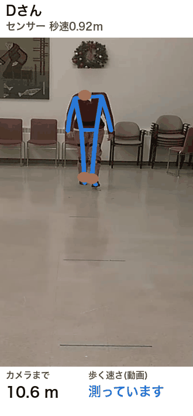
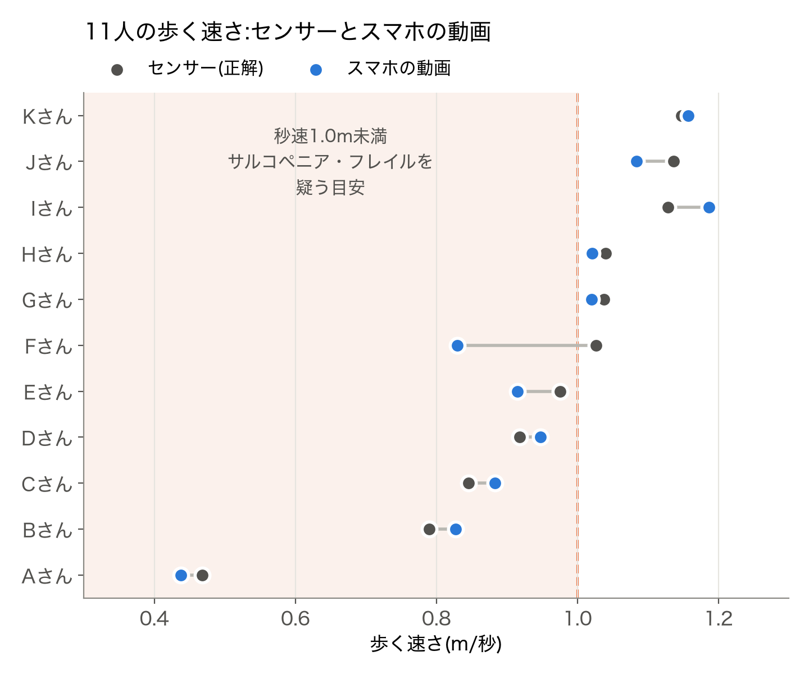
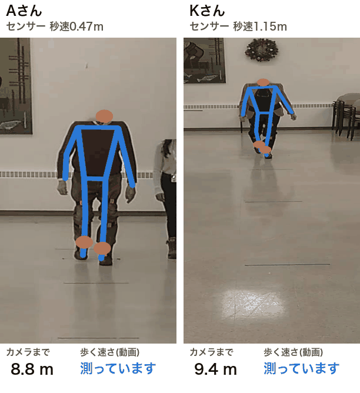
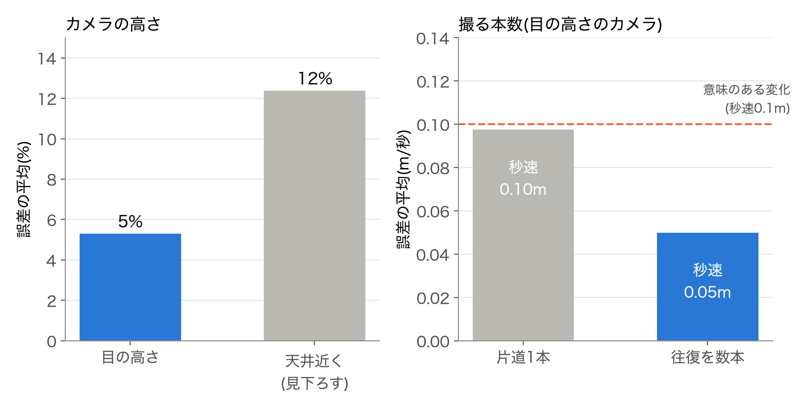
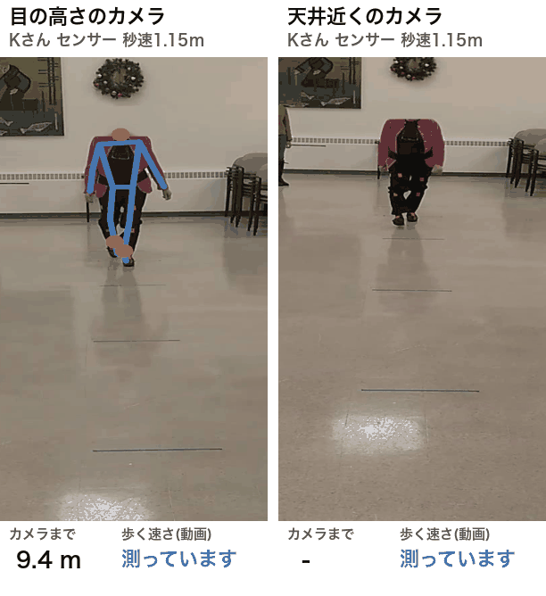
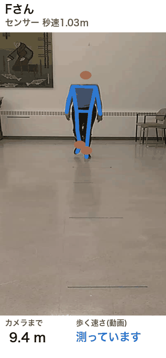
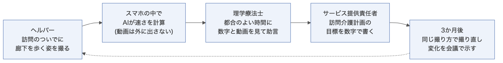

# スマホの動画で、高齢者の歩く速さは測れるか

## 3か月ごとの見直しで、効果が見えない

やってみ太郎です。連載「介護事業所の困りごとを、AIでどこまで解けるか」の3回目です。

前回は、介護保険でヘルパーに頼めるかを、AI に判断させました。

https://note.com/tried_hs/n/na329682e61aa

今回は、リハビリの話です。

介護保険のリハビリでは、3か月ごとに会議を開き、計画を見直します。
ところが国の調査では、会議で「目標を達成できたか」を確かめているのは、半分ほどでした。
確かめなければ、計画は変わりません。同じ訓練が、何年も続きます。

確かめにくい理由の1つは、物差しです。
日常の動作を100点満点で表す点数(Barthel Index)は、リハビリを始めた時点で、半数近くが80点を超えていました。
もともと点数が高いので、良くなっても点数に出にくいのです。

そこで目をつけたのが、歩く速さです。
歩く速さには満点がありません。少しの変化も、数字に出ます。
しかも、ストップウォッチがなくても、スマホで撮った動画から AI で測れるかもしれません。

まず、実際に測っている様子を見てください。

画面の青い線は、AI が見つけた体の骨組みです(骨格推定と呼びます)。
AI は、画面に映る体の大きさから、カメラまでの距離を出します。近づくほど大きく映るからです。
その距離が1秒でどれだけ縮むかが、歩く速さになります。
見出しの下の「センサー」は、体に付けたセンサーで測った正解です。歩き終わるころには、動画の値(秒速0.88m)が正解(秒速0.92m)に近づいています。

結論から書きます。
目の高さに置いたスマホ1台で、歩く速さを誤差約5%で測れました。
ただし、使える条件ははっきりしています。

## 歩く速さは、なぜ大事なのか

歩く速さは、高齢者の体の状態をよく映す数字です。

- 秒速1.0m未満は、サルコペニア(年をとって筋肉が減る状態)を疑う目安です。日本で使うアジアの基準も、日本版のフレイル(心身が弱った状態)の基準も、この線を使っています。
- 9つの研究の、約3万4千人をまとめた研究があります。歩く速さが秒速0.1m速いごとに、死亡の危険が約12%低くなっていました。
- 高齢者の研究では、秒速0.1mの変化が「意味のある変化」とされています。

つまり、秒速0.1mの変化を見分けられれば、見直しの会議で「良くなった」と数字で言えます。

## スマホ1台で、誤差は約5%だった

試したのは、カナダのトロント大学のグループが公開している動画です。
老人ホームに住む高齢者(平均86歳)が、約10mを往復して歩いています。顔はぼかしてあり、自由に使ってよい条件で公開されています。

この動画には、正解が付いています。
歩いている間、足と腰にセンサーを付けて、動きを記録しているのです。
そこで、AI が動画から求めた速さと、センサーの速さを比べました。

センサーに不具合のない11人の結果が、この図です。

灰色の点が正解で、青い点が動画から求めた速さです。2つの点が近いほど、よく当たっています。

- 誤差の平均は秒速0.05m、割合にして約5%でした。
- 秒速1.0mの線で「上か下か」を分けると、11人中10人で、動画とセンサーの判定が一致しました。
- 一番遅い A さん(秒速0.47m)は、椅子から立って歩いて戻る検査(TUG)も、11人で一番時間がかかった人です。動画でも、ちゃんと一番遅く出ています。

一番遅い A さんと、一番速い K さんを、同じ6秒で並べてみます。

同じ6秒で、K さんはカメラの前まで来ますが、A さんはまだ途中です。
数字の差が、歩き方の差としてそのまま見えます。

使った AI は、Google が無料で公開している MediaPipe です。
スマホの中でも動くので、動画を外に送らずに計算できます。
カメラの細かい設定は、何もしていません。スマホの一般的な画角を仮定しただけです。

## 使うには、条件がある

うまくいった一方で、条件を外すと誤差が広がりました。
現場で使うなら、ここが一番大事なところです。

**カメラは目の高さに置く**

天井近くから見下ろすように撮ると、誤差は12%に増え、速めに出ました。
見下ろすと、体の映り方がゆがむからです。

同じ K さんの同じ片道を、2台のカメラで比べたのが次の動画です。

目の高さでは秒速1.11m と、正解(秒速1.15m)にほぼ合いました。天井近くでは秒速1.51m と、大きく速めに出ています。
この片道は特にずれが大きい例で、11人の平均では約1割のずれでした。
スマホは、胸から目くらいの高さに置いて撮ります。

**1本だけでは、変化と誤差を区別できない**

片道を1本だけ撮ったときの誤差は、秒速0.10mでした。
これは、先ほどの「意味のある変化」と同じ大きさです。
つまり、1本だけでは、本当に良くなったのか、測り方のぶれなのかを区別できません。

往復を数本撮って平均すると、誤差は秒速0.05mと半分になりました。
サルコペニアの基準も、歩く速さは「2回以上の平均」をとるよう定めています。
動画でも、同じ決まりが要るということです。

**体つきによっては、大きくずれる**

図の F さんだけは、動画で2割遅く出ました。

見た目には、ほかの人と変わらず歩いています。それでも動画の値は秒速0.76m で、正解の秒速1.03m に届きません。
この方法は、身長を物差しにしています。体の比率が平均から外れる人では、ずれてしまいます。
床に長さの分かる目印を置くなど、別の物差しを足す工夫が要りそうです。

**家には、長い廊下がない**

決められた測り方では、歩く区間の前後に助走を入れ、11mほどのまっすぐな道が要ります。
多くの家には、そんな廊下はありません。

狭い家では、椅子から5回立ち上がる時間を測る方法が向いています。
サルコペニアの基準でも、歩く速さの代わりに使えるとされています。椅子が1脚あれば測れます。

## 業務のどこで使えるか

条件を守れば、使いどころは3つ考えられます。

1つ目は、3か月ごとの見直しです。
会議で「歩く速さが秒速0.8mから0.9mになった」と示せれば、目標を達成できたかを数字で話せます。

2つ目は、訪問介護と理学療法士(PT)の連携です。
訪問介護には、PT の助言をもとに計画を作ると算定できる加算(生活機能向上連携加算)があります。ところが、訪問介護で算定している事業所は、0.1〜0.2%しかありません。
PT を外に出せる人手がないことが、壁の1つです。

ヘルパーが訪問のついでに撮り、PT が都合のよい時間に見る。
これなら、PT とヘルパーが同じ時間に利用者の家に行かなくても済みます。

3つ目は、本人と家族への説明です。
「少し速くなりましたね」より、「3か月で秒速0.1m速くなりました」のほうが伝わります。続ける励みにもなります。

## 経営者から見ると

正直に書くと、今すぐの売上にはつながりません。
歩く速さを測っても、それだけで算定できる加算はないからです。体力測定を求めていた加算も、2024年度の改定でなくなりました。

それでも、経営の意味は3つあると考えます。

- PT がその場にいなくても、測れる。採用が難しい PT の時間を、仕組みで補えます。
- ケアマネジャーに、効果を数字で見せられる。利用者を紹介してもらうときの、ほかの事業所との違いになります。
- 成果を評価する流れに備えられる。国は、自立支援や重度化の防止を掲げ、成果を評価する仕組みを少しずつ増やしています。

始めるのに要るのは、スマホと無料の AI だけです。小さく試せます。

ただし、気をつける点もあります。

- 家の中の動画は、個人情報です。本人の同意をとり、スマホの外に出さない運用にします。
- これは医療機器ではありません。「サルコペニアと診断する」ことはできません。記録を助ける道具として使います。
- 撮る高さ、本数、距離をそろえる手順がないと、数字は比べられません。

## やってみて

最初の場面に戻ります。
3か月ごとの見直しで、効果が見えない。その原因の1つは、物差しがないことでした。

スマホの動画は、物差しになりえます。
目の高さから、往復を数本撮れば、意味のある変化を見分けられる精度が出ました。

一方で、「測れる」ことと「業務で使える」ことの間には、撮り方の決まりが要ります。
そして「経営に効く」かどうかは、まだ確かめていない仮説です。
測った数字で入院が減るのか、紹介が増えるのか。それは、実際の現場で試さないと分かりません。

歩く速さのほかにも、スマホで撮ったり録ったりして測れそうな動作があります。
介護の書類や加算とつながるものだけでも、次のようなものです。

- 椅子から立ち上がり、3m先で折り返して座るまでの時間(TUG)。国のデータベース(LIFE)に出すリハビリの計画書に、測った値を書く欄があります。
- 椅子から5回立ち上がる時間。狭い家でも測れ、サルコペニアの基準で歩く速さの代わりに使えます。
- 口の中の見た目(舌の汚れ、口の開き具合など)。訪問介護でも算定できる口腔連携強化加算で、介護職員が確かめる項目です。
- 「パ」「タ」「カ」を言う速さ。歯科で、舌や唇の動きを確かめる検査です。

どれも、今回と同じように正解と比べて、どこまで使えるかを確かめられそうです。

コードと記録は、ここに置いています。

https://github.com/h-takeshita-henteco-shoji-com/tried/tree/main/2026/11-10-訪問介護の困りごとをAIで解く-03-歩行動画から歩く速さを測る

この記事の検証は、公開データをもとにした非公式のものです。体の状態の評価は、医師や理学療法士に相談してください。

## 参考にした資料

- The Toronto older adults gait archive(使った動画とセンサーのデータ。Scientific Data, 2022) https://pmc.ncbi.nlm.nih.gov/articles/PMC9272879/
- 同 データ(figshare、CC0) https://doi.org/10.6084/m9.figshare.c.5515953.v1
- Asian Working Group for Sarcopenia: 2019 Consensus Update(アジアのサルコペニアの基準) https://www.researchgate.net/publication/339035677_Asian_Working_Group_for_Sarcopenia_2019_Consensus_Update_on_Sarcopenia_Diagnosis_and_Treatment
- 日本語版フレイル基準(J-CHS基準)の改定 https://www.kenko-hyogo21.jp/wp/wp-content/uploads/2020/12/20201008.pdf
- Gait Speed and Survival in Older Adults(歩く速さと死亡の危険。JAMA, 2011) https://jamanetwork.com/journals/jama/fullarticle/644554
- 社会保障審議会 介護給付費分科会 第259回 資料4 訪問リハビリテーション https://www.mhlw.go.jp/content/12300000/001716096.pdf
- 同 第271回 資料1 訪問介護 https://www.mhlw.go.jp/content/12300000/001764375.pdf
- 同 第271回 資料4 訪問リハビリテーション https://www.mhlw.go.jp/content/12300000/001760334.pdf
- 令和7年度 通所・訪問リハビリテーションの適切な在り方についての調査研究事業 報告書(全国デイ・ケア協会) https://day-care.jp/wp/wp-content/uploads/af444edae7f265802fb47e3e26143939.pdf
- 厚生労働省「リハビリテーション・個別機能訓練、栄養、口腔の実施及び一体的取組について」(介護保険最新情報 Vol.1217。リハビリ計画書と、口腔連携強化加算の評価の様式) https://www.mhlw.go.jp/content/001227728.pdf
- 日本歯科医学会「口腔機能低下症に関する基本的な考え方」(令和6年3月) https://www.jads.jp/assets/pdf/basic/r06/document-240329.pdf
- Perera S ら. Meaningful change and responsiveness in common physical performance measures in older adults(意味のある変化の大きさ。J Am Geriatr Soc, 2006)
- MediaPipe Pose Landmarker https://ai.google.dev/edge/mediapipe/solutions/vision/pose_landmarker
