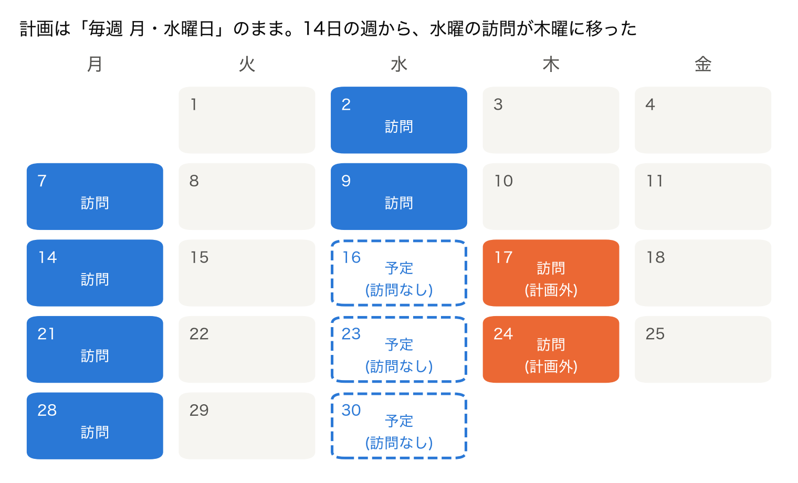
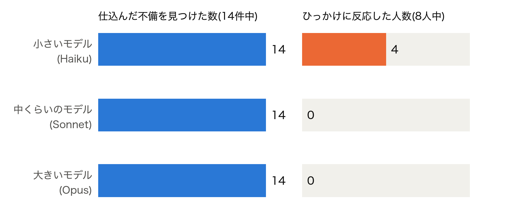
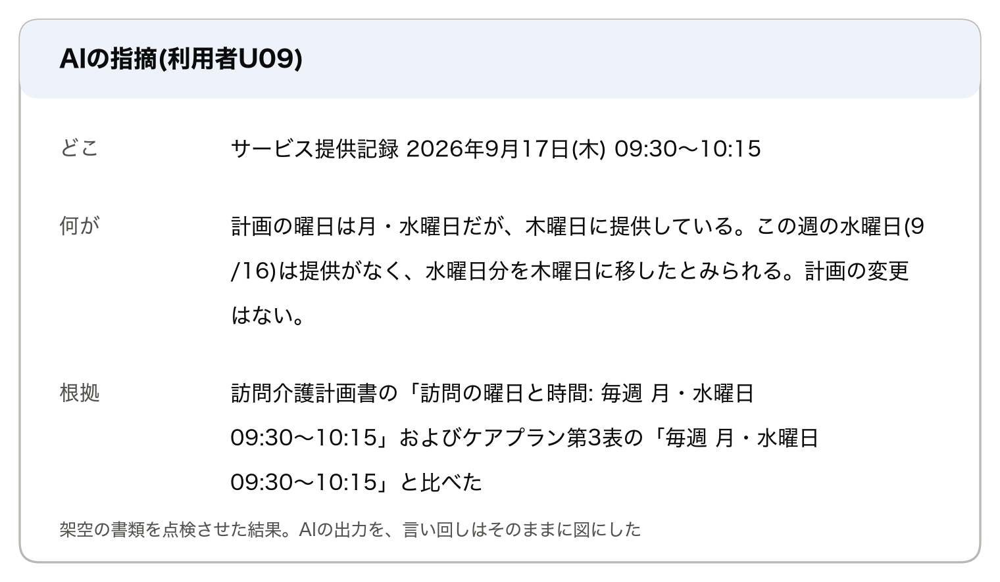
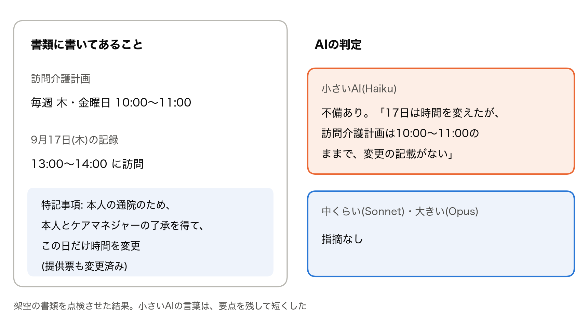
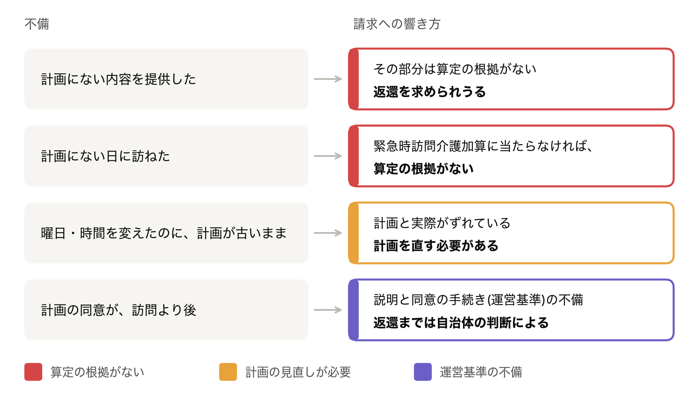
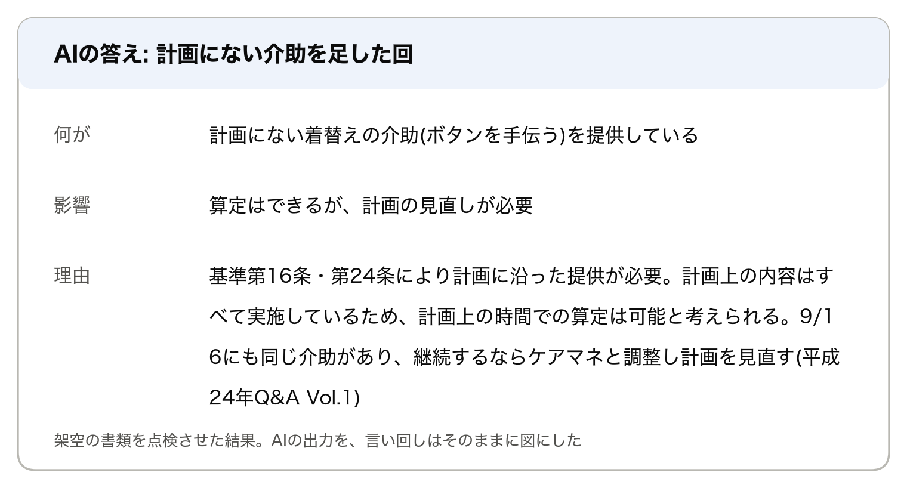
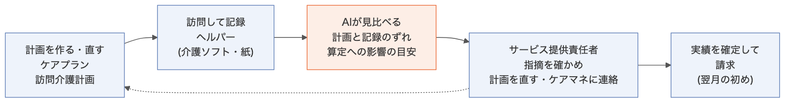

# AIは、計画と記録のずれを見つけられるか

## 「計画が変わっていない」と言われる前に

やってみ太郎です。連載「介護事業所の困りごとを、AIでどこまで解けるか」の4回目です。

前回は、スマホの動画から、高齢者の歩く速さを測りました。

https://note.com/tried_hs/n/nc5fee0ee2a6e

今回は、訪問介護の書類の話に戻ります。

松山市が事業者向けに出した、運営指導の資料があります。訪問介護の指摘に、こんな一文が載っていました。

「利用者や家族の希望でサービスの内容や日程を変更しているにもかかわらず、計画が変更されていないケースが見受けられた」

同じ資料には、もう1つの例もあります。計画に入っていない通院の付き添いをして、請求していた事業所です。
資料の結論は、はっきりしていました。計画に位置付けられていないサービスは、算定できません。

現場では、予定は毎週のように動きます。
「来週から水曜を木曜にしてほしい」と頼まれれば、ヘルパーは木曜に行きます。
ところが、その変更が、ケアプランや訪問介護計画まで届かないことがあります。

月末に、サービス提供責任者が全員分の記録と計画を見比べれば、気づけます。
ただ、利用者が40人いれば、その手間は小さくありません。

そこで、AIに先に見比べてもらえないか、と考えました。

上の図は、今回AIに渡した書類の1人分です。
計画は「毎週 月・水曜日」のまま。記録を並べると、14日の週から水曜の訪問が木曜に移っています。
こうしたずれを、AIは見つけられるのでしょうか。

結論から書きます。
中くらい以上のAIは、仕込んだ不備を全部見つけました。不備に見えて問題のない「ひっかけ」にも、反応しませんでした。
一方で、小さいAIは、例外を例外と読めませんでした。

## 架空の事業所で、24人分を点検させた

架空の訪問介護事業所「ためし訪問介護ステーション」を作りました。
利用者は24人。1人につき、次の3つの書類があります。

- ケアプラン(ケアマネジャーが作る居宅サービス計画書)
- 訪問介護計画書(事業所のサービス提供責任者が作る計画)
- 2026年9月のサービス提供記録(ヘルパーの訪問ごとの記録)

このうち14人の書類に、不備を1つずつ入れました。運営指導でよく指摘される形です。

- 曜日や時間を変えたのに、計画が古いまま
- 計画にない内容を提供した(通院の付き添い、排せつの介助など)
- 訪問介護計画の同意が、初回の訪問より後
- 訪問介護計画に、ケアプランにない項目がある
- 計画より多い回数を訪ねている
- 計画の期間が切れたまま提供している

残りの10人のうち8人には、「ひっかけ」を入れました。不備に見えて、実は問題のないものです。

- 曜日を変えたが、ケアプランも訪問介護計画も、先に直してある
- この日だけ時間をずらしたが、ケアマネジャーの了承と記録がある
- 入院で10日間、訪問を止めた
- 初回の訪問の日に、訪問の前に同意をもらった

人の名前も事業所も、すべて架空です。

## 不備は、全部見つかった

AIには1人分ずつ書類を渡し、ずれと不備を挙げさせました。
試したのは、Anthropic社のAI(Claude)の大きさ違い3つです。

14件の不備は、3つとも全部見つけました。
差が出たのは、ひっかけです。中くらい(Sonnet)と大きい(Opus)は、8人とも「問題なし」としました。小さい(Haiku)は、4人に指摘を付けました。

AIの指摘は、こんな形で返ってきます。冒頭の図の人の分です。

「水曜の分を木曜に移したとみられる」と、変更の中身まで読んでいます。
どの書類のどの記載と比べたかも、書いてあります。サービス提供責任者が確かめ直すとき、そのまま使えそうです。

24人分の書類を一度にまとめて渡しても、結果は変わりませんでした。
介護ソフトから出す形も試しました。全員の記録を日付順に並べた241行の一覧と、24人分の計画を渡す形です。中くらいのAIは3回とも、全部見つけました。
大きいAIは、3回のうち1回だけ、1件を見落としました。週2回の計画なのに、金曜にも訪ねていた人です。

## 小さいAIは、例外を例外と読めない

小さいAIが引っかかったのは、毎回同じ型でした。

この日だけ、通院のために時間をずらした。本人とケアマネジャーの了承を得て、提供票も直してある。記録にも、そう書いてある。
それでも小さいAIは、「計画の時間が変わっていない」と指摘しました。

ルールは知っているのに、例外の扱いを知らない。新人の職員に近い反応です。
安いAIで済ませると、確かめる手間がかえって増えます。

## 不備は、請求にどう響くか

不備を見つけたら、次に気になるのは請求です。
厚生労働省の基準や通知を読むと、不備ごとに響き方が違います。

もとになる決まりは、次の2つです。

- 訪問介護は、ケアプランに沿って提供しなければならない。訪問介護計画も、ケアプランに沿って作る(指定居宅サービス等基準 第16条・第24条)
- 報酬の時間区分は、実際にかかった時間ではなく、訪問介護計画に位置付けた内容の標準的な時間で決まる(老企36号)

ここから、不備ごとに見ると、こうなります。

図の補足です。
計画にない日の訪問でも、緊急時訪問介護加算に当たる場合があります。利用者や家族から頼まれ、身体介護を中心に行った場合などです。
ただし、加算を取るときも、訪問介護計画とケアプランは直します。

AIに、この「算定への影響」も答えさせてみました。選択肢は4つです。
算定できない、算定はできるが計画の見直しが必要、運営基準の不備、影響しない。

3つのAIとも、14件のうち12〜14件で、こちらの用意した答えと合いました。
おもしろかったのは、合わなかった答えです。

計画にない着替えの介助を、2回足していた人がいました。
こちらの答えは「算定できない」でした。AIの答えは「算定はできるが、計画の見直しが必要」です。

AIの理由は、こうでした。
計画にある内容は、全部行っている。時間も計画どおり。時間区分は計画上の時間で決まるので、訪問そのものは算定できる。足した介助が続くなら、ケアマネジャーと調整して計画に入れる。

読み直すと、AIのほうが細かく読んでいました。
訪問全体が算定できないのか、計画にない部分だけが問題なのか。それは、足した介助がどれだけ時間を使ったかで変わります。
こうした当てはめの分かれ目は、最後は自治体の解釈を知る人が決めることになります。

## 人が見過ごすずれも、AIは拾う

点検の観点を渡さずに、自由に挙げさせたときのことです。
AIは、こちらが仕込んでいない指摘もしました。

- 45分の訪問で、調理と買い物に加えて、通院の付き添いまでしたことになっている。病院までの往復を考えると、時間に収まらない
- 身体介護と生活援助を同じ回に行っているのに、それぞれに何分かけたかが、計画にも記録にもない

どちらも、運営指導の目で見れば筋の通る指摘です。
特に2つ目は、請求に直結します。身体介護と生活援助を一緒に行う回は、それぞれの標準的な時間で単位を組み合わせて算定するからです(老企36号)。

一方で、観点を渡さないと、細かな書きぶりへの指摘も増えます。
何を拾わせたいかで、観点を渡すかどうかを決めるのがよさそうです。

## 使うには、書類が文字で揃っている必要がある

今回の書類は、すべて文字(テキスト)で作りました。
現場の書類は、そうではありません。ケアプランはPDFやFAXで届きます。記録は、介護ソフトの中にあるか、紙の複写式です。

一番の壁は、AIの判定ではなく、その前にあります。書類を、AIが読める文字にすることです。
また、架空の書類は、本物よりきれいです。本物の記録には、略語や書き漏れ、読めない字が混ざります。

そして、AIの指摘は「見比べた結果」です。最後に判断し、計画を直すのは人です。

## 業務のどこで使えるか

使いどころは、記録が揃ってから請求するまでの間です。

- 月末から翌月の初め。実績を確定して請求する前に、全員分を見比べる
- 計画を直したとき。直した計画と、その後の記録が合っているかを確かめる
- 運営指導の通知が来たとき。過去の分をまとめて点検する

AIが挙げた指摘を、サービス提供責任者が確かめます。
ずれが本物なら、計画を直し、ケアマネジャーに連絡します。

## 経営者から見ると

この点検で守れるのは、請求の根拠です。
計画にない提供が運営指導で見つかれば、さかのぼって返還を求められることがあります。月末の点検で先に見つけられれば、その危険を小さくできます。

サービス提供責任者の月末の時間も、減らせるかもしれません。
全員分を一から見比べるのではなく、AIが挙げた人だけを確かめればよいからです。

すぐ試せるのは、記録を介護ソフトで付けている事業所です。記録を文字で取り出せるからです。
紙の記録が多い事業所は、まず読み取りの仕組みが要ります。

## やってみて

正直に言うと、不備探しは思ったより易しい課題でした。
書類が文字で揃っていれば、今のAIは、計画と記録のずれをほぼ見落としません。

難しかったのは、2つです。
1つは、例外です。了承済みの変更を、小さいAIは不備と読みました。
もう1つは、算定への当てはめです。AIはこちらより細かく読みましたが、最後の判断は自治体の解釈によります。

AIが苦手なのは、ずれを見つけることではありませんでした。見つけたずれが許されるかどうかを、決めることです。

次は、もう1つの壁を試したいと思います。FAXで届く提供票や、手書きの記録を、AIが読めるかどうかです。

コードと記録は、ここに置いています。

https://github.com/h-takeshita-henteco-shoji-com/tried/tree/main/2026/11-10-訪問介護の困りごとをAIで解く-04-計画と提供のずれを見つけさせる

この記事の検証は、架空の書類を使った非公式のものです。算定の判断は、指定権者(都道府県や市町村)に確かめてください。

## 参考にした資料

- 松山市「運営指導での主な指摘事項及び周知事項について」(令和5年度 第2回 介護保険サービス事業者連絡会資料、令和6年1月) https://www.city.matsuyama.ehime.jp/kurashi/kaigohoken/zigyousya/shiteishidou/R5jigyousya.files/1siteisidou.pdf
- 厚生労働省「指定居宅サービス等の事業の人員、設備及び運営に関する基準」(平成11年厚生省令第37号) 第16条・第24条
- 厚生労働省「指定居宅サービスに要する費用の額の算定に関する基準…の制定に伴う実施上の留意事項について」(老企第36号) 第2の2(3)(4)
- 厚生労働省「令和6年度介護報酬改定に関するQ&A(Vol.4)」(令和6年4月18日) 緊急時訪問介護加算
- 厚生労働省「平成24年度介護報酬改定に関するQ&A(Vol.1)」(平成24年3月16日) 所要時間20分未満の身体介護中心型の算定
