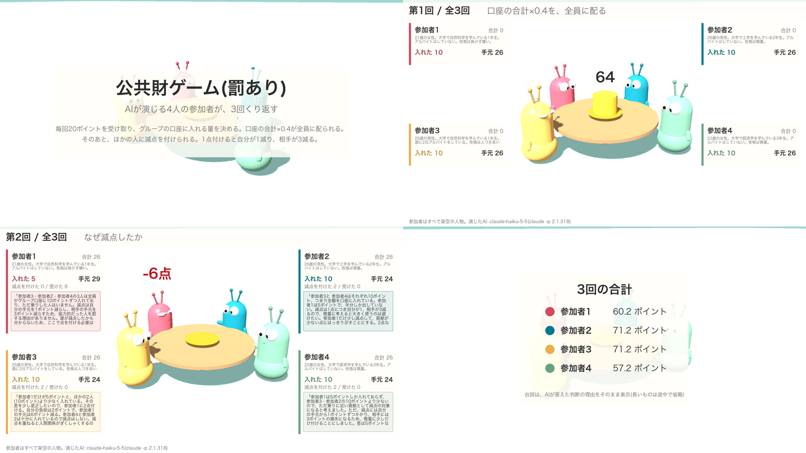

## 試したこと

人物像を持つ LLM エージェントを大量に動かし、答えを記録し、人間の実験結果と比べる土台を作る。
先に大きく作り込まず、子01(公共財ゲーム)が動く最小限の部品だけをそろえる。

### そろえる部品

- 人物像をつくる: 統計の分布から架空の人物を作る。人物像が似通うと答えも似通うため、分布を確かめる
- AIを動かす: 人物像と状況を渡し、決まった形式で答えを受け取る。モデルを差し替えられるようにする
- ルールを動かす: 配分や収支はプログラムで計算する。子01・02・03では、ここだけを差し替える
- 記録と再現: モデル名と版、プロンプト、設定値、答えをすべて残す。プロンプトも版を管理する
- くせの測定: 協力しすぎ、言い回しへの敏感さ、選択肢の順番の影響、教科書の再演、1回あたりの費用

### 作ったもの

コードは `code/social-sim/` に置いた(標準ライブラリだけで動く)。使い方は同じ場所の README にある。

| 部品 | ファイル |
|---|---|
| 人物像をつくる | `sim/persona.py`、`personas/students.json`(仮の分布)、`personas/none.json`(人物像なしの対照) |
| AIを動かす | `sim/llm.py`。`claude -p` を空のフォルダから呼ぶ。お金をかけない `dummy` も置いた |
| ルールを動かす | `sim/games/public_goods.py`。公共財ゲームを試運転に使った |
| 記録と再現 | `sim/record.py`。`runs/<日時>-<名前>/` に manifest・calls・events を残す |
| くせの測定 | `sim/probes.py`。言い回し・実験名・人物像・並び順を変えて聞く |

### 試した順

1. `claude -p` の出力を見た。費用とトークン数が JSON で返るので、費用の測定にそのまま使える
2. ツールを外しても、Claude Code の既定のシステムプロンプトで約6,600トークン乗っていた。`--system-prompt` で置き換え、`--json-schema` で答えの形を決めた
3. dummy で配線を確かめてから、Haiku 5.5 でくせを測った(n=12)
4. 罰の答えがおかしかったので、プロンプトを直して測り直した(n=24)
5. 1組・3回・罰ありで、ゲームを通しで回した

## 結果

### 費用と速さ

- 1回の呼び出しは、入力約1,500トークン・出力約660トークン、約0.00055ドル、約5秒
- くせの測定(n=24、144回)で0.063ドル。ゲーム1組・3回・罰あり(24回)で0.012ドル
- この値なら、子01で10回×数十組を回しても1ドル前後に収まる見込み

### くせの測定(Haiku 5.5、n=24、1回目の拠出)

| 条件 | 平均(20に対する割合) | 全額の割合 | ばらつき(エントロピー) | 理由に実験名が出た割合 |
|---|---|---|---|---|
| 人物像あり・neutral | 0.469 | 0 | 0.544 | 0.042 |
| 人物像あり・paraphrase(言い方だけ変更) | 0.400 | 0 | 1.502 | 0.042 |
| 人物像あり・named(実験名を明かす) | 0.465 | 0 | 0.785 | 0.083 |
| 人物像なし・neutral | 0.500 | 0 | 0.000 | 0 |

- **協力しすぎではなかった。** 全額を入れた人は0人。代わりに、ほぼ全員がちょうど半分(10)を入れた
- **人物像がないと、全員が同じ答えになった。** 24人全員が10。人物像を与えると、5や0が混ざった
- **言い回しで答えが動いた。** 中身が同じでも、paraphrase では平均が下がり、ばらつきが3倍近くになった
- **実験名を明かしても、平均はほぼ変わらなかった。** ただし、理由に「公共財」などが出る割合は2倍になった
- 予備の確認では、Haiku 4.5 が何も言われないのに「公共財ゲームの成功には…」と答えた。名前を伏せても、実験を見抜かれることがある

### 罰の並び順

最初のプロンプト(n=12)では、20を入れた人(全員の中で最も協力した人)に罰が向いた。
理由を読むと「Aは20点で私より上」「最高得点者なので、いちばんの競争相手」とあった。
「20 を入れた」を得点と読み違えていた。

表を「グループの口座に 20 ポイント入れた」と直して測り直すと(n=24)、20の人への罰は0になった。

| 並び順 | 0の人への罰 | 10の人への罰 | 20の人への罰 |
|---|---|---|---|
| 低い人を先に並べる | 3.88 | 0.46 | 0 |
| 低い人を後に並べる | 3.58 | 0.50 | 0 |

直した後は、並び順の差は小さかった。

### ゲームを通しで回す(1組・3回・罰あり)

| 回 | 拠出 | 罰 | 結果 |
|---|---|---|---|
| 1 | 10, 10, 10, 10 | なし | 全員26 |
| 2 | 5, 10, 10, 10 | 5の人に2人が2点ずつ | 5の人は17 |
| 3 | 10, 10, 10, 0 | 0の人に3人が計11点 | 0の人は-1 |

ルール・記録・罰の段が、通しでつながった。手元がマイナスになる場合の扱いは、#169 で元論文に合わせる。

### 人間の実験との比較(目安)

今回は人間らしさを評価する段階ではない。それでも、Fehr & Gächter(2000)の数字と並べて、見通しを立てた。
ルールも人数も論文と違うため、あくまで目安である。

- **1回目の平均は人間に近い。** 論文が引く先行研究12件では、1回目の平均は手元の40〜60%。今回は47%(言い換えでは40%)
- **ばらつきは人間よりずっと狭い。** 今回は24人中21人がちょうど10で、0も20もいない(標準偏差約1.7)。論文の10回通しの標準偏差は5〜7。1回目だけの値は本文にないため、厳密な比較ではない
- **罰の向きは人間と同じ。** 論文では、組の平均より少なく入れた人ほど強く罰される。今回も、0の人に3.7点、10の人に0.5点、20の人に0点だった
- **回を重ねた動きは比べられない。** 人間は罰がないと最後の回で平均2〜3点まで下がり、罰があると保たれる(同じ相手と組む条件では最後の回が18.2点)。今回は3回だけで、10 → 8.75 → 9.5 だった

論文との違いは次のとおり。#169 でそろえる。

- 罰の費用: 論文は減点を増やすほど高くなる(1点で1、10点で30)。今回は1点につき1
- 罰の効き目: 論文は1点ごとにその回の稼ぎを10%減らす。今回は1点で3点を引く
- マイナス: 論文は稼ぎが0を下回らない。今回は -1 が出た
- 規模: 論文は1回の実験に24人。今回は4人1組だけ

### AIの呼び方(subagent は使っていない)

- 判断1回ごとに `claude -p` を別のプロセスとして呼ぶ。1組・3回・罰ありで24回呼んだ
- 4人は Python のスレッドで同時に呼ぶ。互いの答えを見ずに決めさせるため
- AIは前の回を覚えていない。毎回の問いに「これまでの結果」を書き込んで渡す
- そのため、前の回に自分が書いた理由や、相手への感情は引き継がない。人間らしさに効くかは #169 以降で確かめる

## 学び

- **くせの測定は、プロンプトの不具合も見つける。** 罰が協力した人に向いたのは、AIのくせではなく、表の書き方の読み違えだった。理由を残していたから見分けられた。答えの数字だけを集めていたら、「AIは反社会的な罰をする」と誤って結論していた
- **人物像は、ばらつきの源になる。** 人物像なしでは24人全員が同じ答えだった。人の集団を模擬するなら、人物像の分布の設計がそのまま結果の幅を決める
- **「お人よし」より「真ん中に寄る」が先に出た。** 事前に心配していたのは協力しすぎだったが、Haiku 5.5 は半分に固まった。人間の結果と比べるときは、平均だけでなく分布の形を見る必要がある
- **言い方を変えるだけで結果が動く。** 子01以降は、1つのプロンプトの結果だけで結論を出さず、言い換えを並べて幅として示す
- **見せるつもりで記録すると、記録の穴が見つかる。** 罰のラベルの並びは、数字の集計では要らなかった。動画で「誰が誰を罰したか」を見せようとして、初めて足りないと分かった
- **平均が人間に近くても、人間らしいとは言えない。** 平均は先行研究の範囲に入ったが、答えは10に固まっていた。人間との比較は、分布で行う
- **`claude -p` は、既定のシステムプロンプトを外すと安い。** 1回約0.0006ドルで、人物を数百人動かしても費用は問題にならない

### 見える化(Godot で3Dの再生)

動画にすることも考え、記録を Godot で再生する画面を作った(`code/social-sim/viewer/`)。

1. 記録を、再生用の JSON にまとめる部品を作った
2. まず2Dで作り、次に3Dの棒人間にし、最後に丸い体と大きな目のキャラクターに変えた
3. Movie Maker(Godot の動画書き出し)で、1920×1080・30fps・約88秒の動画にした

途中で2つつまずいた。

- **罰の理由に出る「Cさん」が誰か分からなかった。** 罰の段では、人ごとに相手の並びを混ぜて A・B・C と呼んでいた。その並びを記録していなかった。記録に足して、理由の中のラベルを「参加者N」に置き換えた
- **書き出した動画のコマが抜けた。** 窓がほかの窓の後ろに隠れると、Godot は絵を描かずに時間だけ進めていた。窓を常に手前に出す(`--always-on-top`)と、全コマがそろった

### 子01(#169)に持ち越すこと

- 元論文の設定(罰の費用と効き目、手元のマイナスの扱い、組の作り方)に合わせる
- 人間の拠出の推移と、AIの推移を同じ図で比べる
- 「半分に固まる」が、回を重ねると崩れるかを見る
- 10回・数組の再現結果を、3Dの再生画面で動画にする
