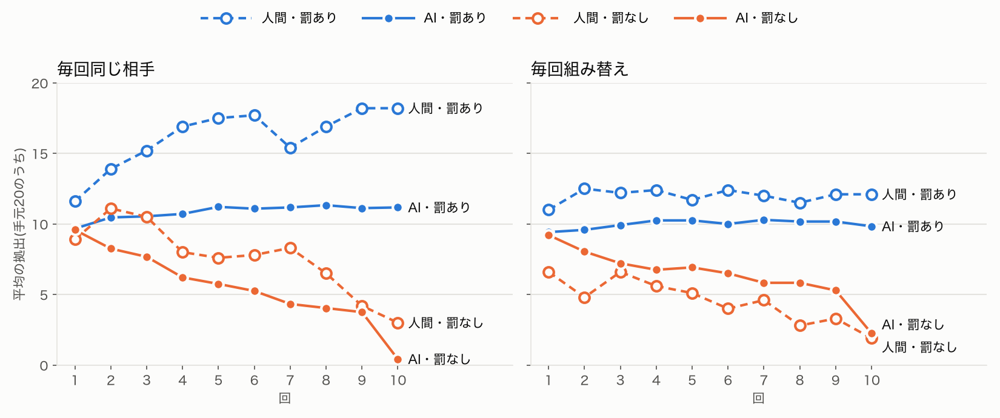

## 試したこと

Fehr & Gächter(2000)の公共財ゲームを LLM エージェントで再現し、人間と同じ結果が出るか確かめる。4人1組で共同の財布にお金を出し合い、罰あり・なしで比べる。
再現できたら、糸島の共同乾燥施設・堆肥舎の維持費の拠出に置き換え、罰の代わりに利用停止・集落の評判・JAの規約を試す。

### 比べるもの

- 人間の結果: 罰なしだと拠出が回を追って下がり、罰ありだと高い協力が続く
- AIの結果: 同じ傾向が出るか。最初から全額を出す「お人よし」にならないか
- 教科書の再演: 実験の名前や説明を変えても、同じ結果が出るか
- 費用: 1回の実験にかかる API の利用料

### 回す前に決めた物差し

結果を見てから物差しを選ぶと、都合のよい比較になる。そのため、回す前に次の5つを決めた。
人間の値は `code/social-sim/reference/fg2000.json` に、論文の表と図から写した。

| 物差し | 人間(論文) | 再現できたとみなす目安 |
|---|---|---|
| 1. 1回目の平均 | 先行研究で手元の40〜60% | 40〜60%に入る |
| 2. 答えの散らばり | 10回通しの標準偏差 4.5〜6.8 | 0と20の両方が出る。標準偏差が3を超える |
| 3. 罰なしの推移 | 10回目は1回目の3〜4割まで下がる | 10回目が1回目の半分以下 |
| 4. 罰の効き目 | 罰ありは減らない。同じ相手なら18前後まで上がる | 罰ありの10回目が、罰なしの10回目より明らかに高い |
| 5. 罰の向き | 他の3人の平均より少ない人ほど強く罰される | 平均より少ない人への罰が、多い人への罰より大きい |

### 論文に合わせた設定

- 4人1組、手元20、1ポイントにつき0.4ずつ全員に返る。10回
- 罰の費用: 1人に付ける点数ごとに 0,1,2,4,6,9,12,16,20,25,30(10点で30)
- 罰の効き目: 受けた点数1点ごとに、その回の稼ぎを10%減らす。10点で0になり、0未満にはならない
- 組み方: 毎回同じ相手と組む(Partner)と、毎回組み替える(Stranger)の2通り。どちらも24人
- 論文は1つの実験で罰あり・なしを続けて行った。今回は条件ごとに新しく始め、論文で先に行った条件の値と比べる

## 結果

24人・10回で、4条件を回した(記録は `code/social-sim/runs/20261111-10*-game-*`)。
呼び出しは合わせて1,440回、費用は0.95ドル。試しの1組を足しても約1ドルだった。

### 物差しごとの判定

| 物差し | 人間 | AI | 判定 |
|---|---|---|---|
| 1. 1回目の平均 | 40〜60% | 46〜48%(4条件) | 合う |
| 2. 答えの散らばり | 標準偏差 4.5〜6.8 | 10回通しで 1.1〜3.7。1回目は 1.4〜1.9 で、0も20も出ない | 合わない |
| 3. 罰なしの推移 | 10回目は1回目の29〜34% | 同じ相手 4%、組み替え 24% | 合う |
| 4. 罰の効き目 | 同じ相手で18.2、組み替えで12.1(10回目) | 同じ相手で11.2、組み替えで9.8 | 向きは合う。量は足りない |
| 5. 罰の向き | 平均より2〜8少ない人に約3点 | 同じ区間で約2.6点。平均どおりの人には0.8点 | 合う。ただし件数が少ない |

### 向きの再現は頑健か(seed と言い回しを変えて回す)

1回だけでは偶然かもしれないので、4条件を次の5通りで回した(計20回、4.7ドル)。判定は `code/social-sim/runs/robustness.json`。

- seed 1・2・3(人物像の組み合わせと、組み替えのくじが変わる)
- 言い回しを変えた問い(paraphrase)
- 実験名を明かした問い(named)

| 物差し | そろった回数 | 中身 |
|---|---|---|
| 1. 1回目の平均 | 5 / 5 | 43〜49% |
| 2. 答えの散らばり | 0 / 5 | 20は4,800回の拠出で一度も出ない。最大は16 |
| 3. 罰なしの推移 | 5 / 5 | 10回目は1回目の4〜28% |
| 4. 罰の効き目 | 5 / 5 | 10回目は、罰ありが7.2〜11.3、罰なしが0.4〜2.7 |
| 5. 罰の向き | 3 / 5 | 言い回しを変えた問いと実験名を明かした問いでは、同じ相手の組で、少ない人と多い人への罰がほぼ同じ(約1.4点) |

- **罰の有無による推移の向きは、偶然ではなかった。** どの seed と言い回しでも、罰なしは下がり、罰ありは保たれた
- **同じ相手の効果は、どの回でも出なかった。** 罰ありの平均の差(同じ相手 − 組み替え)は −0.1〜1.2。人間は5.5
- **罰の向きは、問いの書き方で崩れた。** 言い回しを変えた問いでは、拠出の問いは「共用の箱」、罰の問いは「グループの口座」と、呼び名がそろっていなかった。このずれが効いた可能性がある。実験名を明かした問いでも崩れた理由は、まだ分からない
- 実験名を明かしても、向きの結果はほぼ変わらなかった。教科書の結論をなぞっている様子は、数字からは見えない

### 合ったこと

- **罰がないと、回を追って拠出が下がった。** どちらの組み方でも、毎回少しずつ下がった
- **最後の回で大きく下がった。** 同じ相手の組では、9回目の3.8から10回目の0.4に落ちた。理由には「最終回なので、協力に報いる機会がない」とあった
- **罰があると、拠出は下がらなかった。** 10回目の差は、同じ相手で11.2対0.4、組み替えで9.8対2.3
- **少なく入れた人ほど、強く罰された。** 区間ごとの罰の点数は、論文の図5の値とほぼ同じだった

### 合わなかったこと

- **20を入れた人が1人もいなかった。** 4条件の960回の拠出で、最大は15。罰ありの組では、10と12に固まった
- **罰ありでも、同じ相手の組で協力が育たなかった。** 人間は同じ相手だと18まで上がり、組み替えより大きく高い。AIは組み方による差がほとんどない(11.2と9.8)
- **ばらつきが狭いので、罰の向きを測る件数が少ない。** 平均より2以上少ない人は、罰ありの各条件で6〜7件しかいなかった

### 「負けず嫌い」が、罰の多くを出していた

- 罰を付けた判断のうち、性格が「負けず嫌い」の人の判断が、同じ相手の組で66%、組み替えの組で76%を占めた。この性格の人は全体の25%しかいない
- 理由の多くは「全員が同じだけ入れているが、相手の稼ぎを下げて相対的に上に立ちたい」だった
- 同じ額を入れた人への罰(反社会的な罰と呼ばれる)は人間にもある。ただ、性格の一語がそのまま行動のスイッチになっている

## 学び

- **向きは再現できても、量は再現できない。** 罰の有無で推移が分かれる、という論文の主な結論は出た。しかし人間の「同じ相手なら20近くまで協力する」は出なかった。「再現できた」と言うには、どの物差しで見たかを必ず添える
- **10に寄るくせは、10回続けても抜けなかった。** 子00で見えた「半分に固まる」は、1回目だけのくせではなかった。人間らしい散らばりを出すには、人物像の作り方から見直す必要がある
- **人物像の一語が、行動を強く決める。** 「負けず嫌い」の人が罰の大半を出した。人物像の割合を変えれば、結果を思いどおりに動かせてしまう。糸島に置き換える段では、人物像の分布の根拠を記録に残す
- **問いの呼び名は、すべての段でそろえる。** 言い換えの実験で、拠出と罰の問いで呼び名がずれていた。言い換えるときは、関わるすべての問いをまとめて言い換える
- **物差しを先に決めておいてよかった。** 図だけを見ると「だいたい合っている」と読める。先に決めた目安と並べると、散らばりと協力の育ち方が合っていないと、はっきり言えた
- **AIに伝えていないルールがあった。** 以前の作りでは、1回目に拠出を決めるとき「あとで罰の段がある」と伝えていなかった。論文の参加者は最初から知っていた。再現では、参加者が知っていた情報をそろえる
