# AIに公共財ゲームをさせて、人間らしく振る舞えるか確かめた

## 糸島の農業を、AIで考えたい

やってみ太郎です。

先日、JA糸島の現地レポートを読みました。
米の値段がコストを割り、小さな田んぼは借り手がつかない。共同で使う乾燥施設や堆肥舎は、誰がどれだけ維持費を出すかで悩む。
どれも糸島だけの話ではなく、社会学や経済学で昔から研究されてきた問題に見えました。

この問題の解決策を、AIを使って見つけられないか。そう考えました。
農家の集団をAIでシミュレーションし、支援策や決め方を変えたときに、農家がどう動くかを比べるのです。

ただ、それには前提があります。
AIが、人間と同じように判断できないといけません。

AIが人間と違う判断をするなら、糸島に置き換えても、出てくるのはAIのくせです。
そこでまず、AIが人間らしく判断できるかを確かめることにしました。

題材には、人間での結果がよく知られた「公共財ゲーム」という実験を使います。

## 公共財ゲームのルール

4人で1組になり、1回ごとに次の3つをくり返します。

1. 4人の参加者が、20ポイントずつ受け取る
2. 各自が、そのうち何ポイントを「共同の口座」に入れるかを決める。入れなかった分は手元に残る
3. 口座の合計の0.4倍が、4人それぞれに配られる。口座に入れた人にも、入れなかった人にも、同じ量

たとえば、4人が10・10・5・15ポイントを入れたとします。

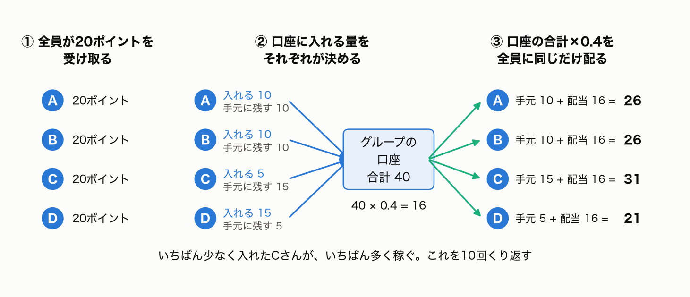

口座の合計は40で、その0.4倍は16です。この16ポイントが、4人全員に配られます。
稼ぎは「手元に残した分 + 配られた16」なので、いちばん少ない5しか入れなかったCさんが31で、いちばん多く稼ぎます。
いちばん多く入れたDさんは21です。

ここに、このゲームの悩ましさがあります。極端な3つの場合で比べてみます。

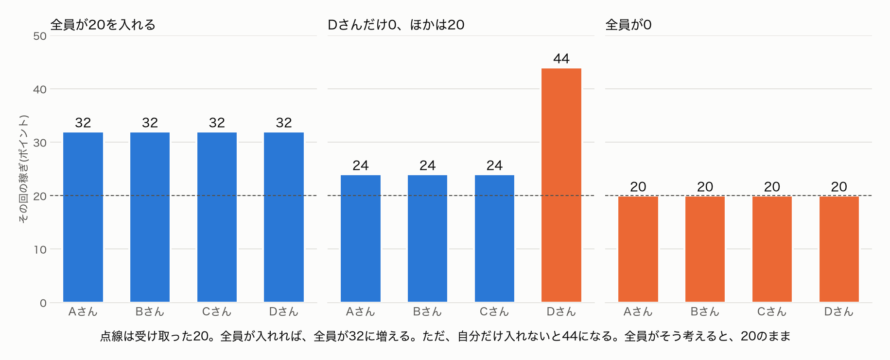

- 4人全員が20ポイントを全部入れると、口座は80、配られるのは32です。全員が20から32に増えます
- Dさんだけ0にすると、口座は60、配られるのは24です。入れた3人は24、Dさんは手元の20と合わせて44になります
- 全員が0なら、全員が20のままです

みんなで入れれば、みんなが得をします。ところが一人ひとりで見ると、自分が1ポイント入れても、自分に戻るのは0.4ポイントだけです。
損得だけを考えれば、入れないほうが得なのです。全員がそう考えると、誰も得をしない「全員0」に落ち着きます。

これを10回くり返します。

## 減点のルール

お手本にしたのは、Fehr と Gächter が2000年に発表した実験です。大学生を集めて、このゲームを行いました。
この実験には、もう一つ「減点」のルールがあります。

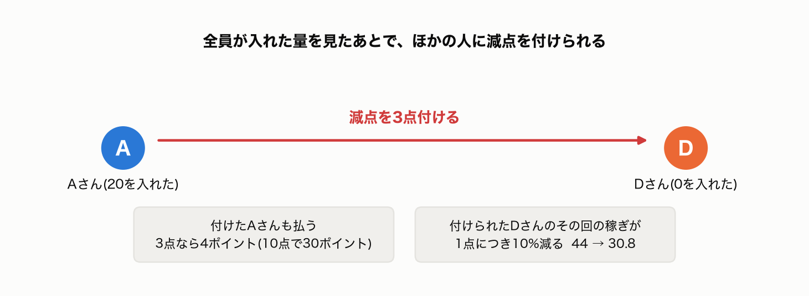

全員が口座に入れた量を見たあとで、参加者は、ほかの参加者に減点を付けられます。
減点を付けた人は、自分のポイントを払います。3点なら4ポイント、10点なら30ポイントです。
減点を付けられた人は、その回の稼ぎが1点につき10%減ります。さっきのDさんが3点を付けられると、44が30.8になります。

減点を付ける人には、損しかありません。それでも人間は、減点を付けるのでしょうか。

## 人間の判断には、特徴がある

人間の実験からは、人の判断にいくつかの特徴があると分かっています。このゲームでは、それぞれの特徴が、口座に入れる量にはっきり表れます。

**約半分の人は、相手に合わせて入れる量を決めます。** ほかの人が多く入れれば、自分も多く入れる人たちです。
ただし、相手よりほんの少しだけ少なく入れがちです。少しずつ少なく入れる人がいると、ほかの人もそれに合わせて減らします。
そのため、減点のルールがないと、入れる量は回を追って下がっていきます。

**約3割の人は、いつもほとんど入れません。** 一方で、最初から全部入れる人もいます。
そのため、口座に入れる量は人によって大きく違い、0の人と20の人が同じ組に混ざります。

**多くの人は、ずるい人に、損をしてでも減点を付けます。** そして減点を受けた人は、次の回から多く入れるようになります。
そのため、減点のルールがあると、入れる量は下がらずに上がっていきます。

実際、Fehr と Gächter の実験では、減点のルールがないと、最後の回に入れる量は20のうち2〜3まで落ちました。
減点のルールがあり、同じ相手と組み続けると、入れる量は18まで上がりました。

## この検証での「人間らしさ」

では、AIの判断が人間らしいかは、どう決めればよいでしょうか。

この検証では、人間らしさを「人間と同じ特徴が、AIの結果にも表れること」と定めました。
比べる相手は、Fehr と Gächter の大学生の実験です。

大事なのは、平均が近いだけでは人間らしいとは言わないことです。
人ごとのばらつき、回を追った変わり方、減点への反応まで、人間と同じかを見ます。

結果を見てから比べ方を選ぶと、都合よく合わせられてしまいます。そこで、AIで回す前に、5つの物差しを決めました。

1. 1回目に口座に入れる量の平均が、手元の4割から6割か
2. 全部入れる人も、まったく入れない人もいて、入れる量が十分にばらつくか
3. 減点のルールがないと、10回目に入れる量が、1回目の半分以下まで下がるか
4. 減点のルールがあると、減点のルールがないときより多く入れるか
5. 少なく入れた人ほど、強く減点を付けられるか

2番目から5番目は、さっきの人間の特徴が、このゲームに表れたときの姿です。

## 土台を作る

AIには Claude Haiku 5.5 を使いました。安くて速いので、人数を増やせます。

参加者は24人です。一人ひとりに、架空の人物像を持たせました。
「21歳の女性。大学で自然科学を学んでいる1年生。アルバイトはしていない。性格は負けず嫌い。」といった短い文です。
年齢や専攻、性格は、決めた割合に沿って、プログラムがくじで割り振ります。

判断は1回ごとに、別々にAIを呼んで答えさせます。AIは前の回を覚えていないので、毎回「これまでの結果」を文章で渡します。
答えは、口座に入れるポイントと、その理由です。理由を残しておくと、あとで「なぜそうしたのか」を読めます。

1回の呼び出しは約0.0006ドルでした。何百人を動かしても、費用は問題になりません。

試しに4人で3回だけ回し、その様子を3Dで再生する画面も作りました。

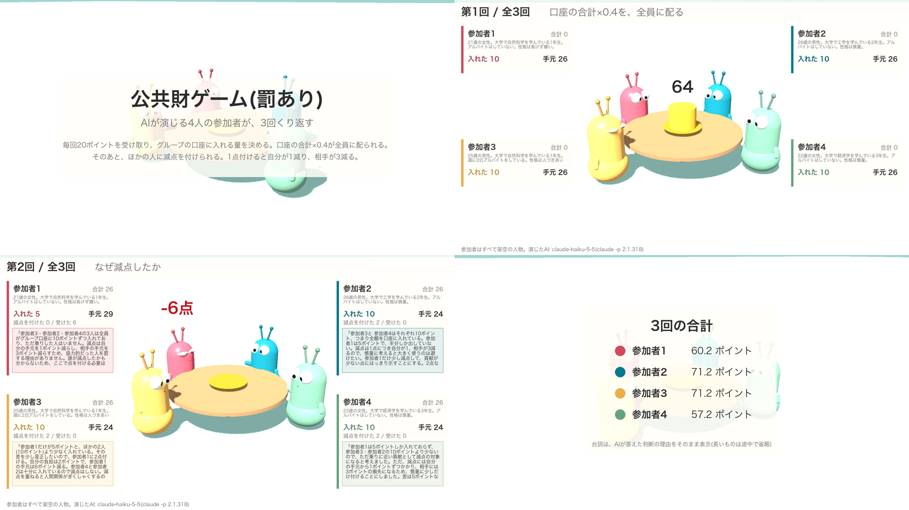

この試運転で、まず一つ失敗しました。
減点を付ける段で、いちばん多く入れた人に減点が集まったのです。理由を読むと「Aさんは20点で私より上」「最高得点者なので、いちばんの競争相手」とありました。
「20を入れた」を、得点と読み違えていました。

表の書き方を「グループの口座に20ポイント入れた」と直すと、その人への減点は0になりました。
理由を残していなければ、「AIは協力した人に減点を付ける」と誤って結論していたところです。

## 再現してみる

土台ができたので、論文と同じ設定で回しました。
4人1組、10回。毎回同じ相手と組む条件と、毎回組み替える条件。それぞれに減点のルールがある場合とない場合があり、全部で4つの条件です。

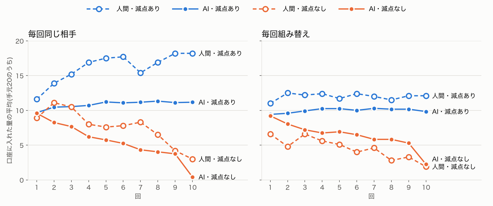

減点のルールがないと、入れる量は回を追って下がりました。減点のルールがあると、下がりませんでした。この2つは、人間と同じです。
少なく入れた人ほど強く減点を付けられる点も、論文の値とほぼ同じでした。
人物像の組み合わせや問いの言い回しを変えて5通り回しても、この結果は崩れませんでした。

ところが、図をよく見ると、おかしなところがあります。

減点のルールがあって同じ相手と組む条件で、人間が入れる量は18まで上がっています。AIは11前後で止まっています。
そして、20を全部入れた人が一人もいませんでした。4,800回の判断で、一度もです。

AIは、ほぼ全員が毎回10前後を入れていました。手元のちょうど半分です。
平均だけを見ると人間に近いのに、中身は「全員が同じ量を入れている」のでした。物差しの2番目が、外れたのです。

## 人物像を工夫しても、ばらつかない

人間の実験では、0を入れる人も、20を入れる人もいます。最初から全部入れる人が平均を押し上げ、減点がそれを全体に広げていきます。
AIにも、そういう人を作れないか。人物像を工夫してみました。

まず、さっきの人間の特徴の割合を、そのまま人物像に書きました。
相手に合わせる人が半分、いつもほとんど入れない人が3割、といった割合です。
0を入れる人は出ました。ところが、この人たちは減点を何度受けても0を入れ続けました。人間なら、減点を受けると入れるようになります。
AIは、人物像に書かれた型を「好み」ではなく「守るべき決まり」として読んでいるようでした。

身の上を厚くしてみたこともあります。出身地、家族、趣味、将来の夢、最近あったことまで書きました。
すると、かえって答えがそろいました。判断に関係のない情報が増えると、AIは無難な真ん中に寄るようです。

「ほかの人は平均18くらい入れると思っている」と、他人への見込みを書いた人もいます。
それでも、入れたのは16〜18でした。20には届きません。

## AIの中には、全部入れる考えもあった

行き詰まって、AIへの質問の仕方そのものを変えてみました。
1つの数で答えさせる代わりに、「0から20のそれぞれを入れる確率」を答えさせます。実際に入れる量は、その確率に沿ってプログラムがくじで決めます。

あれ、と思いました。
AIは、0にも20にも、5〜25%の確率を置いていたのです。

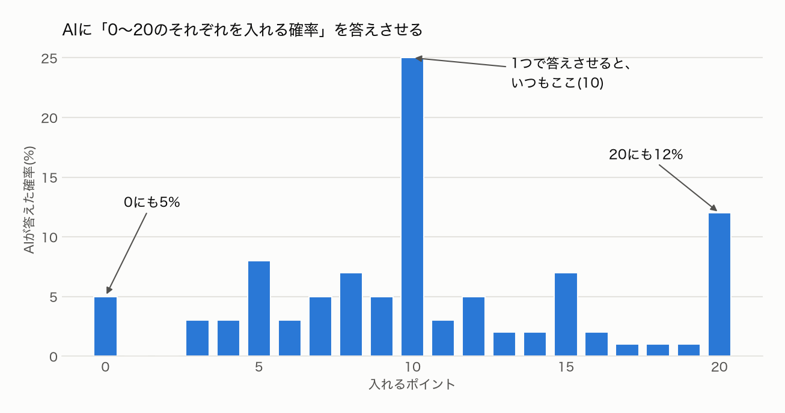

1つだけ答えさせると、いちばんありそうな「10」を選びます。でもAIの中には「20を全部入れることもある」という考えがありました。
質問の仕方が、ばらつきを消していたわけです。

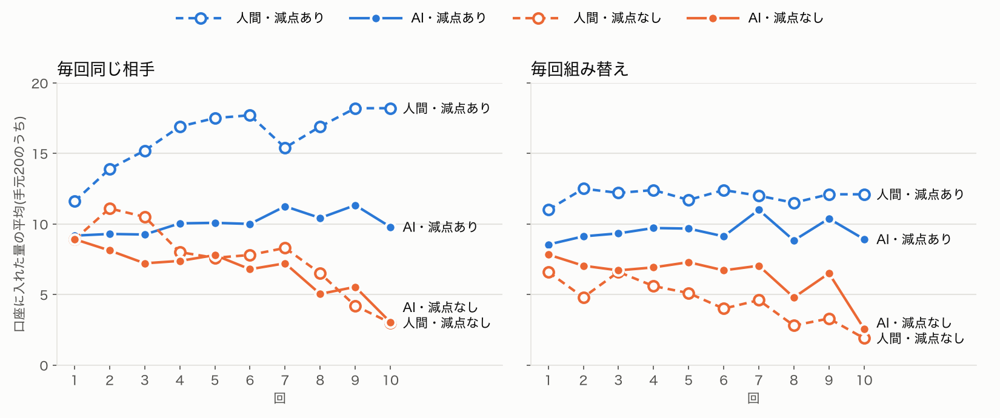

減点のルールがないときの下がり方は、人間の線とほぼ重なりました。20を全部入れる人も出ました。
5つの物差しのうち、4つを初めて同時に満たしました。

喜んだのも束の間でした。記録を一人ずつ見ると、同じ人が、ある回は18、次の回は2を入れていたのです。
毎回くじを引き直すので、ばらつきは「人による違い」ではなく「一人の中のゆらぎ」になっていました。
人間のばらつきは、主に人による違いです。いつも多く入れる人と、いつも少なく入れる人がいます。

そして、減点のルールがあっても、入れる量はやはり伸びませんでした。

## 20を入れる人がいないのは、なぜか

ここで、AIが1回目に書いた理由を読み返しました。480件のうち178件が、全部入れるのは避けると自分から書いていました。

「いきなり全額入れて一方的に損をするのは避けたいけれど、まったく入れないで様子見だけするのも気が引ける。そこで半分の10ポイントを…」

条件を1つずつ変えて、1回目だけを聞いてもみました。
手元を10や30に変えても、配られる倍率を0.3から0.9に変えても、AIは半分前後を入れました。
損得を計算した結果ではなく、「まだ分からないから半分」という決まった型だったのです。

では、AIに自分の行動のルールを先に語らせたらどうでしょう。
「前の回にほかの人が平均5ポイント入れたら、次は何ポイント入れますか」「減点を3点受けたら、次は何ポイント入れますか」と聞きました。

120人中99人が「減点を受けたら、入れる量を減らす」と答えました。
ところが、実際のゲームの記録と照らし合わせると、減点を受けた66人のうち、次の回に入れる量を減らした人は一人もいませんでした。
少なく入れて減点を受けた人は、次の回に平均で2ポイント近く増やしていました。人間と同じ反応です。

AIは、自分の行動を正しく語れませんでした。そして、減点を受けたときの実際の反応は、人間らしいものでした。

だとすると、何が足りないのでしょう。

## 足りないのは、多く入れて減点も付ける人だった

確かめるために、24人のうち3人を、プログラムで動く参加者に入れ替えました。
毎回必ず20を全部入れる参加者です。

20を入れるだけの参加者がいる組では、AIが入れる量は13〜14まで上がりました。それ以上は上がりません。
AIは周りのAIにも合わせるうえ、誰も減点を付けないからです。

次に、20を入れたうえで、少なく入れた人に減点を付ける参加者に替えました。
すると、その組のAIは早い回から入れる量を増やし始め、10回目には平均16.7になりました。人間の18.2にかなり近い値です。

AIは、減点を受ければ、ちゃんと多く入れるようになる。
足りなかったのは、自分は多く入れて、しかも少ない人に減点を付ける人でした。

人間の実験では、こういう人が自然にいます。プログラムで足すのではなく、AIの中からこの人を生み出せないか。次の問いはそれになりました。

## くじの位置を、参加者ごとに決めておく

思いついたのは、確率で答えさせる方法を少し変えることです。

AIが答えた確率を、0から20の順に1本の帯に並べます。くじは、この帯のどこか1か所を指します。
毎回くじを引くのは、毎回ちがう位置を指すことです。そこで、参加者ごとに「くじの位置」を決めておくことにしました。

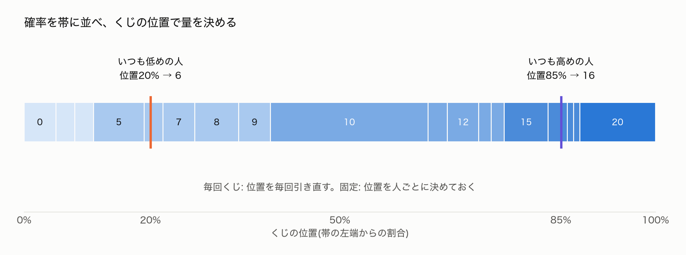

帯の左から20%の位置に決まっている人は、さっきの答えなら6を入れます。85%の人は16です。
AIの答えが回ごとに変わっても、20%の人はその中の少なめ、85%の人は多めを入れ続けます。

位置を完全に固定すると、いつも多く入れる人が生まれました。その一部は、少なく入れた人に減点を付けました。
人による違いが、一人の中のゆらぎより大きくなり、中身も人間に近づきました。

ところが、今度は別のところが崩れました。
いつも左寄りの位置の人は、減点を受けても帯の左側から引かれ続けます。経験によって入れる量が変わる余地が、なくなってしまったのです。
減点のルールがないときの下がり方も、9回目まで平らになりました。

毎回くじを引くと、経験でよく変わる一方、人による違いが出ない。
位置を完全に固定すると、人による違いは出るが、経験で変わらない。
人間は、その中間にいます。人による違いがはっきりありながら、経験に応じて変わります。

そこで、位置が毎回少しだけ揺れるようにしました。毎回の位置は、その人の決まった位置と、その回のくじを混ぜて決めます。混ぜ方の度合いは、その人の位置に強く引っぱられる0.7にしました。1なら完全に固定、0なら毎回くじです。

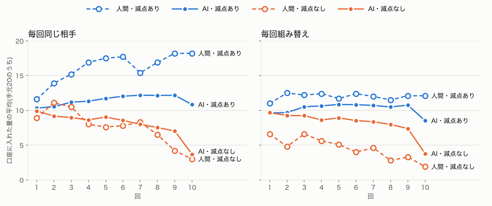

5つの物差しを、すべて満たしました。人物像の組み合わせを変えた3通りすべてで、です。
ここまでいろいろ試してきて、初めてのことでした。

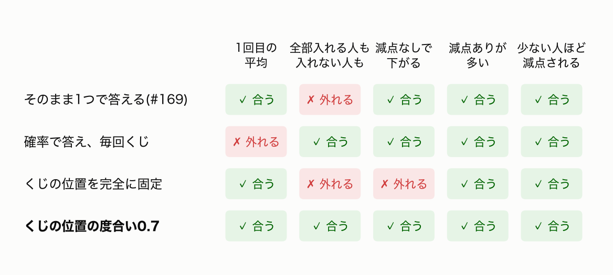

一人ずつ見ても、違いがはっきりしていました。同じ4人の10回を、毎回くじの場合と並べます。

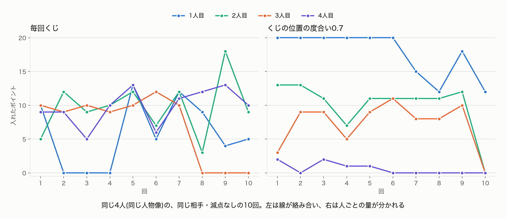

毎回くじでは、同じ人が0の次に13を入れ、線が絡み合います。度合い0.7では、いつも20近くの人、10前後の人、ほぼ0の人に分かれました。
それでいて、同じ人も回によって上下しています。

## それでも、減点のルールがあるときは人間に届かない

ただ、図の左上を見ると、まだ届いていないところがあります。
減点のルールがあって同じ相手と組む条件で、人間が入れる量は18まで上がります。AIは12前後で頭打ちになり、最後の回に減りました。

最後の回の理由を読むと、72人中62人が「最終回」と書いていました。

「今回が最終回なので、将来の報復や評判を気にする必要はなく、経済的には0を入れるのが最も得になる。ただ(中略)減点されるのは避けたい。そこで、グループの平均に合わせて10前後を中心にし…」

AIは、協力を「次の回のため」と考えていました。最終回には、その理由がなくなります。
人間は、減点のルールがあるとき、最後の回でも入れる量を減らしませんでした。

多く入れて減点も付ける人の数も、数えてみました。
度合いを0.7にすると、多く入れる人は増えていました。でも、その人たちはあまり減点を付けませんでした。多く入れて、しかも強く減点を付ける人は、72人中3人だけです。

それなら、減点を付ける性格を人物像に足せばいい。
性格の候補に「ずるい人を許せない」を加えました。

この性格の人は、ねらいどおり、少なく入れた人だけを狙って強く減点を付けました。ほかの性格の5〜10倍です。
ところが、自分が入れる量は13くらいで、多くありませんでした。
減点を付けることと、多く入れることが、一人の中で結びつかなかったのです。

この人が2人いた組は、人間と同じ18.2まで上がりました。ただ、そういう組は1つしかなく、全体の入れる量はほとんど変わりませんでした。

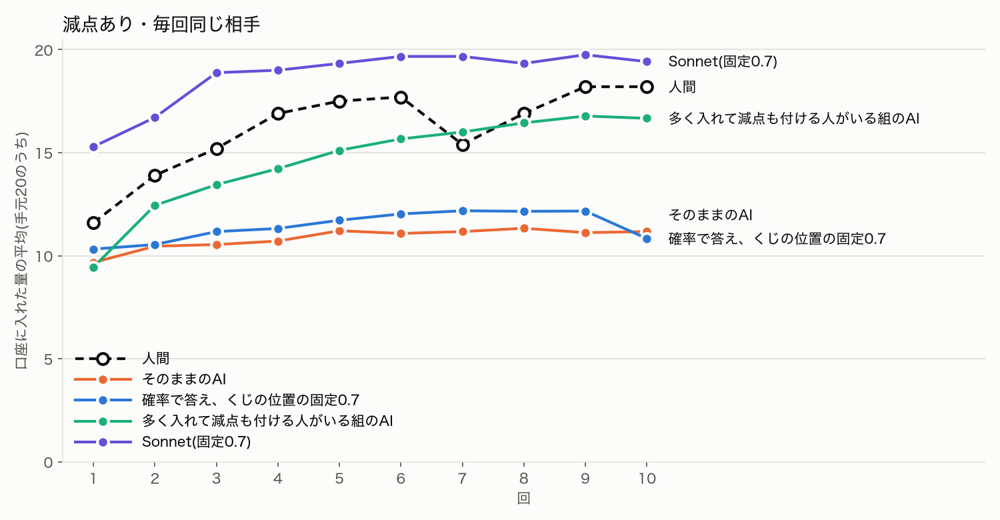

## 大きいAIなら届くのか

最後に、Haiku より大きい Sonnet 5.5 でも、くじの位置の度合い0.7で回してみました。

10回目に入れた量は、平均19.4ポイント。人間の18.2に届きました。最終回にも減りません。
24人全員が「最終回」と書いたうえで、ほとんどが20を入れました。

「最終回だが、これまでほかの人がほぼ20を入れてきたし、減点を受ける可能性もあるので、基本は20を入れる。」

これで解決、とはいきませんでした。
Sonnet は、1回目から平均15を入れていました。24人中9人が、いきなり20です。人間の1回目は12弱でした。
全員が最初から多く入れるので、減点を付ける相手がほとんどいません。多く入れるようになったのは、減点によって育ったからではありませんでした。

10回目の量は人間と同じでも、そこまでの増え方が違います。

## 結局、どうだったのか

結局、AIは人間の判断を、まだ十分にはまねできませんでした。
減点で協力が保たれる点は、人間と同じでした。工夫を重ねて、5つの物差しも全部満たしました。
それでも、人間の実験と比べると、違いが3つ残りました。

- **1回目に、ほぼ全員が半分を入れる。** 人間は、全部入れる人から、まったく入れない人までばらつきます
- **減点のルールがあっても、入れる量が12前後で止まる。** 人間は18まで上がり、最後の回でも減らしません。AIは最後の回に減らしました
- **多く入れて減点も付ける人が、ほとんどいない。** 人間では、多く入れた人が、少なく入れた人に減点を付けていました

なぜ違うのか。ここからは、私の見立てです。

一つめは、人間の幅です。人間には、破天荒な人も、リスクを好む人もいます。
一方、AIはたくさんの文章から、ありそうな答えを返すように学んでいます。そのため、1つだけ答えさせると、平均的な人になりがちです。
確率で答えさせると、AIの中には全部入れる考えもありました。人間の幅を出すには、くじの位置を決めておくような工夫が要るのです。

二つめは、協力の理由です。AIは協力を、損得の計算で考えていました。次の回に減点されないために入れていたので、最終回には減らします。
人間には、損得だけでない「入れるのが当たり前」という感覚があるのでしょう。

三つめは、性格の使い方です。AIは人物像の性格を、行動ごとにばらばらに使います。
「ずるい人を許せない」人物でも、自分は多く入れませんでした。人間では、多く入れた人が、少なく入れた人に減点を付けていました。

## 学び

最初に心配していたのは、AIが「お人よし」すぎることでした。全員が全部入れてしまうのではないか、と。
実際に出てきたのは、全員が半分を入れる、無難な一人でした。

その一人を、人間の集団に近づけようとして、分かったことがあります。

- **AIの答えの中には、もともと幅がある。** 1つだけ答えさせると、いちばんありそうな答えに寄る。確率で答えさせると、全部入れる人も出てくる
- **AIは、自分の行動を正しく語れない。** 「減点を受けたら減らす」と語った人は、実際には増やしていた。AIに先にルールを語らせて、それで集団を作る方法は使えない
- **減点を受けた側の反応は、人間らしい。足りないのは減点を付ける側。** 多く入れて減点も付ける人がいる組は、人間に近い量まで上がった
- **協力と減点が、一人の中で結びつかない。** 減点を付ける性格を与えても、自分は多く入れなかった
- **10回目の量が合っても、増え方が違えば、人間をまねできたとは言えない。** Sonnet は人間の量に届いたが、最初から全員が多く入れていた

最初の再現で、図を見たときに「だいたい合っている」と感じました。減点のルールがないと下がり、あると保たれる。人間と同じでした。
もし物差しを先に決めずに回していたら、あそこで「AIは人間を再現できた」と書いていたと思います。
その図の裏で、24人全員が毎回10を入れていました。

糸島の共同施設に置き換える前に、もう一つ確かめたいことがあります。
多く入れて、しかも減点も付ける人を、AIの中から自然に生み出せるのか。それができない限り、AIの集団は「減点で協力が育つ」ところを再現できません。

ここまでに使った費用は、3つの段を合わせて約36ドルでした。

コードと記録は、ここに置いています。

https://github.com/h-takeshita-henteco-shoji-com/tried/tree/main/code/social-sim

この記事の参加者は、すべて架空の人物です。実在の人や団体を再現したものではありません。

## 参考にした資料

- Fehr, E. & Gächter, S. (2000). Cooperation and Punishment in Public Goods Experiments. American Economic Review 90(4), 980-994.
- Fischbacher, U., Gächter, S. & Fehr, E. (2001). Are people conditionally cooperative? Evidence from a public goods experiment. Economics Letters 71(3), 397-404.
- Fischbacher, U. & Gächter, S. (2010). Social Preferences, Beliefs, and the Dynamics of Free Riding in Public Goods Experiments. American Economic Review 100(1), 541-556.
- Fischbacher, U., Gächter, S. & Quercia, S. (2012). The behavioral validity of the strategy method in public good experiments. Journal of Economic Psychology 33(4), 897-913.
- JAcom 農業協同組合新聞「【現地レポート】ＪＡ糸島(福岡県)米麦二毛作に危機感 意欲引き出す農政を」(2026年11月9日、村田武) https://www.jacom.or.jp/articles/hwAYYjCYa3VaeIBx1RYi1
