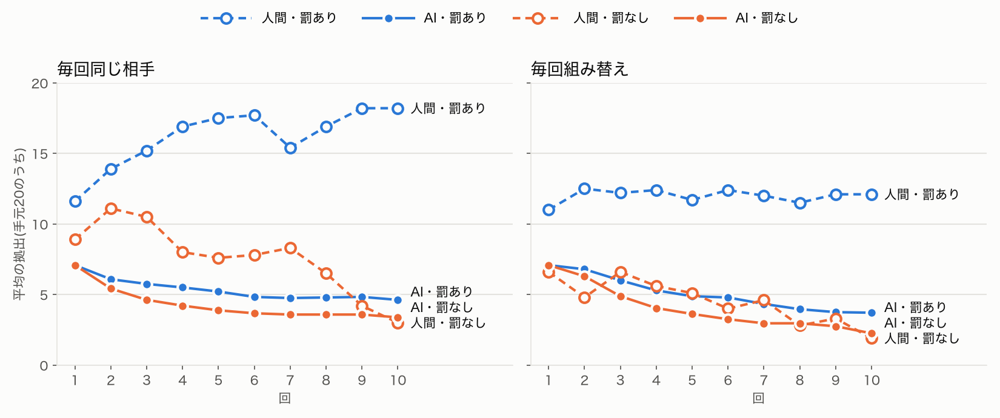
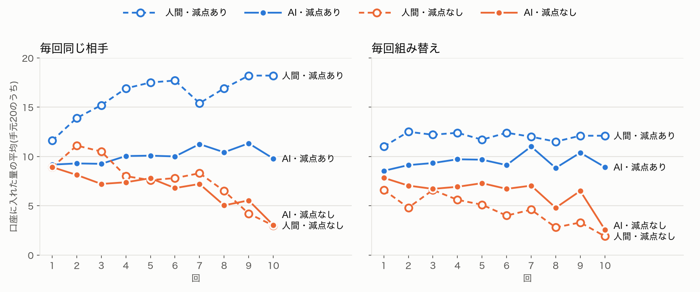

## 試したこと

公共財ゲームで、AIの答えが人間ほど散らばらない問題を直せるか試す。AIの協力の型を戦略法で測り、判断の基準(協力の型)を人間の割合で割り振る案を中心に、他人への予想・自分の理由の記憶・厚い人物像と比べる。
合格の目安は、答えの散らばり(0と20の両方が出る、標準偏差が3を超える)を満たし、罰の有無による推移の向きを壊さないこと。

### 検証の順番

1. AIの協力の型を、戦略法(ほかの3人の平均が0〜20のとき、それぞれ何点入れるか)で測る
2. 協力の型を、人間の割合で割り振る(本命)
3. 属性だけの人物像を厚くする(2の対照)
4. 他人への予想を、人によって変える
5. 自分の過去の理由を覚えさせる

## 結果

### 検証1: AIの協力の型を測る(戦略法)

Fischbacher, Gächter & Fehr(2001)の戦略法をAIに解かせた。ほかの3人の平均が0〜20のそれぞれの場合に、自分が何点入れるかを答えてもらい、答え方の形で型に分けた(48人ずつ、0.09ドル。記録は `code/social-sim/runs/20261111-123623-strategy`)。

| 型 | 人間(論文) | AI・人物像あり | AI・人物像なし |
|---|---|---|---|
| 条件付き協力(ほかの人に合わせる) | 50% | 100% | 100% |
| ただ乗り(どの場合も0) | 約30% | 0% | 0% |
| 山型(途中まで合わせ、その先で減らす) | 約14% | 0% | 0% |

- **全員が「条件付き協力者」だった。** 人物像の有無に関係なく、48人全員が、ほかの人の平均が増えるほど自分も増やした
- **答えの形もそろっていた。** ほかの人の平均よりわずかに少なく入れる(平均20なら18〜20)。この「少しだけ下回る」形は人間の条件付き協力者と同じで、#169 で拠出が回を追って下がった理由を説明できる
- **ふつうの決め方では、拠出がさらに低かった。** 人物像ありの平均は6.9。ゲームの1回目(約9.5)より低い。問いの形で答えが動くことが、ここでも出た

#169 で「AIは平均的な一人を演じている」と見立てた。その一人の正体は、平均よりやや控えめな条件付き協力者だった。

### 検証2: 協力の型を、人間の割合で割り振る

人物像に「お金の分け合いについての考え方」として型を書き、条件付き協力50%・ただ乗り30%・山型14%・その他6%で24人に割り振った(`personas/students_types.json`)。性格からは「負けず嫌い」「疑い深い」のような、判断の基準に近い語を外した。

- **与えた型は保たれた。** 戦略法で測り直すと、条件付き協力60%・ただ乗り29%・山型8%だった
- **散らばりは広がった。** 10回通しの標準偏差は3.3〜3.8で、目安の3を超えた。1回目に0を入れた人が29%いた
- **それでも、10を超える人がいなかった。** 4条件の960回で最大は10。20どころか11も出ない
- **罰が効かなくなった。** 10回目は罰ありが3.7〜4.6、罰なしが2.3〜3.4で、差がほとんどない。人間で最もはっきりした結果が消えた
- **罰の向きは、はっきり出た。** 平均より少ない人に約5点、多い人に0点
- **罰が効かない理由は、ただ乗りの人が変わらないことだった。** 同じ相手の組で、ただ乗りの人は計256点の減点を受けても、平均1.5前後しか入れなかった。理由には「ほかの人がどれだけ入れていても、自分の取り分を優先する」と、人物像の文をそのまま繰り返していた。何人かは「減点を避けるため」と4〜5に増やしたが、少数だった

### 検証3: 属性だけの人物像を厚くする(対照)

出身・家族・趣味・将来の夢・最近の出来事を足し、判断の基準は書かなかった(`personas/students_rich.json`)。

- **かえって、答えがそろった。** 戦略法では100%が条件付き協力。ゲームでは、ほぼ全員が毎回10を入れた(10回通しの標準偏差 0.3〜2.0)
- 罰なしでも、9回目まではほぼ10のままで、最後の回だけ下がった
- 身の上を厚くしても、判断の基準は変わらない。先行研究の「人物像を与えても平らにならされる」と同じ結果になった

### 検証4: 他人への見込みを、人によって変える

1回きりのゲームで、ほかの3人の平均の予想と、自分の拠出を一緒に聞いた(48人ずつ)。

| 人物像 | 予想の平均 | 拠出の平均 | 拠出の範囲 |
|---|---|---|---|
| 見込みを書かない | 8.4 | 6.7 | 0〜10 |
| 楽観的 | 10.8 | 10.5 | 8〜12 |
| 中くらい | 9.2 | 8.2 | 7〜10 |
| 悲観的 | 5.8 | 4.6 | 4〜6 |

- **見込みに沿って、拠出が動いた。** 予想と拠出の順位相関は0.83で、人間と同じく強く結びついた
- **ただし、見込みの中では答えが固まった。** 楽観的な人でも、ほかの人は平均11しか入れないと予想した。20を予想する人はいなかった

### 検証5: 自分の過去の理由を覚えさせる

過去の回の結果に、自分が書いた理由(150字まで)を添えた。罰ありの2条件だけ回した。

| 組み方 | 理由なし(#169) | 理由あり |
|---|---|---|
| 同じ相手 | 平均10.9、10回目11.2 | 平均12.4、9回目14.4 |
| 組み替え | 平均10.0、10回目9.8 | 平均11.0、10回目11.8 |

- **罰ありで、協力が回を追って育った。** 理由なしでは横ばいだった。人間の「罰ありで上がっていく」形に近づいた
- **同じ相手の効果は、少しだけ出た。** 差は0.9から1.4に広がった。人間の5.5には遠い
- 最大は15で、20は出なかった

### 追加検証A: 確率で答えさせ、くじで決める

temperature は上げられない(Claude の上限は既定値と同じ1.0。Haiku 5.5 は既定値以外を受け付けない)。そこで、毎回の拠出を「0〜20それぞれを入れる確率(合計100)」で答えさせ、プログラムがその確率でくじを引いた(`--dist`、4条件で1.4ドル)。

| 物差し | 結果 | 判定 |
|---|---|---|
| 1. 1回目の平均 | 39〜46% | 惜しく外れる(組み替え・罰なしが39%) |
| 2. 答えの散らばり | 標準偏差 3.8〜4.9。1回目は 4.8〜6.2 で、20を入れた人が8% | 初めて合う |
| 3. 罰なしの推移 | 10回目は1回目の33〜34%(人間は29〜34%) | 合う |
| 4. 罰の効き目 | 10回目は、罰ありが8.9〜9.8、罰なしが2.6〜3.0 | 合う |
| 5. 罰の向き | 平均より少ない人に2.2〜2.4点、多い人に0.6〜0.8点 | 合う。件数も十分(57〜72件) |

- **AIの中には、もともと幅があった。** 一つの数を答えさせると10に固まるが、確率で聞くと0にも20にも5〜25%を置いていた。答え方の形が、散らばりを消していた
- **同じ相手・罰なしの推移は、人間の線とほぼ重なった**
- **ただし、出てきた散らばりは「人ごとの違い」ではなく「一人の中のゆらぎ」だった。** 同じ相手・罰なしの組で、一人の10回の標準偏差は平均3.8、人ごとの平均の標準偏差は2.6。同じ人が、ある回は18、次の回は2を入れる
- 同じ相手の効果(差0.6)と、罰ありで20近くまで上がる動きは、まだ出ない

### 追加検証B: 1回目の前の見込みを、数字で与える

人物像に「知らない人と組むと、ほかの人は平均で○ポイントくらい入れるだろうと考えている」と書き、○を2・6・10・14・18で割り振った(`personas/students_expect.json`、4条件で0.9ドル)。人間の予想の分布が手元にないため、割り振りは仮置き。

| 与えた見込み | 1回目の拠出(同じ相手・罰なし) |
|---|---|
| 2 | 3〜5 |
| 6 | 6〜8 |
| 10 | 全員10 |
| 14 | 10〜14 |
| 18 | 12〜16 |

- **見込みどおりに入れた。** 見込みより少しだけ少なく入れる、条件付き協力者の形のままだった
- **人ごとの違いが、安定して出た。** 一人の10回の標準偏差は1.3、人ごとの平均の標準偏差は3.5。追加検証Aと逆の形
- **それでも20は出ない。** 見込み18の人でも最大18で、多くは16。1回目の標準偏差は4.0〜4.7まで広がったが、10回通しでは2.7〜3.8
- **罰なしでも下がりにくくなった。** 10回目は1回目の65〜67%。人間(29〜34%)よりずっと緩い

### 追加検証C: 見込みを与えたうえで、確率で答えさせる(AとBの組み合わせ)

追加検証Bの人物像で、追加検証Aの答え方をさせた(4条件で1.3ドル)。

| 物差し | 結果 | 判定 |
|---|---|---|
| 1. 1回目の平均 | 41〜43% | 合う |
| 2. 答えの散らばり | 標準偏差 4.3〜4.8、0と20が出る | 合う |
| 3. 罰なしの推移 | 10回目は1回目の76〜84% | 合わない(ほとんど下がらない) |
| 4. 罰の効き目 | 10回目の差は、同じ相手で4.4、組み替えで2.6 | 組み替えで目安(3)に届かない |
| 5. 罰の向き | 少ない人に約3点、多い人に0点 | 合う |

- **散らばりの中身は、人ごとの違いと一人の中のゆらぎが同じくらいになった。** 一人の10回の標準偏差は3.1〜3.3、人ごとの平均の標準偏差は2.9〜3.4。AとBの中間
- **その代わり、罰なしで下がらなくなった。** 人物像の「ほかの人は平均○ポイントくらい入れるだろうと考えている」は、毎回の問いに入る。そのため、ほかの人が入れなくなっても、見込みが書き換わらなかった可能性が高い。ただ乗りの型を与えたときと同じく、人物像の文が「変わらない決まり」になっている

### 追加検証D: 見込みを「実験の前の予想」として書く

追加検証Cの見込みの文を、過去の時点のことに書き直した(4条件で1.4ドル)。

- 変更前: 知らない人と組むと、ほかの人は平均で○ポイントくらい入れるだろうと考えている
- 変更後: 実験が始まる前は、ほかの人は平均で○ポイントくらい入れるだろうと予想していた

| 物差し | 結果 | 判定 |
|---|---|---|
| 1. 1回目の平均 | 40〜45% | 合う |
| 2. 答えの散らばり | 標準偏差 4.1〜4.2。0は出るが、最大は18〜19 | 合わない(20が出ない) |
| 3. 罰なしの推移 | 10回目は1回目の60〜71% | 合わない(Cの76〜84%よりは下がる) |
| 4. 罰の効き目 | 10回目の差は、同じ相手で6.1、組み替えで4.0 | 合う |
| 5. 罰の向き | 少ない人に約3点、多い人に0点 | 合う |

- **見込みが、経験で書き換わるようになった。** 見込み18の人は「平均18ほど入れると思っていたが、実際はずっと低く…期待が外れている」と書いた。見込み14と18の人は、10回目に3.8と7.0まで下げた(Cでは6.0と10.0)
- **罰の効き目が、組み替えの条件でも戻った。** Cで目安に届かなかった組み替えの差が、2.6から4.0になった
- **その代わり、人ごとの違いが薄れた。** 一人の10回の標準偏差は3.3〜3.6、人ごとの平均の標準偏差は1.7〜2.3。見込みが更新されると、人は経験に合わせてそろっていく
- **20は出なくなった。** Cでは出ていた20が、くじでも一度も出なかった。見込みの高い人が、早い回で下げたため

### 追加検証E: 見込みとメモを、AI自身に毎回書き直させる

人物像を2層に分けた(4条件で1.3ドル、`--belief`)。

- 変わらない層: 追加検証Dの人物像に、見込みの直し方を1文足した。「信じ続ける」「周りに合わせる」「疑い深い」を3分の1ずつ割り振った
- 変わる層: 毎回、拠出と一緒に「今回ほかの人は平均いくつ入れると思うか」と「次の回の自分へのメモ(60字以内)」を答えさせ、次の回の問いに入れた

| 物差し | 結果 | 判定 |
|---|---|---|
| 1. 1回目の平均 | 44〜49% | 合う |
| 2. 答えの散らばり | 標準偏差 3.5〜3.8。罰なしの組では20が出た | 合わない(20が出ない組がある) |
| 3. 罰なしの推移 | 10回目は1回目の90〜105% | 合わない(まったく下がらない) |
| 4. 罰の効き目 | 10回目の差は、同じ相手で3.5、組み替えで2.0 | 組み替えで目安(3)に届かない |
| 5. 罰の向き | 少ない人に約3点、多い人に0点 | 合う |

- **見込みどおりに入れるようになり、下がらなくなった。** 拠出は見込みより平均0.16多いだけで、見込みは実際より0.16高いだけだった。見込みと拠出が釣り合い、10前後で止まった
- **見込みの直し方の違いは、3回目までに消えた。** 1回目は「疑い深い」5.9、「信じ続ける」12.2だった。3回目には9〜11にそろった。人ごとの平均の標準偏差は1.9〜2.3で、Dと変わらない
- **メモは「方針」になり、決まりとして守られた。** メモの多くは「12で据え置き」「8〜9を基本に」のような方針だった。人物像の文と同じく、自分で書いた方針も変わらない決まりになった

### 追加検証F: AIが1回目にちょうど半分を入れる理由

#169 の人物像(students、24人)に、履歴のない1回目の拠出だけを聞いた。条件を1つずつ変えた(`why10.py`、10条件で0.12ドル)。

| 条件 | 平均 | ちょうど半分の割合 | 0の人数 |
|---|---|---|---|
| もと(手元20、戻り0.4) | 9.4 | 83% | 0 |
| 手元30 | 14.0 | 83% | 0 |
| 手元10 | 4.5 | 83% | 1 |
| 戻り0.3 | 9.3 | 83% | 0 |
| 戻り0.7 | 9.5 | 88% | 0 |
| 戻り0.9 | 9.5 | 88% | 0 |
| 「以前の参加者は平均4」と知らせる | 7.0 | 38% | 0 |
| 「以前の参加者は平均16」と知らせる | 10.0 | 67% | 0 |
| 「誰が何を入れたかは誰にも分からない」と足す | 9.4 | 88% | 0 |
| 先に、稼ぎを最大にする量を計算させる | 7.7 | 71% | 4 |

あわせて、#169 の1回目の理由(96件)に出る言葉を数えた。

- 「半分」82%、「様子を見る」80%、「全部入れると不安・損」62%
- 「ほかの人に合わせる」5%、「0.4・0.6の計算」23%、「最適・合理」5%

見立てごとの判定は次のとおり。

- **範囲の真ん中を選んでいる: 当たり。** 手元を10・20・30と変えても、83%がちょうど半分を入れた
- **損得を計算していない: 当たり。** 戻りの率を0.3から0.9まで変えても、平均は9.3〜9.5で動かなかった。人間は、戻りの率を上げると拠出が増える(Isaac & Walker 1988)。戻り0.9でも、理由は「全部入れると損をしそうで不安」だった
- **ほかの人に合わせている: 下にだけ当たり。** 平均4と知らせると下がったが、平均16と知らせても上がらなかった
- **見られ方を気にしている: 外れ。** 誰にも知られないと書いても、変わらなかった
- **計算すれば変わる: ほぼ外れ。** 24人全員が「0が最適」と正しく計算した。それでも17人が10を入れた。理由は「金銭だけを見れば0が最適だと分かる。ただ…中間的な選択にした」

### 追加検証G: 同じ10条件を、Sonnet 5.5 と Opus 5.5 にも聞く

人物像・問い・seed は追加検証Fと同じにした。費用は Sonnet が1.44ドル、Opus が3.55ドル。

| 条件 | Haiku 5.5 | Sonnet 5.5 | Opus 5.5 |
|---|---|---|---|
| もと: 平均(ちょうど半分の割合) | 9.4(83%) | 10.3(58%) | 10.3(54%) |
| もと: 標準偏差 | 1.4 | 1.3 | 2.7 |
| 手元10 / 30 の割合 | 45% / 47% | 54% / 48% | 55% / 49% |
| 戻り0.3 → 0.9 | 9.3 → 9.5 | 9.8 → 10.3 | 9.7 → 13.0 |
| 「平均4」/「平均16」と知らせる | 7.0 / 10.0 | 5.4 / 13.2 | 8.1 / 13.0 |
| 「誰にも分からない」と足す | 9.4 | 10.0 | 10.2 |
| 先に計算させる(0の人数) | 7.7(4人) | 9.8(0人) | 9.8(0人) |

- **「半分」の型は、3つのモデルに共通していた。** 手元を変えても、どのモデルも半分前後を入れた。ちょうど半分の割合は、大きいモデルほど下がった
- **戻りの率に反応したのは Opus だけだった。** 戻り0.9で平均13.0、20を入れた人も1人出た。理由は「みんなが多く入れれば全員が得をする仕組みだから」。人間と同じ向きの反応
- **上にも合わせるのは、Sonnet と Opus だった。** Haiku は平均16と知らせても上がらなかった。Sonnet と Opus は13前後まで上がった
- **見られ方は、どのモデルにも効かなかった。**
- **計算させても、0に寄らなかった。** Sonnet と Opus は「計算では0が得なのは分かっています。でも10回同じメンバーで続くので…」と書き、10〜15を入れた。くり返しを見越した判断で、Haiku より筋が通っている
- **散らばりは、Opus でも人間に届かない。** もとの条件の標準偏差は2.7で、0も20も出なかった

### 追加検証H: 考えてから答えさせる

Haiku 5.5 に、答える前に考えさせた(effort max)。考えるモデルほど協力が崩れるという研究があり、Haiku でも起きるかを見た。罰ありの2条件は、PCのメモリが足りなくなり4〜5回目で止まった。止まった分は回し直していない。費用は4.12ドル。

| 条件 | 1回目 → 10回目 | 考えさせない場合(#169) | 人間 |
|---|---|---|---|
| 同じ相手・罰なし | 8.2 → 1.5 | 9.6 → 0.4 | 8.9 → 3.0 |
| 組み替え・罰なし | 8.3 → 1.5 | 9.2 → 2.3 | 6.6 → 1.9 |
| 同じ相手・罰あり | 9.7 → 10.8(4回目まで) | 9.7 → 10.7(4回目) | 11.6 → 16.9(4回目) |

- **考えさせても、ほとんど変わらなかった。** 罰なしの下がり方が少しなだらかになっただけで、最大は12、20は出なかった
- **理由に計算が増えた。** 「最終回のため、今回の選択で今後の協力を引き出す意味はありません」。一方で「0が合理的だとは分かっています。それでも…」と10を入れた人もいた
- 協力が崩れたと報告した研究は、o1-mini のような考えることに特化したモデルを使っている。Haiku に長く考えさせるのは、それと同じではない
- 1回の答えに約25秒、費用は約5倍かかった。改善に見合わない

### 追加検証I: 決まった式で動かす「規則型」と比べる

AIを使わず、式だけで24人を動かす比較相手を作った(`rule_model.py`)。式は Fischbacher & Gächter 2010 と Fischbacher, Gächter & Fehr 2001 を単純にしたもので、係数は人間の推移に合わせて動かしていない。

- 見込み: 次の見込み = 0.4 × 今の見込み + 0.6 × 今回ほかの人が入れた平均
- 型の割合: 条件付き協力50%(見込みの9割を入れる)、ただ乗り30%(0)、山型14%、その他6%
- 罰: 平均より少ない人に、差1ポイントにつき0.2点を全員が付ける。受けた罰1点につき、次の回から1ポイント上乗せ

20 seed で回した(費用0円)。

| 物差し | 合った seed |
|---|---|
| 1. 1回目の平均 | 0/20(32%で低すぎる) |
| 2. 散らばり | 2/20 |
| 3. 罰なしの推移 | 17/20 |
| 4. 罰の効き目 | 20/20 |
| 5. 罰の向き | 20/20(罰の式を人間の図から決めたので、検証にはならない) |

- **罰ありで上がり続ける動きは、式なら簡単に出た。** 同じ相手・罰ありは 6.4 → 13.4。AIでは一度も出なかった動き
- 1回目の高さと散らばりは、係数を合わせていないので外れた

### 追加検証J: AIに性質を答えさせ、式で動かす(組み合わせ)

AIには人物像ごとに1回だけ、3つを答えさせた(`hybrid.py`、費用約0.27ドル)。拠出は追加検証Iの式で計算した。

1. 実験の前に、ほかの人が平均で何ポイント入れると思うか
2. 前の回のほかの人の平均が 0・5・10・15・20 のとき、次の回に何ポイント入れるか
3. 自分が4、ほかの人が平均10を入れ、減点を0・3・6点受けたとき、次の回に何ポイント入れるか

| 物差し | 合った seed |
|---|---|
| 1. 1回目の平均 | 20/20 |
| 2〜4 | 0/20 |
| 5. 罰の向き | 20/20(式なので検証にならない) |

- **AIが語った性質で動かすと、大きく外れた。** 罰なしではまったく下がらず(9.2 → 8.6)、罰ありではかえって崩れた(9.2 → 3.9)
- 120人中99人が「減点を受けたら減らす」と答えた。人間で多いのは、罰を受けて増やす反応
- 合わせ方の表も、人間と形が違った。相手の平均が低いとき、相手より多く入れると答えた

### 追加検証K: 前もって聞いた答えと、実際の行動を照らす

追加検証Jで聞いた答えと、#169 のゲームでの同じ人物の行動を、1人ずつ比べた(`say_do.py`、費用0円)。

| 照らしたこと | 結果 |
|---|---|
| 1回目 | 語った見込みと表から出した量が、実際とよく合った(誤差0.74、相関0.71) |
| 回を重ねたあとの合わせ方 | 語った表より「前の回と同じ量」のほうが当たった(誤差 2.01 対 0.99) |
| 罰への反応 | 罰を受けた66人のうち53人が「減らす」と語ったが、実際に減らした人は0人 |
| 同じ問いを2回聞く | 罰への反応の向きが一致したのは67% |

- **語った答えは、経験のあとの行動を予測しなかった。** 人間では、規則として聞いた答えで実際の行動をかなり予測できたと報告されている(Fischbacher, Gächter & Quercia 2012)
- 実際の行動の向きは人間と同じだった。平均より少なく入れて罰を受けた次の回には、平均1.9ポイント増やした

### 追加検証L: 20を入れる人がいない理由を、記録で確かめる

#169 の1回目の理由480件のうち、178件(37%)が全額を避けると自分から書いていた。

> いきなり全額入れて一方的に損をするのは避けたいけれど、まったく入れないで様子見だけするのも気が引ける。そこで半分の10ポイントを…

- 1回目は、両極端を避けて半分を選ぶ型がある(追加検証F)
- 2回目以降は、全員が周りに合わせて少し控えめに入れるので、誰も上に引っぱらない(検証1)
- 1つだけ答えさせると、いちばんありそうな答えに寄る。確率で答えさせると、20にも確率を置いていた(追加検証A)

### 追加検証M: そろった組でも罰は続くか

#169 の罰ありの記録で、全員の拠出がそろった組を数えた(費用0円)。

- **そろった組の35%で、罰は続いていた。** 多くは、負けず嫌いの人物が全員に同じように付ける嫌がらせの罰だった
- **罰への反応は、立場で違った。** 平均より少なく入れて罰を受けた次の回は +2.34、平均どおり入れて罰を受けた次の回は +0.27
- AIは罰を受けると、組の水準までは戻る。組の水準を超えて上がることはない

### 追加検証N: 毎回20を入れる参加者を混ぜる

24人のうち3人を、毎回20を入れる式の参加者に入れ替えた(`--bots 3`)。同じ相手の6組のうち3組に1人ずつ入る。AIは1つの数で答える #169 の方式のまま。式の参加者がいる組と、いない組で、AIの拠出を比べた(費用約1.03ドル)。

| 同じ相手・罰あり | 式の参加者がいる組のAI(10回目) | いない組のAI(10回目) | 人間 |
|---|---|---|---|
| 20を入れるだけの参加者 | 13.7 | 10.2 | 18.2 |
| 20を入れ、少ない人を罰する参加者 | **16.7** | 10.5 | 18.2 |

- 20を入れるだけでは、AIは13〜14にとどまった。周りのAIにも合わせるうえ、誰も罰しないためである
- 罰する参加者を混ぜると、AIは早い回から上がり、20を入れる人も4人出た
- **AIの罰への反応は、人間に近かった。** 足りないのは「高く入れて、しかも罰する人」だった

### 追加検証O: 確率で答えさせ、くじの位置を人ごとに固定する

追加検証Aのくじを、人ごとに位置を固定して引いた(`--rho 1`、費用1.40ドル)。最初に1人1つの乱数を決め、毎回その位置で分布から選ぶ。いつも下から80%の位置で引く人は、毎回高めになる。

| 条件 | 1回目 → 9回目 → 10回目 | 追加検証A | 人間 |
|---|---|---|---|
| 同じ相手・罰あり | 10.0 → 13.5 → 12.3 | 9.2 → 11.3 → 9.8 | 11.6 → 18.2 → 18.2 |
| 同じ相手・罰なし | 11.0 → 7.8 → 2.8 | 8.9 → 5.5 → 3.0 | 8.9 → 4.2 → 3.0 |

- 物差し1・4・5は合い、2(罰ありで0が出ない)と3(組み替えで52%)は外れた
- **人ごとの違いが、一人の中のゆらぎより大きくなった。** 同じ相手・罰なしで、人ごとの違い3.8、ゆらぎ2.5(追加検証Aは2.6と3.8)
- いつも多く入れる人が生まれ、その一部は少ない人を罰した
- 一方で、いつも低い位置の人は、罰を受けても低い側から引かれ続けた。罰なしの推移は9回目まで平らで、10回目に一気に落ちた

注意: 追加検証A以降の確率の方式には、弱点が1つある。くじで引いた量がAIの意図と違っても、次の回にはAI自身が選んだ量として履歴に見せている。

### 追加検証P: 固定の度合いを0.7にする

固定の度合いを1と0の間にした(`--rho 0.7`)。毎回の位置は、人ごとの位置とその回の乱数を混ぜて決まり、人ごとの位置との相関が0.7になる(正規分布の z = 0.7 × 人ごとの値 + 0.71 × その回の値)。seed 1〜3で回した(費用4.08ドル。ほかに、組の数を指定し忘れた1回分の0.23ドルを捨てた)。

| 物差し | seed 1 | seed 2 | seed 3 |
|---|---|---|---|
| 1. 1回目の平均 | 合う | 合う | 合う |
| 2. 散らばり | 合う | 合う | 合う |
| 3. 罰なしの推移 | 合う(0.32〜0.36) | 合う(0.37) | 合う(0.43〜0.44) |
| 4. 罰の効き目 | 合う(差9.1) | 合う(差7.1) | 合う(差5.2) |
| 5. 罰の向き | 合う | 合う | 合う |

3つの seed の平均:

| 条件 | 1回目 | 4回目 | 7回目 | 9回目 | 10回目 | 人間の10回目 |
|---|---|---|---|---|---|---|
| 同じ相手・罰あり | 10.3 | 11.3 | 12.2 | 12.2 | 10.8 | 18.2 |
| 組み替え・罰あり | 9.6 | 10.7 | 10.7 | 10.8 | 8.5 | 12.1 |
| 同じ相手・罰なし | 9.9 | 8.6 | 8.0 | 7.0 | 3.7 | 3.0 |
| 組み替え・罰なし | 9.7 | 8.6 | 8.4 | 7.4 | 3.8 | 1.9 |

- **5つの物差しを、3つの seed すべてで満たした。** これまでで初めて
- 罰なしの推移は人間にかなり近い。人ごとの違い(3.6)も、ゆらぎ(2.8)より大きいまま残った
- 罰ありは12前後で頭打ちになり、10回目に下がった。人間は18まで上がり、最後まで下がらない

### 追加検証Q: 最後の回の落ち込みと、高く入れて罰する人を数える

追加検証Pの記録を読んだ(費用0円)。

最後の回について:

| 条件 | 9回目に「最終回」と書いた人 | 10回目に「最終回」と書いた人 | 10回目に「仕返し・今後」と書いた人 |
|---|---|---|---|
| 同じ相手・罰あり | 4/72 | 62/72 | 53/72 |
| 組み替え・罰あり | 3/72 | 71/72 | 51/72 |

> 今回が最終回なので、将来の報復や評判を気にする必要はなく、経済的には0を入れるのが最も得になる。ただ(中略)減点されるのは避けたい。そこで、グループの平均に合わせて10前後を中心にし…

高く入れて罰する人(10回の平均が14以上で、自分より少ない人に合わせて10点以上の減点を付けた人)について:

| 方法 | 高く入れる人 | 高く入れて罰する人 | 高く入れる人が少ない人に付けた減点 |
|---|---|---|---|
| 追加検証A(固定0) | 6% | 5% | 19.6点 |
| 追加検証P(固定0.7) | 11% | 3% | 9.6点 |
| 追加検証O(固定1) | 27% | 12% | 11.5点 |

- **AIは、最終回に損得の計算へ戻る。** 協力を「次の回のため」と考えていて、最終回にはその理由がなくなる
- **固定0.7では、高く入れる人は増えたが、その人たちの罰が弱かった。** 高く入れて罰する人がいる組は、どの方法でも協力が高かった(固定0.7で 12.0 対 13.0)。ただし組の数は少ない

### 追加検証R: Sonnet 5.5 で回す

追加検証Pと同じ設定で、Sonnet 5.5 に罰ありの同じ相手だけを回した(費用4.52ドル。Haiku の約10倍)。

| | 1回目 | 2回目 | 3回目 | 4回目 | 7回目 | 9回目 | 10回目 |
|---|---|---|---|---|---|---|---|
| Sonnet | 15.3 | 16.7 | 18.9 | 19.0 | 19.7 | 19.8 | 19.4 |
| Haiku(追加検証P) | 10.3 | — | — | 11.3 | 12.2 | 12.2 | 10.8 |
| 人間 | 11.6 | — | — | 16.9 | 15.4 | 18.2 | 18.2 |

- **10回目の高さは人間に届いた。** 24人全員が「最終回」と書いたうえで、ほとんどが20を入れた
- **ただし、1回目から高すぎた(76%)。** 24人中9人が1回目から20を入れた
- 罰で協力が上がったのではない。全員が平均14以上を入れ、罰する相手がほとんどいなかった
- 人ごとの違いはほぼ消えた(1.0)
- 罰なしを回していないので、Sonnet が罰に反応したのか、協力的すぎるだけなのかは分からない

### 追加検証S: 人物像に「ずるい人を許せない」を足す

性格の候補に「ずるい人を許せない」を、ほかと同じ重みで足した(`personas/students_fair.json`)。Haiku、固定0.7、罰ありの同じ相手を seed 1〜3 で回した(費用1.29ドル)。

| 性格 | 人数 | 拠出の平均 | 少ない人への減点 | 多い人への減点 |
|---|---|---|---|---|
| ずるい人を許せない | 11 | 13.2 | **24.0** | 0.9 |
| 負けず嫌い | 4 | 13.1 | 18.0 | 16.8 |
| 疑い深い | 5 | 10.6 | 9.6 | 0.6 |
| 几帳面 | 12 | 11.6 | 5.2 | 0.0 |
| 慎重・のんびり・人づきあいが好き | 40 | 11.0〜12.9 | 1.3〜2.0 | 0.0〜0.1 |

| | 同じ相手・罰ありの9回目 | 10回目 | 高く入れて罰する人 |
|---|---|---|---|
| 性格を足した | 13.0 | 11.4 | 7/72 |
| 足さない(追加検証P) | 12.2 | 10.8 | 3/72 |

- **罰する人は、性格の一言で生まれた。** 少ない人だけを、ほかの性格の5〜10倍強く罰した
- **ただし、自分の拠出は高くならなかった。** 全体の伸びは0.6〜0.8で、seed のばらつきの範囲に収まる
- 高く入れて罰する人が2人いた組は、18.2まで上がった。ただし1組だけ

### まとめ

| 検証 | 散らばり | 20が出るか | 罰の効き目 | 同じ相手の効果 |
|---|---|---|---|---|
| もとの人物像(#169) | 狭い | 出ない | 出る | 出ない |
| 2. 型を割り振る | 広がる | 出ない(最大10) | 消える | 出ない |
| 3. 身の上を厚くする | さらに狭い | 出ない | 弱まる | 出ない |
| 4. 見込みを変える | 見込みの数だけ分かれる | 出ない | (未測定) | (未測定) |
| 5. 理由を覚えさせる | 狭い | 出ない | 強まる | 少し出る |
| A. 確率で答えさせる | 合う(一人の中のゆらぎ) | 出る | 出る | 出ない |
| B. 見込みを数字で与える | 1回目は広がる(人ごとの違い) | 出ない(最大18) | 出る | 出ない |
| C. AとBの組み合わせ | 合う(違いとゆらぎが半々) | 出る | 罰なしで下がらず、弱い | 出ない |
| D. Cの見込みを過去の予想に | 合う(ゆらぎが主) | 出ない(最大19) | 出る | 出ない |
| E. Dに見込みとメモの引き継ぎ | やや狭い(ゆらぎが主) | 一部で出る | 罰なしで下がらず、弱い | 出ない |
| H. 考えてから答えさせる | 狭い | 出ない | (途中で停止) | 出ない |
| I. 規則型(AIなし) | 狭い | 一部で出る | 強く出る(上がり続ける) | 出ない |
| J. AIに性質を答えさせ、式で動かす | 狭い | 出ない | 逆向き(崩れる) | 出ない |
| O. Aのくじの位置を固定(1) | 罰ありで0が出ない(人ごとの違いが主) | 出る | 出る | 出ない |
| P. Aのくじの位置を固定(0.7) | 合う(人ごとの違いが主) | 出る | 出る(12前後で頭打ち) | 少し出る |
| R. Pを Sonnet で | 狭い(全員が高い) | 多く出る | 罰ありで人間の高さ(罰なしは未測定) | (未測定) |
| S. Pに「ずるい人を許せない」 | 合う | 出る | Pとほぼ同じ | (未測定) |

最初の5つは、どれも合格の目安(0と20の両方が出て、標準偏差が3を超え、推移の向きを壊さない)を満たさなかった。追加検証Aは、物差し2〜5を初めて同時に満たした。追加検証Cは物差し1・2・5を満たしたが、罰なしの推移が崩れた。追加検証Dは物差し1・4・5を満たし、罰なしの推移もCより戻ったが、20が消えた。追加検証Eは、罰なしの推移がまったく下がらなくなった。追加検証Fでは、1回目の「半分」が損得の計算ではなく、決まった型の判断だと分かった。追加検証Gでは、この型が Sonnet と Opus にも共通し、Opus だけが戻りの率に反応した。

追加検証H〜Sでは、罰ありで協力が伸びない原因を追った。考えさせても(H)、AIの語った性質で式を動かしても(J)、良くならなかった。高く入れて罰する式の参加者を混ぜると、AIは人間に近い高さまで上がった(N)。足りないのは、罰を受けた側の反応ではなく、罰する側の人だった。確率で答えさせ、くじの位置の人ごとの固定を0.7にする方法(P)は、5つの物差しを3つの seed すべてで満たした。それでも罰ありは12前後で頭打ちになり、人間の18に届かない。Sonnet は人間の高さに届いたが、1回目から高すぎた(R)。性格で罰する人は生まれたが、自分は高く入れなかった(S)。費用は合わせて約30.8ドル。

## 学び

- **AIの「平均的な一人」は、控えめな条件付き協力者だった。** 戦略法で測ると、人物像の有無に関係なく全員がこの型だった。#169 で見えた「半分に固まる」「回を追って下がる」は、この一つの型で説明できる
- **基準を与えると、AIは基準を守りすぎる。** ただ乗りの型を与えた人は、減点を受け続けても変わらなかった。人間のただ乗りする人は、罰を受けると入れるようになる。人物像の文が「好み」ではなく「守るべき決まり」として読まれている
- **上側の散らばりは、どの方法でも出なかった。** 0は型を与えれば出るが、20は一度も出ない。人間の高い協力は、楽観的な条件付き協力者が互いに引き上げて生まれる。AIは楽観的な人でも「ほかの人は11くらい」と見込み、上に踏み出さない
- **身の上を厚くすると、かえってそろう。** 判断に関係のない情報が増えると、AIは無難な真ん中に寄るように見える
- **記憶は、人間らしい「育ち方」に効いた。** 自分の理由を引き継ぐと、罰ありで協力が育った。量と散らばりより、時間の流れの再現に効く
- **散らばりの「中身」も見る。** 確率で答えさせると散らばりは合ったが、それは一人の中のゆらぎだった。見込みを与えると人ごとの違いは出たが、量が足りなかった。人間の散らばりは主に人ごとの違いなので、標準偏差の数字だけでは判定できない
- **人物像に書いた見込みは、更新されない。** 毎回の問いに入る文は、経験で書き換わらない。「実験の前は…と予想していた」と過去の時点のこととして書くと、AIは「期待が外れた」と書いて見込みを下げた。経験で変わるべきものと、変わらない性格は、書き方で分けられる
- **人ごとの違いは、経験でならされる。** 見込みが更新されるようになると、人ごとの違いは薄れた。人間の人ごとの違いは10回たっても残る。経験でも変わらない何か(性格や信念)が、人間にはある
- **AIは、見込みどおりに入れる。** 人間は、自分の見込みより少しだけ少なく入れる(Fischbacher & Gächter 2010)。この小さなずれが、回を追って下がる理由とされている。AIに見込みを毎回書かせると、見込みと拠出が釣り合って止まった。人間らしさは「ちょっとだけ自分に甘い」ところにあるのかもしれない
- **自分で書いたメモも、決まりになる。** 経験で書き換わる層を作ったつもりが、AIはメモに方針を書き、それを守った。書き換えの仕組みを足すだけでは、変わり方の人ごとの違いは出なかった
- **AIの1回目の「半分」は、計算ではなく決まり文句だった。** 「まだ分からないから、半分入れて様子を見る」という型で、手元の量にも戻りの率にも反応しない。0が最適だと正しく計算できても、半分を選ぶ。平均が人間に近く見えたのは、この型がたまたま人間の平均と重なったからだった
- **AIは、下には合わせるが上には合わせない。** 低い平均を知らせると下がり、高い平均を知らせても上がらない。上側の散らばりが出ない理由の一つと考えられる
- **大きいモデルほど、条件に反応する。** 「半分」の型はどのモデルにもあった。ただ、Opus は戻りの率に、Sonnet と Opus は高い平均に反応した。安い Haiku で全員を動かすと、人間らしい反応の一部を最初から失う
- **一つ直すと、別のところが崩れる。** 型で散らばりを出すと、罰の効き目が消えた。合格かどうかは、すべての物差しを同時に見て決める
- **AIは、自分の行動を語れない。** 前もって聞いた規則は1回目をよく当てたが、経験のあとの行動は「前の回と同じ」より当たらなかった。罰を受けたら減らすと語った人は、実際には一人も減らさなかった。AIに戦略を語らせて模型を作る方法は、使えない
- **罰を受けた側の反応は人間らしく、罰する側が足りない。** 高く入れて罰する人を式で混ぜると、AIは人間に近い高さまで上がった。AIの中からこの人を生むことが、罰ありを再現する鍵になる
- **人ごとの違いと、経験による変化は、引っぱり合う。** くじの位置を完全に固定すると人ごとの違いは出たが、経験で変わらなくなった。毎回くじを引くと、その逆になった。固定0.7でようやく両立した。人間はこの中間にいる
- **AIは、協力を「次の回のため」と考える。** 最終回には72人中62〜71人が「最終回」と書き、損得の計算に戻った。人間は罰ありの最終回でも下がらない。人間の協力には、損得だけでない規範が混じっている
- **協力と罰が、一人の中で結びつかない。** 「ずるい人を許せない」人物は強く罰したが、自分の拠出は高くしなかった。人間では、高く入れる人ほど強く罰する。AIは、人物の性格から行動の組を一貫して引き出せていない
- **大きいモデルは、人間を越えて協力的になる。** Sonnet は罰ありで人間の高さに届いたが、最初から全員が協力的で、罰がいらなかった。高さが合っても、そこに至る道すじが違えば、模せたとは言えない
