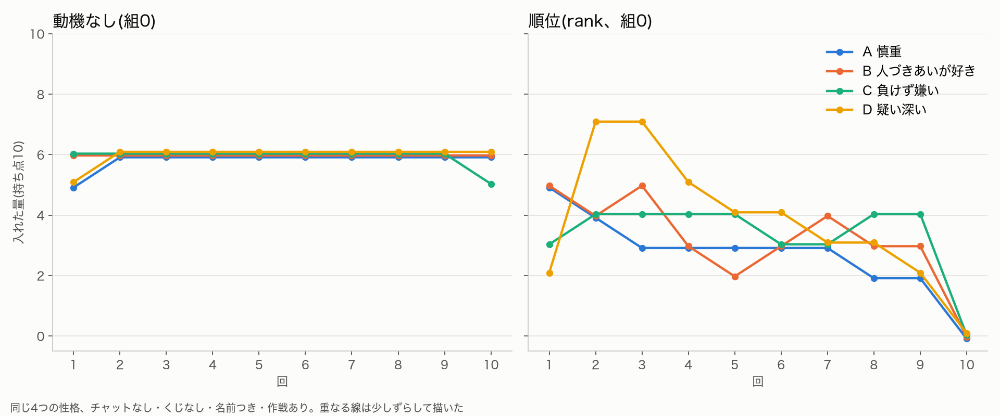
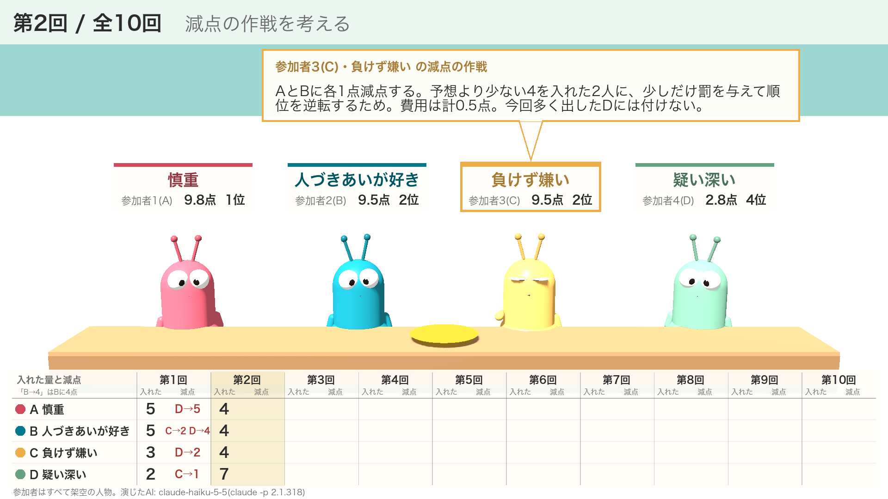

# 公共財ゲームで、AIが毎回同じ量を入れる理由を調べた

## 前回までの悩み

やってみ太郎です。

この記事の内容を、へんロボが説明する動画にもしました。後半では、AIが演じる参加者のゲームを3Dで再生した様子を、カットせずにお見せしています。

https://youtu.be/JS3YIK-_U9k

糸島の農業の悩みを、AIのシミュレーションで考えたい。そのために、AIが人間らしく判断できるかを確かめています。
題材は「公共財ゲーム」です。4人が手元のポイントのうち何ポイントを共同の口座に入れるかを決め、口座の合計の0.4倍が全員に配られます。みんなで入れれば全員が得をしますが、一人ひとりで見ると、入れないほうが得です。

前回までに、困ったことが分かっていました。
AIの参加者に入れる量を答えさせると、4人とも同じような量を入れ、回を重ねても量をほとんど変えないのです。人間の実験では、多く入れる人も少なく入れる人もいて、相手の出方を見て毎回量を変えます。

前回は、AIに「0から20のそれぞれを入れる確率」を答えさせ、プログラムがくじで量を決める方法で、ばらつきを出しました。
ただ、そのばらつきは「人による違い」ではなく、くじによる「一人の中のゆらぎ」でした。同じ人が、ある回は18、次の回は2を入れます。理由を読んでも、なぜその量なのかは書いてありません。

今回は、くじを使わずに、AIが理由をつけて入れる量を変える条件を探しました。

## 今回のゲーム

今回は、Bochet、Page、Putterman が2006年に発表した実験に合わせました。4人で1組、毎回同じ相手と10回くり返します。毎回10ポイントを受け取り、口座の合計の0.4倍が全員に配られます。

全員が入れた量を見たあとで、ほかの人に「減点」を付けられます。1点付けると、自分が0.25ポイントを払い、相手が1ポイント減ります。
人間がこの「減点だけ」の条件で入れた量は、10回の平均で10のうち6.93でした。

AIには Claude Haiku 5.5 を使いました。4人には、「21歳の女性。大学で自然科学を学んでいる1年生。性格は慎重。」のような短い人物像を持たせます。
今回は比べやすくするため、4人の性格を「慎重」「人づきあいが好き」「負けず嫌い」「疑い深い」に決めました。

## AIは、誰に減点されたかを覚えていなかった

まず、AIのゲームを3Dで再生して眺めました。

ある組では、1人が毎回ほかの全員に減点を付けていました。ところが、減点された人たちは誰も反応しません。次の回も、何事もなかったように同じ量を入れます。

AIに渡している文を読み返して、理由が分かりました。
AIは前の回を覚えていないので、毎回「これまでの結果」を文章で渡しています。その文では、減点が匿名でした。参加者の記号(A・B・C)も毎回付け直していたので、誰が誰に減点したかが分かりません。減点を決める問いには、過去の回の結果すら入っていませんでした。

AIは、相手を見て判断できない作りになっていたのです。

そこで、AIに渡す文に3つを足しました。

- **名前つき：** 記号を最後まで同じにして、誰が誰に何点減点したかを全員に見せる
- **履歴：** 全員が入れた量と、全員の稼ぎの合計を見せる
- **作戦の段：** 入れる量を決める前に、相手ごとの印象と、相手が入れると思う量を書かせ、作戦を立てさせる。減点の前にも作戦を考えさせる。印象は次の回に引き継ぐ

これで、AIは相手を見て入れる量を決められるはずです。

## それでも、4人とも6を入れ続けた

くじを使わずに回しました。結果は、拍子抜けするものでした。

左の図が、その組です。1回目こそ5と6に分かれましたが、2回目からは4人とも6を入れ続けました。9回目まで、誰も量を変えません。
3組とも同じでした。2回目から9回目に、前の回と量を変えた判断は、全体の5%だけです。

理由を読むと、全員が同じことを考えていました。

慎重な A さんは、5回目にこう書いています。
「第4回まで全員が6を入れ、協力が安定している。急に拠出を変えると、ほかの人の信頼を損ねるかもしれない。」

疑い深い D さんも、ほぼ同じです。
「ほかの人が抜け駆けする不安は残るので、急に上げたり下げたりはしない。平均並みに合わせて、減点リスクを抑えるのが無難だと判断した。」

疑いの気持ちは書いているのに、行動は「平均並み」です。

## AIが量を変えない理由を調べた

AIへの問いの文に誤りがあるのではないか。そう疑って、AIに渡す文の一部を抜いたり書き換えたりして、同じ問いを何度も投げ直しました。

ルールの説明も、稼ぎの計算も合っていました。
過去の回を書き換えて「A さんが1しか入れなかった」ことにすると、AIはちゃんと量を下げます。文は読んでいます。

分かったのは、次の3つでした。

**1つ目は、AIが「相手は前の回と同じ量を入れる」と予想することです。** 作戦の段で書かせた予想は、95%が相手の前の回の量そのままでした。全員が6なら、次も全員6だと予想します。

**2つ目は、AIが同じ問いに毎回同じ量を答えることです。** ある回の問いを、そのまま4回投げ直しました。AIは4回とも、同じ量を答えました。AIの中に、人間のようなゆらぎがないのです。人間なら、同じ状況でも気分や読みで量が変わります。

**3つ目は、誰も最初に量を変えないことです。** 1つ目と2つ目が重なると、誰も予想と違う量を入れないので、予想も外れません。4人が同じ量でそろうと、そのまま同じ量を入れ続けます。

そして、もう一つ気づいたことがあります。
作戦の文を読むと、「勝つ」「順位」といった言葉が出てきません。作戦の文240件のうち、1件だけでした。

人間の実験では、稼いだポイントが本物のお金で支払われます。だから人間は、自分の稼ぎを強く意識します。
AIにとってのお金は、文の上の話にすぎません。失うものがないので、ほかの人に合わせた「平均並み」の量を選ぶのかもしれません。

## 全員に「順位」を意識させる

そこで、性格とは別に、全員に同じ動機の文を持たせることにしました。

短い予備の試しで、いくつかの文を比べました。「稼いだポイントは本物のお金として支払われる」とお金を強調する文では、AIは入れる量をほとんど変えませんでした。
AIが量を変えたのは、勝ち負けをはっきり書いた文です。

- **勝ち(win)：** 「最後に稼ぎの合計が一番多い人が勝ち。このゲームに勝ちたいと強く思っている」
- **順位(rank)：** 「最後の稼ぎの合計で、グループの中の順位が決まる。順位を一つでも上げたいと強く思っている」

それぞれ3組ずつ、10回のゲームを回しました。

最初の図の右側が、順位を意識させた組です。4人が、回ごとに違う量を入れています。
前の回と量を変えた割合は、動機なしの5%から、順位で45%、勝ちで43%に増えました。

理由を読むと、量を変えるたびに、わけがありました。

疑い深い D さんは、1回目に「口では協力を言う人がいても、実際の拠出と一致するかは疑わしい」と書いて、2を入れました。ほかの3人から、合わせて11点減点されます。
2回目は、こう書いて7に上げました。「前回2点は低すぎて、減点を受けたのは当然だと考えています。今回は7点を入れて協力姿勢を示し、減点を避けます。」

人づきあいが好きな B さんは、5回目に量を2に下げました。
「順位を上げたいので、(中略)手元に残す分を増やします。ただ、0にすると減点が集中するリスクがあるので、AとDの減点を招かない程度に2としました。」

減点の作戦にも、順位が出てきます。
「首位を守るため、A・Bに各2点減点する。A・Bは3点差以内で迫る相手。」

## 新しい画面で見ると、駆け引きが読める

4人が量を変えるようになったので、再生画面も作り直しました。

4人の頭の上に、性格と、いまの得点と順位を出します。作戦は1人ずつ、その人の上に吹き出しで出します。画面の下には、回ごとの入れた量と、誰が誰に何点減点したかの表を出します。

これで眺めると、たしかに人間のゲームを見ているようでした。
最下位の人が入れる量を下げて逆転を狙い、減点された人が慌てて量を上げ、首位の人が2位の人に減点を付けて得点を減らします。

## どの仕組みで、AIが量を変えるようになったのか

足したものが多いので、1つずつ外して確かめました。

**順位や勝ちの動機を外すと、AIは量を変えなくなります。** 先ほどの「4人とも6」に戻ります。AIが量を変える理由になっていたのは、動機の文でした。

**作戦の段を外すと、減点が倍以上に増えます。**
勝ちの文を持たせた組どうしで比べると、作戦の段がないときの減点は、あるときの2.3倍でした。作戦を考えさせると、AIは「0.25点の出費は無駄」「仕返しの連鎖を招く」と計算して、減点を控えます。
ただ、作戦の段には困った面もありました。作戦の段がないと、減点された人は、次の回に入れる量を平均2ポイント近く増やします。作戦の段があると、この反応がほとんど消えるのです。人間は減点されると増やすので、ここでは作戦の段が、AIの結果を人間と違うものにしていました。

**減点した人の名前を伏せると、量を変える割合は89%まで上がります。** 一見よく量を変えていますが、量の変化を一人の中のゆらぎと人による違いに分けると、一人の中のゆらぎのほうが、人による違いより大きくなっていました。前回のくじに近い、理由の薄い変化です。

AIが理由をつけて量を変えるには、相手が誰かが分かることと、その中で勝ちたいと思うことの両方が要るようです。

## まだ人間とは違うところ

AIの量の変え方は人間らしくなりましたが、数字はまだ人間から離れています。

**AIが入れる量が低いです。** 順位を意識させた組の平均は3.2で、人間の6.93の半分ほどです。勝ちたい気持ちが、協力より抜け駆けに向いています。
最後の回は平均1.1まで下がり、0を入れる人が多く出ました。AIは理由に「今回は最終回なので、次回以降の報復や協力関係を気にする必要がありません」と書いています。

**AIが付ける減点が多すぎます。** 順位を意識させると、AIは減点を、ずるい人を正すためではなく、順位が近い相手の得点を減らすために使います。協力した人への減点が、全体の3割を占めました。勝ちの文では5割です。

**性格の一語が、行動を決めすぎています。** 前回までの実験も合わせて見ると、疑い深い人はどの条件でも一番少なく入れ、負けず嫌いの人は協力した人への減点をほぼ一人で出していました。そして、勝ちや順位の動機を持たせると、今度はその差が縮み、全員が互いに減点を付けます。動機の一文の影響が、性格の一語より強いのです。

## 学び

**AIが入れる量を変えないのは、渡す文が足りないからとは限りません。** 名前と履歴と作戦を渡して、相手を見て判断できるようにしても、4人とも6を入れ続けました。情報があっても、変える理由がなければ、AIは「平均並み」にとどまります。

**変える理由は、性格より動機の一文から生まれました。** 「順位を一つでも上げたい」と書くだけで、4人がそれぞれ違う量を入れ始めました。人間がお金のために真剣になる部分を、AIでは文で補う必要があるようです。

**AIが量を変えたかどうかだけで、喜んではいけません。** 減点した人の名前を伏せると、量を変える割合は一番大きくなりましたが、中身は理由の薄いゆらぎでした。量を変えた割合だけでなく、一人の中のゆらぎか、人による違いかを分けて見て、初めて違いが分かりました。

全員が6を入れ続ける組を眺めて、最初は「AIらしいな」と思っていました。
でも、A さんも D さんも、理由に「急に変えると信頼を損ねる」と書いていました。変えたくなかったのではなく、変える理由がなかったのです。
「順位を上げたい」を渡しただけで入れる量を変え始めた4人を見て、人間がゲームの中で量を変える理由も、案外こうした単純な欲なのかもしれないと思いました。

この記事の比較にかかった AI の利用料は、約2.7ドルでした。
コードと記録は、リポジトリ(コードを置いている公開の保管場所)にあります。
https://github.com/h-takeshita-henteco-shoji-com/tried/tree/main/code/social-sim

## 参考にした資料

- Bochet, O., Page, T. & Putterman, L. (2006). Communication and punishment in voluntary contribution experiments. Journal of Economic Behavior & Organization 60(1), 11-26.
