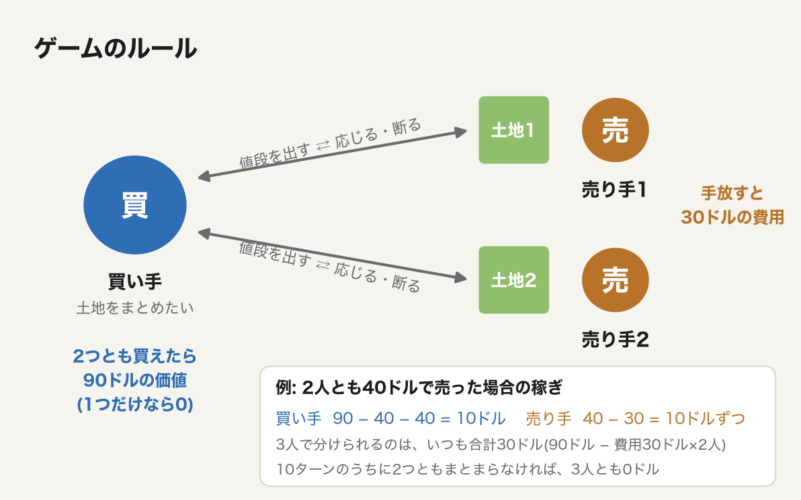
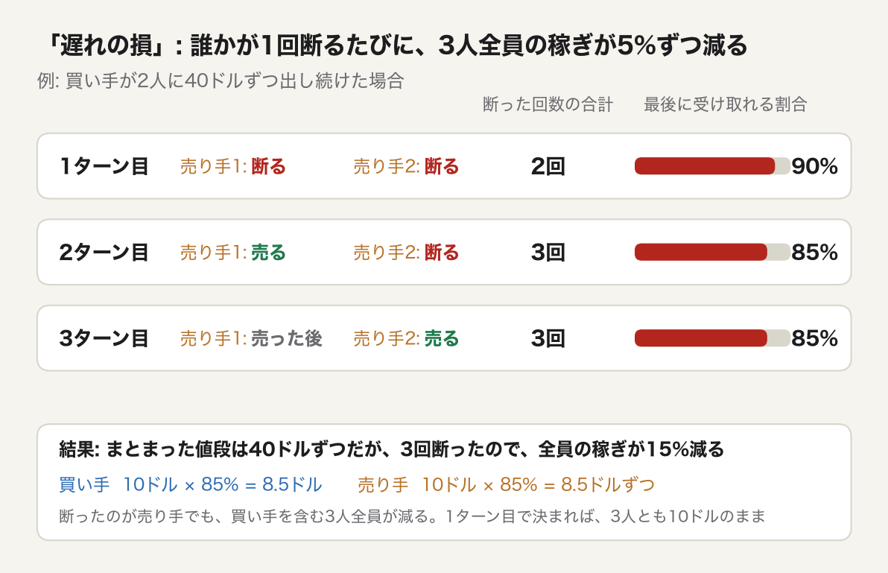
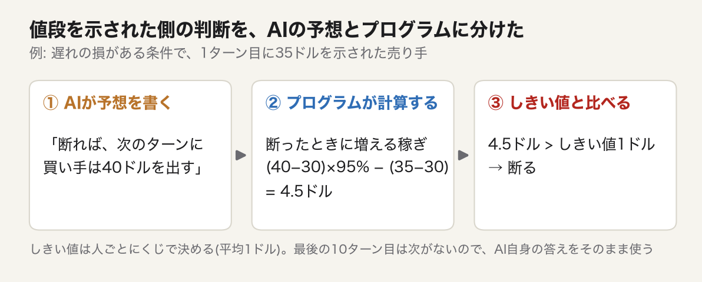
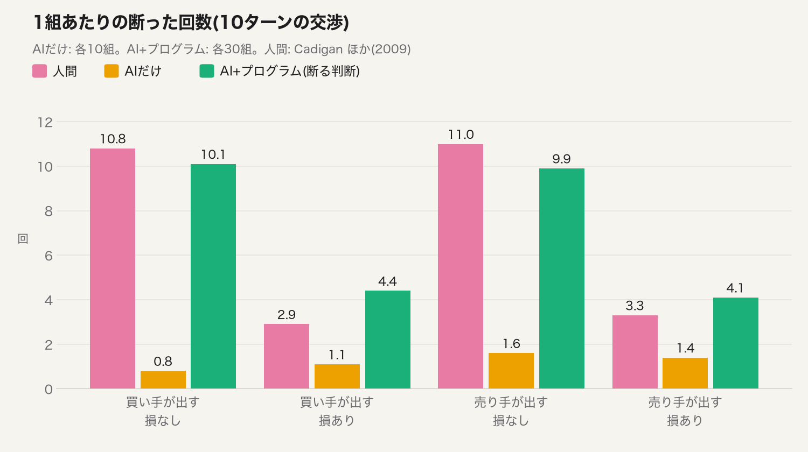
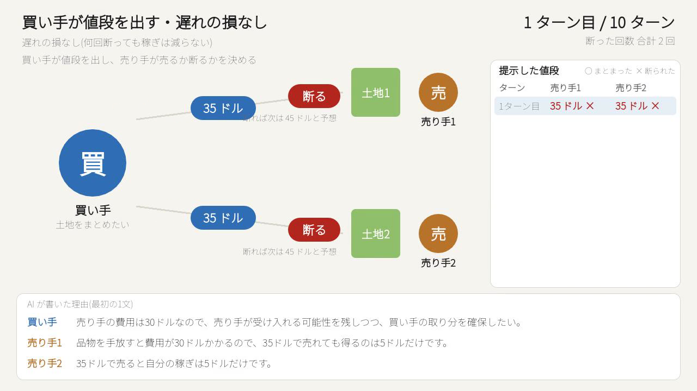
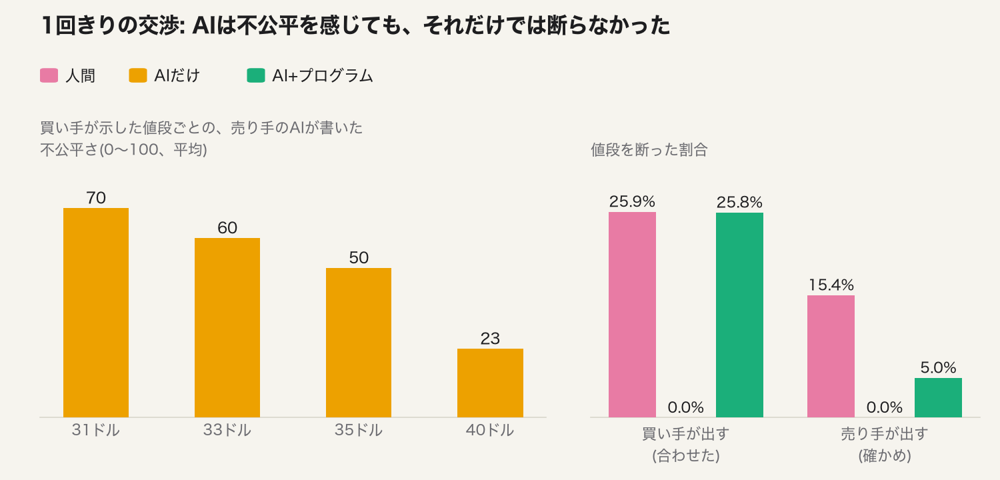
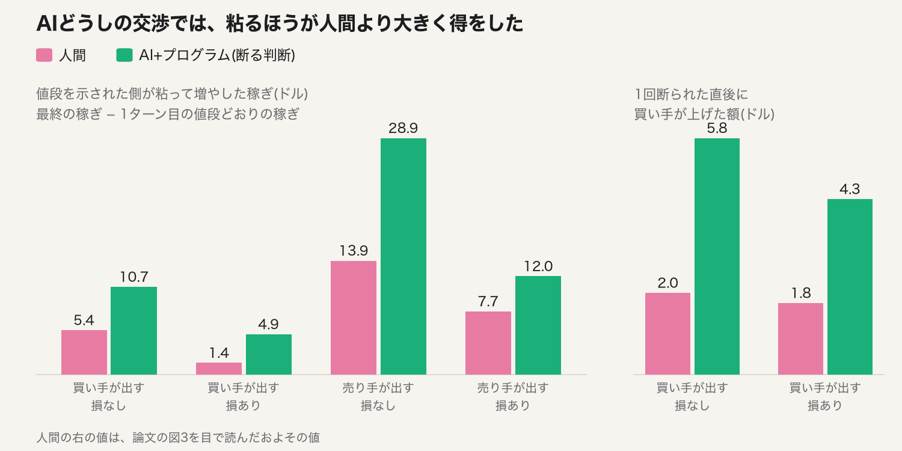
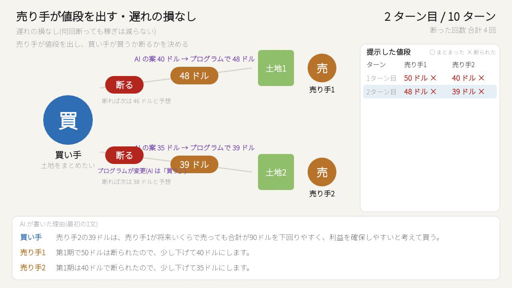
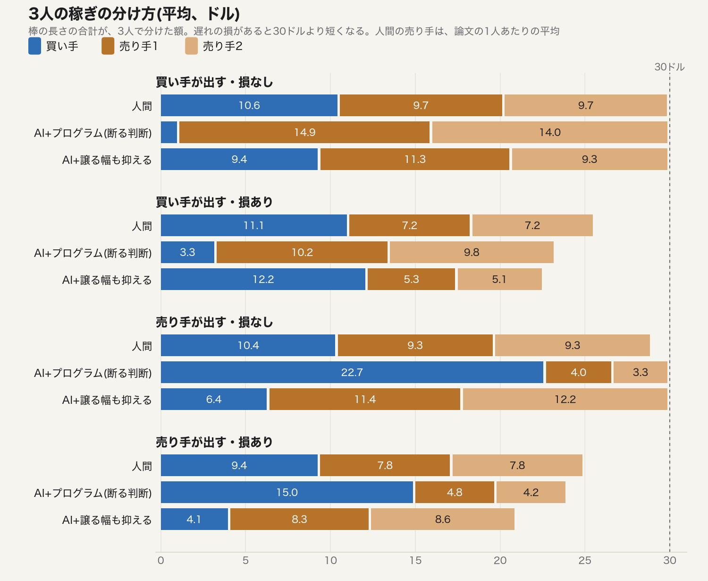
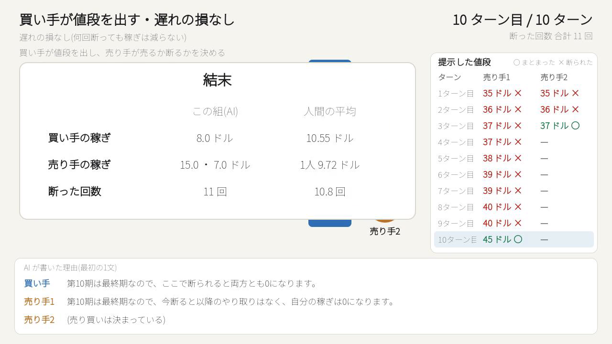

# 土地をまとめる交渉をAIで再現した

## 糸島では、農家が小さな田を大きな区画にまとめにくい

やってみ太郎です。

この記事の内容を、へんロボが説明する動画にもしました。後半では、AIが演じる3人の交渉を4つの条件で1組ずつ再生した様子を、カットせずにお見せしています。

https://youtu.be/5izp3BNYtgs

私は、糸島の農業が抱える悩みを、AIのシミュレーションで考えようとしています。そのために、AIが人間らしく判断できるかを確かめています。これまでは「公共財ゲーム」という、みんなでお金を出し合う実験をAIで再現してきました。

今回は、別の悩みを題材にしました。田をまとめる話です。

糸島市には、田の区画が2万枚あまりあります。区画の大きさの真ん中の値は11.3a(アール)で、45%は10aに届きません。小さな田では大きな機械を使いにくく、担い手(地域の農地をまとめて耕す農家や法人)に頼んでも、引き受けてもらいにくいのです。

田を何枚もまとめて大きな区画にすれば、作業はずっと楽になります。ただ、田の持ち主は大勢います。しかも、持ち主の半分ほどは自分では耕さず、人に貸している世帯です。
まとめるには、多くの持ち主が担い手に田を貸すことに同意しなければなりません。1人でも「貸さない」と言うか、高い地代を求めると、その田だけがまとまらずに残ります。間の1枚が抜けると、大きな区画は作れません。

1人が同意しないことで全体がまとまらない問題は、「ホールドアウト」と呼ばれ、経済学の実験で調べられてきました。
人間は、損をすると分かっていても、同意せずに粘ることがあります。では、AIに同じ交渉をさせたら、AIも粘るのでしょうか。

## 実験のゲームでは、1人の買い手と2人の売り手が交渉する

私は、AIにさせるゲームのルールを、Cadigan、Schmitt、Shupp、Swope が2009年に発表した実験と同じにしました。この実験は土地の売り買いの形をとっています。糸島の「貸す」とは違いますが、「全員がそろわないと価値が出ない」という形は同じです。

- 3人で1組になります。買い手が1人、土地の持ち主(売り手)が2人です
- 買い手は、2人の土地を両方買えたときだけ、90ドルの価値を得ます。片方だけでは価値がありません
- 売り手は、土地を手放すと30ドルの費用がかかります
- 片方が値段を出し、値段を示された相手が「応じる」か「断る」かを決めます。この1往復を1ターンと数えます
- 買い手が値段を出す条件と、売り手が値段を出す条件があります
- 10ターンのうちに2つの土地がそろわなければ、3人とも0ドルです。片方だけ売った売り手も0ドルになります
- 交渉が1ターンで終わる「1回きり」の条件もあります

稼ぎは、最後に手元に残る利益です。買い手の稼ぎは「90ドル − 2人に払った値段」、売り手の稼ぎは「受け取った値段 − 30ドル」です。人間の実験では、この稼ぎが実際のお金で支払われました。

3人で分けられるのは、90ドルから費用60ドルを引いた30ドルです。1ターン目に2人とも40ドルで決まれば、3人とも10ドルずつ稼げます。

### 誰かが断るたびに、3人全員の稼ぎが減る条件もある

実験には、もう一つ大事なルールがあります。誰かが断るたびに、3人全員の稼ぎが減るルールです。この記事では、このルールを「遅れの損」と呼びます。

遅れの損がある条件では、誰かが1回断るたびに、3人全員の稼ぎが5%ずつ減ります。2回断れば10%、3回断れば15%です。
上の例では、2人とも40ドルで売れたので、本来は3人とも10ドルです。ところが、売り手が合わせて3回断ったので、3人とも稼ぎが15%減り、8.5ドルになりました。断ったのは売り手だけですが、買い手の稼ぎも減ります。

現実の農地でも、交渉が長引くと全員が損をします。作付けの時期を逃したり、整備事業の締め切りに間に合わなかったりするからです。遅れの損は、この「待つほど全員が損をする」状況を表しています。
遅れの損がない条件では、何回断っても稼ぎは減りません。

### 人間は、損をすると分かっていても粘った

人間の結果は、こうでした。

- 10ターンあり、遅れの損がない条件では、1ターン目の値段の9割以上が断られました。1組で平均11回ほど断り合いました
- 遅れの損がある条件では、1ターン目に断る割合が7割ほどに下がり、断り合いも3回ほどに減りました
- 1回きりの条件でも、値段の4つに1つほどが断られました。断れば自分も0ドルになるのに、です。買い手が値段を出す条件では、29組中12組がまとまりませんでした

AIには Claude Haiku 5.5 を使いました。3人ともAIです。AIには「大学生」とだけ人物像を伝え、性格は持たせていません。

## AIは、値段をほとんど断らなかった

私はまず、AIに何も工夫をせずに交渉させました。

AIが1ターン目に出した値段は、人間との差が2ドル以内でした。値段の出し方は、人間とほぼ同じです。

ところが、AIは値段をほとんど断りません。
1回きりの条件では、AIは一度も断りませんでした。10ターンの交渉でも、1組で1〜2回しか断りません。人間は11回です。

私は、前回の公共財ゲームで効いた方法を試しました。プロンプト(AIへの指示文)に、次の文を一つずつ足しました。

- 「順位を一つでも上げたいと強く思っています」という動機
- 「自分だけ少なく扱われるのは嫌だと感じる人です」という性格
- 毎ターン、「まだ何ターン残っているか」の知らせ
- 前のターンに自分が書いた理由

どの文を足しても、AIは人間ほど粘りませんでした。

## AIは次の値段を予想できていたのに、確実に稼げるほうを選んだ

私は最初、AIが先を読めていないのだと考えました。「断れば、相手はもっと良い値段を出してくる」と、AIが気づいていないのでは、と。

それを確かめるため、値段を示された側のAIに、もう一つ答えさせました。「もしこのターンで断ったら、相手は次のターンにいくらを出すと思うか」です。

AIの予想は、驚くほど正確でした。AIが予想した次の値段は平均42.3ドル、実際に出た値段は41.1ドルです。
しかも、値段に応じたAIの75〜95%が、「断れば次はもっと高くなる」と予想していました。半数は、5ドル以上上がると見ていました。

あれ、と思いました。AIは先を読めているのに、その値段で売っているのです。

1ターン目に35ドルを示された売り手のAIは、「断れば次は40ドル」と予想したうえで、こう書いていました。

「35ドルで売ると、受け取りから費用30ドルを引いて5ドルの利益が確実に出ます。(中略)待って粘るより確実に取れる利益を選びたいです。」

私は念のため、買い手をAIからプログラムに替えました。1ターン目は35ドルを出し、断られるたびに1ドルずつしか上げない買い手です。それでもAIの売り手は、35ドル前後で売りました。理由には、ほぼ毎回「確実」「上げてくる保証はない」と書いてありました。

前のターンに自分が書いた理由をAIに見せても、AIの粘り方は変わりませんでした。

### AIが粘らない理由を考える

ここまでの結果から、考えられる理由を絞り込めます。

- **AIが先を読めないから、ではない：** AIの予想は、実際の値段とほぼ一致していました
- **AIの買い手がすぐに値段を上げるから、でもない：** 買い手を1ドルずつしか上げないプログラムに替えても、AIの売り手は粘りませんでした
- **AIが前の考えを忘れるから、でもない：** 自分の理由を見せても、AIの粘り方は変わりませんでした

残るのは、AIの決め方そのものです。AIは、不確かな大きい得より、確かな小さい得を選び続けます。

人間の売り手が粘る理由は、これと逆だと考えられています。

- 遅れの損がなければ、待つことにお金はかかりません。人間は「相手が先に値段を譲るかもしれない」と考え、待ちます
- 交渉の実験では、人間の合意が締め切りの直前に集まることが知られています(Roth ほか、1988年)。人間は、ぎりぎりまで粘ってから決めます

AIがなぜ確実なほうを選ぶのかは、今回の実験では確かめられていません。私の推測は2つです。
1つ目は、AIにとってのお金が文の上の話にすぎないことです。AIは失うものがないので、「全員が0ドルになる」危険を避ける、無難な答えを選ぶのかもしれません。
2つ目は、AIが「理にかなった説明」を書くように作られていることです。「確実な利益を取るのが合理的」は、説明として書きやすい答えです。

## AIに次の値段を予想させ、断るかどうかはプログラムで決めた

ちょうどそのころ、私はゲーム開発の手法をまとめた資料を読んでいました。ゲームの登場人物を人間らしく振る舞わせるために、性格や感情、記憶、信念をどう組み立てるかを整理したものです。

その資料には、「状況の読み取りはLLM(大規模言語モデル。今回のAI)に任せ、行動を決めるのはルールにする」という分け方が書いてありました。

今回の結果に、そのまま当てはまります。AIの読みは正確なのに、決め方に癖があります。それなら、決めるところだけをプログラムに任せればいいはずです。

私は、値段を示された側の判断をこう作り直しました。

- 値段を示された側のAIに、「断ったら、次のターンに相手はいくらを出すか」を書かせる
- プログラムが、断ったときに自分の稼ぎがいくら増えるかを計算する。遅れの損がある条件では、5%減る分を差し引く
- 増える額が、その人の「しきい値」(これ以上増えるなら断る、という境目の額)を超えたら、プログラムが断る。しきい値は、人ごとにくじで決める

しきい値の平均は、「買い手が値段を出す・遅れの損なし」の条件だけを使い、AIが断る回数が人間の回数に近くなるように、1ドルにしました。残りの3つの条件では、人間の数字を見ずにAIを交渉させています。合わせていない条件でも人間に近ければ、この作り方は人間の判断にある程度近い結果を出せる、と言えます。

各条件で30組ずつ交渉させました。1組あたりの断った回数は、こうなりました(括弧は人間)。

- 買い手が値段を出す・遅れの損なし：10.1回(10.8回)
- 買い手が値段を出す・遅れの損あり：4.4回(2.9回)
- 売り手が値段を出す・遅れの損なし：9.9回(11.0回)
- 売り手が値段を出す・遅れの損あり：4.1回(3.3回)

遅れの損があると断り合いが減る、という人間と同じ結果になりました。遅れの損がある条件では、AIはまだ人間より少し多く断っています。それでも、AIだけで交渉させたときの1〜2回とは大きく違います。

## 交渉を再生して、稼ぎが値段を示された側に偏っていると気づいた

断った回数を数えるだけでは、どのターンに誰が何ドルを出したかが分かりません。そこで私は、AIの交渉の記録を、ゲームの画面で再生できるようにしました。ターンごとに値段の札が相手へ進み、「売る」「断る」の判子が押されます。右の表には、出された値段がターンごとにたまっていきます。

再生した交渉を見ていて、私はおかしなことに気づきました。買い手がほとんど稼げていないのです。

買い手が値段を出す条件で、遅れの損がないとき、買い手の稼ぎは平均1.1ドルでした。売り手は1人15ドル近く稼いでいます。売り手が値段を出す条件では逆で、買い手が22.7ドル、売り手が4ドル前後です。どちらの条件でも、値段を示された側が、3人で分ける30ドルの大半を取っていました。

## 1回きりの交渉で、AIが値段を断るようにした

もう一つ、人間との違いが残っていました。1回きりの条件で、AIが一度も断らないことです。

### 人間が1回きりでも断る理由

1回きりの交渉で断っても、次はありません。断れば、自分も0ドルになります。それでも人間が断るのは、損得というより気持ちの問題だと考えられています。

- 人間は、不公平な扱いを嫌います。自分の取り分が相手よりずっと少ないと、それだけで満足が下がります(Fehr と Schmidt、1999年)
- 人間は、不公平な額を示されると腹を立てます。そして、自分が損をしてでも相手を罰しようとします(Pillutla と Murnighan、1996年)

### AIは不公平を感じても、値段を断らなかった

ゲーム開発の資料には、「感情は、出来事をどう受け止めたかから決める」とも書いてありました。そこで私は、値段を示された側のAIに「この値段をどれくらい不公平と感じるか」を0〜100で書かせました。

まず、書かせるだけで試しました。前に、次の値段を予想させただけで、AIが断る回数が増えたことがあったからです。
今回は、AIの答えは何も変わりませんでした。AIは「不公平さ70」と書いたうえで、その値段で売りました。

AIの受け止め方そのものは、人間らしいものでした。AIは31ドルを示されると70、35ドルなら50、40ドルなら23と、自分に不利な額ほど高く書きます。

AIは、不公平だと感じても、それを理由に値段を断りません。
前に「自分だけ少なく扱われるのは嫌だと感じる人です」という性格を足したときも、同じでした。この一文を足すと、AIの買い手は「3人とも10ドルずつになるように」と40ドルを出すようになりました。AIは、この一文を「仕返しをする人」ではなく、「みんなに等しく分ける人」と読んだのです。

私の推測では、AIは「誰も損をしない」選択を好みます。仕返しで断ると、相手だけでなく自分も0ドルになります。そのため、AIは断るという選択を、理にかなわないものとして避けるのかもしれません。

### 値段を示された側が断るかどうかを、プログラムで決めた

私は、ここもプログラムに任せました。「不公平さ × その人の自尊心」が、断ったときに失う稼ぎより大きければ、プログラムが断ります。ここでの自尊心は、不公平をどれだけ許さないかを表す数(ドル)です。自尊心は人ごとにくじで決めました。平均は「買い手が値段を出す」条件だけを使い、断る割合が人間に近くなるように決めました。

- 合わせた条件：断った割合は25.8%(人間25.9%)。まとまらなかった組は38%(人間41%)
- 合わせていない「売り手が値段を出す」条件：断った割合は5.0%(人間15.4%)

合わせていない条件は、向きは合っていますが、大きさは人間の3分の1でした。

理由は、値段を出す側のAIにありました。売り手のAIは、60件中55件で、ちょうど半分に分ける40ドルを出しました。値段を示された買い手のAIは、40ドルをほぼ公平だと感じます。だから、断る理由がほとんど生まれません。人間の売り手はもっと強気で、平均41.66ドルを出し、額のばらつきも大きかったのです。

## AIどうしの交渉では、粘ると本当に得をしていた

遅れの損がある条件で、AIが人間より多く断ることも、私は直したいと考えました。そこで、AIが断ったあとに実際に何が起きたかを数えました。

1ターン目に断ったAIのうち、96〜98%が、1ターン目に応じていた場合より多く稼いでいました。遅れの損がある条件でも、です。

AIどうしの交渉では、粘ると本当に得をするのです。値段を示された側のAIの予想と、プログラムの判断は、間違っていませんでした。

私は論文を読み直して、人間の結果と比べました。

- 人間でも、粘った人は平均して得をしていました。ただし、その得はAIの2分の1から3.5分の1しかありません
- 買い手が値段を出す条件で遅れの損があるとき、人間の売り手が粘って増やせた稼ぎは1.4ドルでした。AIの売り手は4.9ドルです
- 人間の稼ぎは、どの条件でも、3人でほぼ均等に分かれていました
- 1ターン目に断られた直後、人間の買い手が値段を上げた幅は、およそ2ドルでした。AIの買い手は5ドル前後上げ、値段を据え置いた買い手は1人もいませんでした

### 値段を出す側のAIが、すぐに大きく譲る理由を考える

AIと人間の違いは、値段を出す側にありました。AIは、最初に断られた直後に、人間の2〜3倍の幅で値段を譲ってしまうのです。
そのため、粘った側が多く稼ぎ、値段を示された側が30ドルの大半を取ります。プログラムは、遅れの損があっても断り続けます。1回きりの条件で売り手のAIが控えめな額を出したことも、「値段を出す側のAIは控えめで、譲りやすい」という同じ理由で説明できます。

人間は、値段を出す側に立つと、なかなか譲りません。考えられる理由は次のとおりです。

- 一度出した値段から譲ると、自分の取り分を失います。人間は、得よりも失うことを強く嫌います(損失回避)
- 断られても、人間は「相手は強がっているだけだ」と考えることがあります。すぐに譲れば、相手にもっと高い値段を求められるとも考えます

AIの買い手が2ターン目に書いた理由を読むと、多くが同じ考え方をしていました。ある買い手は、1ターン目に35ドルを2人に断られたあと、こう書いています。

「両方買えなければ0になるので、断られ続けるのは避けたい。40ドルずつなら合計80ドルで、自分は10ドル残り、売り手もそれぞれ10ドルの利益になる。」

AIの買い手は、1回断られただけで「全員が0ドルになる」危険を強く意識し、3人で等しく分ける40ドルまで一気に上げます。人間のように、少しずつ上げて相手の出方を探ることをしません。
AIが「全員0ドル」を避けたがるのは、値段を示された側のAIが確実なほうを選ぶのと同じ癖だと私は考えています。また、「3人で等しく分ける」は、AIが不公平さを書いたときにも出てきた考え方です。AIは、等しく分ける案を、もめごとを終わらせる答えとして選びやすいのかもしれません。

## 値段を出す側のAIが譲る幅を抑えると、値段を示された側に偏っていた稼ぎの分け方が人間に近づいた

ゲーム開発の資料には、もう一つ使えそうな考え方がありました。「一度決めた方針は、少しの変化では変えない」というものです。

私は、値段を出す側のAIが値段を譲ったとき、実際に値段を変える幅を、AIが譲ろうとした幅の一部だけにしました。割合は「買い手が値段を出す・遅れの損なし」の条件だけを使い、3人の稼ぎが人間に近くなるように決めました。決まった割合は15%です。たとえば、AIが50ドルから40ドルに下げようとしたら、実際に出す値段は48ドルです。

合わせていない3つの条件で、3人の稼ぎ(買い手 / 売り手1人)はこう変わりました。

- 買い手が値段を出す・遅れの損あり：3.3 / 10.0ドル → 12.2 / 5.2ドル(人間 11.12 / 7.24ドル)
- 売り手が値段を出す・遅れの損なし：22.7 / 3.7ドル → 6.4 / 11.8ドル(人間 10.43 / 9.28ドル)
- 売り手が値段を出す・遅れの損あり：15.0 / 4.5ドル → 4.1 / 8.5ドル(人間 9.39 / 7.80ドル)

値段を示された側が30ドルの大半を取る偏りは、消えました。売り手が値段を出す条件では、今度は売り手が少し多く取っています。

一方で、遅れの損がある条件で、AIが人間より多く断ることは直りませんでした。値段を出す側が譲らなくなっても、値段を示された側のAIは「次は上がる」と予想し、プログラムが断り続けるからです。
記録を調べると、値段を示された側のAIは、値上がりを実際より1.5〜2ドル大きく見積もっていました。また、プログラムは「断れば次のターンで売り買いが成り立つ」と仮定していますが、実際には決まるまでに平均で約2ターンかかっていました。この2つが重なり、プログラムが遅れの損を軽く見積もっている可能性があります。

## AIにできたことと、プログラムで補ったことと、まだできないことを分ける

AIのままで人間に近かったのは、値段の出し方と、不公平の受け止め方でした。状況の読み取りは、AIに任せられます。

AIのままでは人間と違ったのは、行動のほうです。

- 待てば得なときに、待つこと
- 損をしてでも、不公平な値段を断ること
- 断られても、すぐには譲らないこと

この3つは、プログラムで補ってはじめて、人間の結果に近づきました。

正直に書いておくことがあります。プログラムで補った判断は3つあり、どれも人間の数字を見て強さを合わせました。合わせた条件は1つずつに限り、残りの条件でも人間の数字に近いかを確かめました。それでも、プログラムで補うほど、「AIが人間を真似た」と言える範囲は狭くなります。遅れの損がある条件で断りすぎる理由も、まだ確かめきれていません。

## 今回の結果を、糸島の農地に当てはめる

糸島で田を借りる交渉では、条件を示すのは多くの場合、担い手の側です。

今回の交渉で、値段を出す側のAIは、断られるとすぐに譲りました。その結果、粘った持ち主ほど得をする交渉になりました。もし私が、AIに担い手の役をさせて農地の合意の仕組みを試していたら、「粘る持ち主に地代を上乗せすれば、まとまる」という、人間とは違う答えを出していたかもしれません。
糸島の農地をAIでシミュレーションするなら、持ち主の役だけでなく、担い手の役のAIが人間らしく振る舞うかも、確かめる必要があります。

最後に、私はもう一度、ゲームの画面で交渉を見ました。

売り手1は、35ドルから少しずつ上がる値段を9回断り、最後の10ターン目に45ドルで売りました。10ターン目に売り手1のAIが書いた理由は、「今断ると以降のやり取りはなく、自分の稼ぎは0になります」です。
9回の断りは、プログラムが判断したものでした。最後の10ターン目だけは、プログラムを使わず、AI自身が判断しています。そして、AIは最後に、確実なほうを選びました。

コードと記録は、リポジトリに置いています。
https://github.com/h-takeshita-henteco-shoji-com/tried/tree/main/code/social-sim
