# 米と野菜の値段を、AIと統計のモデルで予測した

## 米の値段は、この先どうなるのか

やってみ太郎です。

私は、福岡県糸島市の農業が抱える悩みを、AIのシミュレーションで考えています。きっかけは、JA糸島を取材した記事でした。記事によると、糸島の農家は米と麦を同じ田で作っています(二毛作)。その米の値段が、作るのにかかる費用を下回っていました。

米の値段は、ここ数年で大きく動きました。農林水産省が毎月公表している「米の相対取引価格」は、産地の団体などが卸売業者に米を売った値段です。その全銘柄の平均は、玄米60kgあたりで次のように動きました。

- 2023年産: 15,495円
- 2024年産: 25,825円
- 2025年産: 34,362円
- 2026年産(9月と10月の平均): 21,364円

2年で2倍以上に上がり、そのあと1年で4割近く下がりました。農家にとっては、来年の値段の見込みがそのまま、来年の収入の見込みになります。

そこで今回は、米の値段を予測できるかを試しました。過去の値段の動きから先を予測する方法を「時系列分析」と呼びます。あわせて、AI(Claude)にも同じデータを渡して、予測させてみました。

## 8つの方法で予測した

予測には、性質の違う8つの方法を使いました。どの方法にも、ある時点までの値段の表を渡し、その先の値段を当てさせます。比べるときは、どの方法にも同じ値段の表を渡しました。

### 何も工夫しない予想(比べるための基準)

- **前の月のまま**: 最後の月の値段が、この先も続くと考えます
- **前の年の同じ月**: 去年の同じ月と同じ値段になると考えます

どちらも計算は要りません。工夫した方法がこれに勝てないなら、使う意味がありません。

### 昔からある統計のモデル

- **指数平滑法**: 最近の値段ほど重く見て、平均をとります。そこに、値段が上がっているか下がっているかの傾きと、毎年くり返す季節の動きを足して、先を延ばします
- **SARIMA**: 「今月の値段は、前の月や前の年の同じ月の値段と、どれくらい関係しているか」を、過去のデータから式にします。その式を使って、1か月ずつ先を計算します

どちらも何十年も使われてきた方法で、パソコンですぐに計算できます。

### IT企業が作った新しいモデル

- **Prophet(Meta)**: 値段の動きを、長い目で見た流れと、1年の中の季節の動きに分けて当てはめます。お店の売上のように、季節で動くデータ向けに作られました
- **TimesFM(Google)、Chronos(Amazon)**: 世の中のたくさんの時系列データ(電気の使用量、交通量、売上など)で、前もって学習したモデルです。米や野菜の値段で学習させなくても、渡した値段の並びを見て、そのまま先を予測します。文章を学習した生成AIの、数字の並び版のようなものです

### 生成AI(Claude)

Claude には、値段の表を文章として渡し、「この先の値段はいくらか」と聞きました。理由も書かせました。条件を2つ用意し、それぞれ何回か聞いて、答えの真ん中の値を使いました。

- 表だけを見て予測する
- 表に加えて、Claude が知っているニュースも使ってよい

米では、値段の表に加えて、在庫や作付けの量などの表も渡す条件を足しました。これは Claude だけの条件です。

### Claude も答えを知らない問題にした

Claude は、2026年6月までの出来事を学習しています。過去の年で試すと、答えを覚えているだけかもしれません。そこで、2026年6月より後の値段を当てる問題にしました。

- 米: 2026年8月末までの値段で、新米が出る2026年9・10月の値段を当てる
- 野菜: 2026年6月までの値段で、7・8・9月の値段を当てる

指示文と入力のファイルは、回す前に記録に書いて固定しました。答えを見てから指示を直すと、予測ではなく後付けになるからです。

## 米の値段は、どの方法でも当てられなかった

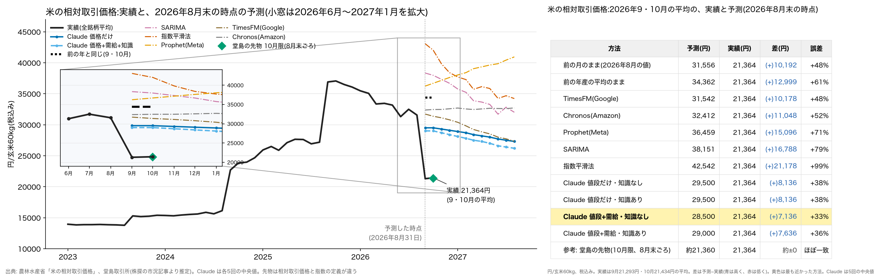

- 前の月のまま(8月の31,556円)と見込むと、48%高く外れました。前の年産の平均のままなら61%です
- 統計のモデルは5つとも、48〜99%高く外れました。TimesFM(+48%)と Chronos(+52%)は8月の値段をほぼそのまま延ばし、SARIMA・指数平滑法・Prophet は、2024〜2025年に上がった勢いを引き継いで、さらに高く予測しました
- Claude は28,500〜29,500円と予測し、33〜38%高く外れました

Claude は、どの統計のモデルより実績に近い値でした。ただ、理由を読むと、需給を読んだからではありませんでした。
Claude は、「年産の途中で値段が下がり続けた年は、次の9月が前の8月より安く始まる」という過去の例を挙げていました。そして、8月の値段から約10%下げていました。過去にあった下げ幅は、最大で9%ほどです。実際の下げ幅は約32%でした。

需給の表も渡した回では、Claude は「在庫が前の年より72万トン多い」ことを、一番の根拠に挙げました。それでも、下げ幅は過去の例と同じくらいにとどめました。

知識を使ってよいとした回では、Claude は次のことを知っていると書きました。

- 政権が代わったこと
- 2026年産の生産の目安が減らされたこと
- JA が農家に先に払うお金(概算金)が下がるという報道

それでも、予測は知識を使わない回とほとんど同じでした。

ほぼ当てていたのは、米の先物の市場でした。堂島取引所の米の指数の先物は、8月末ごろに10月の値段を約2万1千円台と見ていました。市場で売り買いする人たちは、概算金や集荷の動きなど、表にない情報を値段に織り込んでいたのだと思います。

米の値段は、毎月少しずつ動くわけではありません。新米が出る9月に段差がついて変わり、そのあとの1年はほぼ横ばいです。段差の大きさは、在庫や政策で決まります。過去の値段の動きだけを見る方法では、この段差を当てられませんでした。

## 野菜なら、時系列のモデルが働いた

米で全滅したので、私は別の作物でも試したくなりました。野菜です。

野菜には、毎年くり返す季節の動きがあります。たとえば、夏に安く冬に高い品目があります。値段も毎日つくので、データの量は米よりずっと多くなります。

最初に、東京都中央卸売市場のキャベツとたまねぎで試しました。2026年6月までの値段で、7・8・9月を当てる問題です。誤差は、多くの方法で6〜20%に収まりました。米の30〜99%とは、まるで違いました。Claude の誤差は13〜15%で、統計のモデルと同じくらいでした。

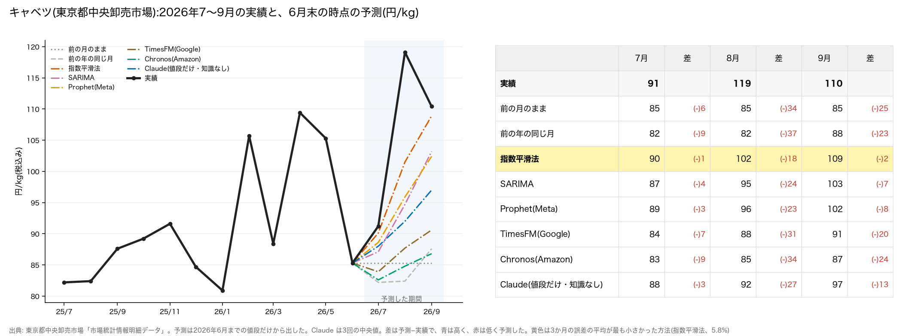

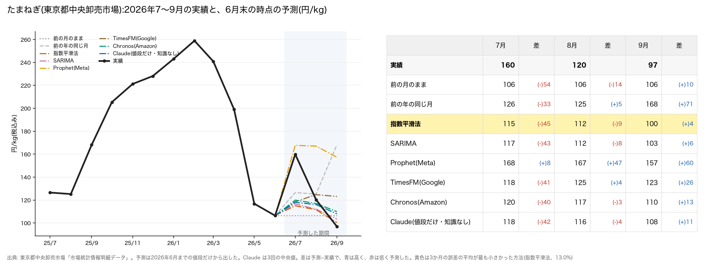

Claude には、値段に加えて入荷量の表も渡す回を試しました。それでも、誤差は値段だけの回とほとんど変わりませんでした。

## 福岡の市場で、12品目に広げた

糸島の話をするなら、東京ではなく福岡の市場で確かめたいと思いました。

福岡市中央卸売市場の年報を見つけたので、PDF の表から数字を取り出そうとしました。ところが、10年分のうち3年分は、PDF の文字の対応が崩れていました。数字は元に戻せましたが、品目名は戻せません。前後の年の並びから品目名を推し量ってみました。すると、たまねぎの1年の量が、ほかの年の30分の1になりました。この方法はあきらめました。

代わりに、農林水産省の「青果物卸売市場調査」を使いました。福岡市中央卸売市場の、品目ごと・月ごとの値段が、2010年から2025年まで Excel でそろっています。2026年の分は、同じ調査の毎日の速報を月ごとにまとめて作りました。

品目は、性質の違う12品目を選びました。

- 葉物: キャベツ、はくさい、レタス、こまつな
- ハウスで作ることが多い果菜: トマト、きゅうり、なす
- ブロッコリー、ねぎ
- 根菜や、貯蔵できるもの: にんじん、ばれいしょ、たまねぎ

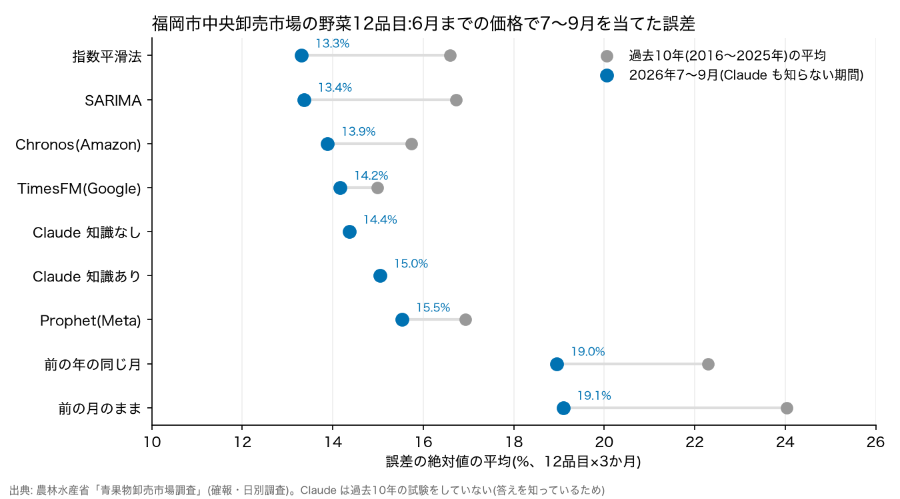

2026年7〜9月の誤差(12品目×3か月の平均)は、次のとおりでした。

- 統計のモデル: 13〜16%
- Claude: 14〜15%
- 前の月の値段のまま、前の年の同じ月の値段: 約19%

過去10年でも同じ問題を解かせました。すると、事前に学習したモデル(TimesFM、Chronos)が15%台で一番よく当たりました。Claude は過去の答えを知っているので、過去10年の問題には参加させていません。

品目ごとに、実績と予測の折れ線と、対比表を並べました。表で黄色にした行は、3か月の誤差の平均が一番小さかった方法です。一番の方法は品目ごとにばらばらで、6つの方法がどれかの品目で1位になりました。

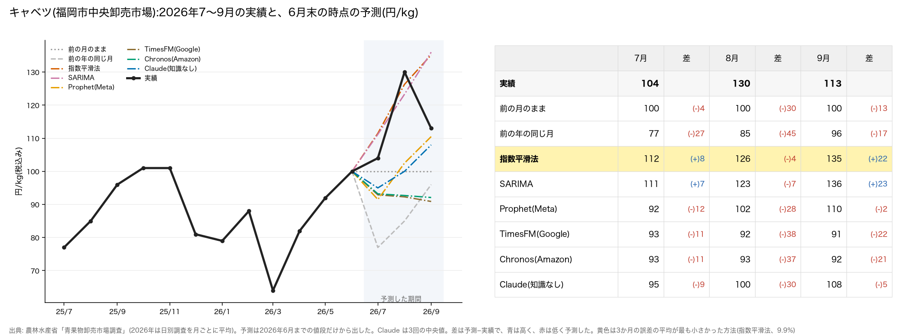

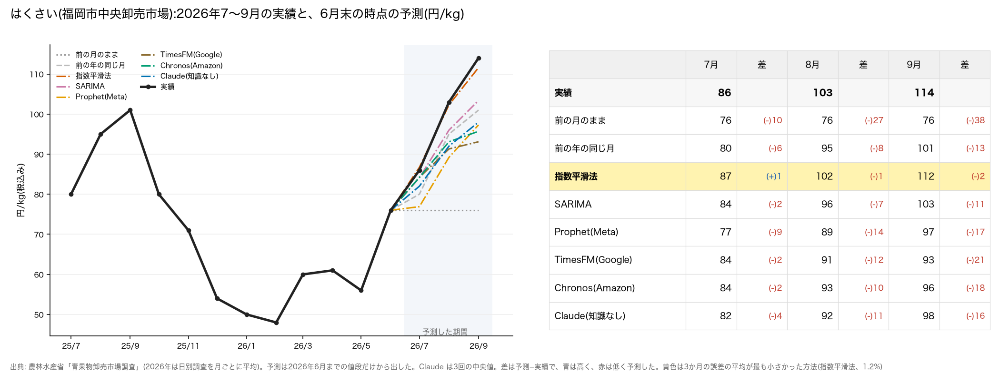

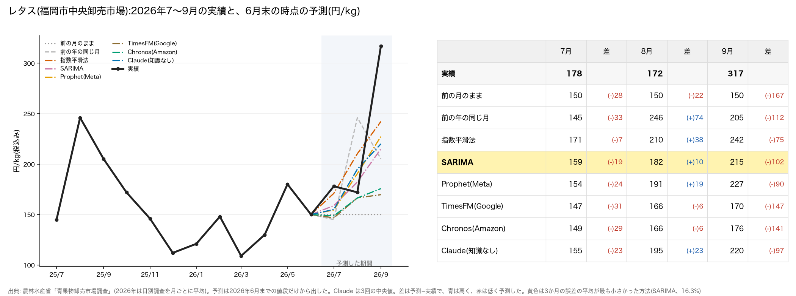

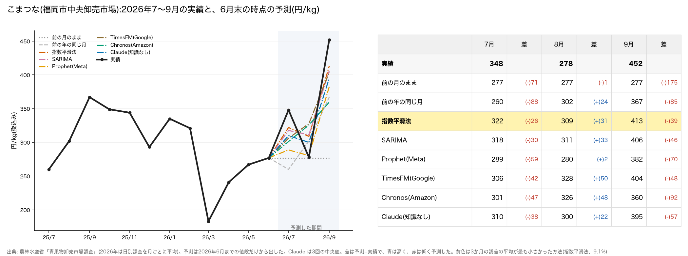

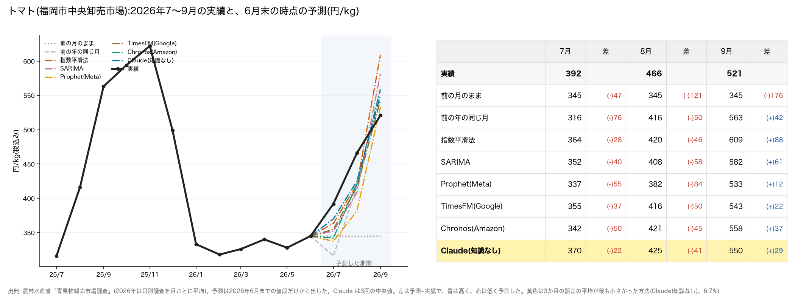

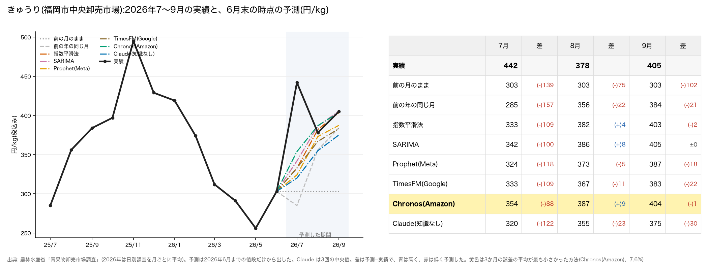

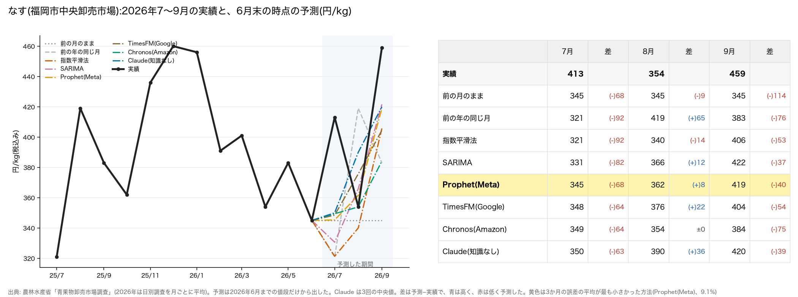

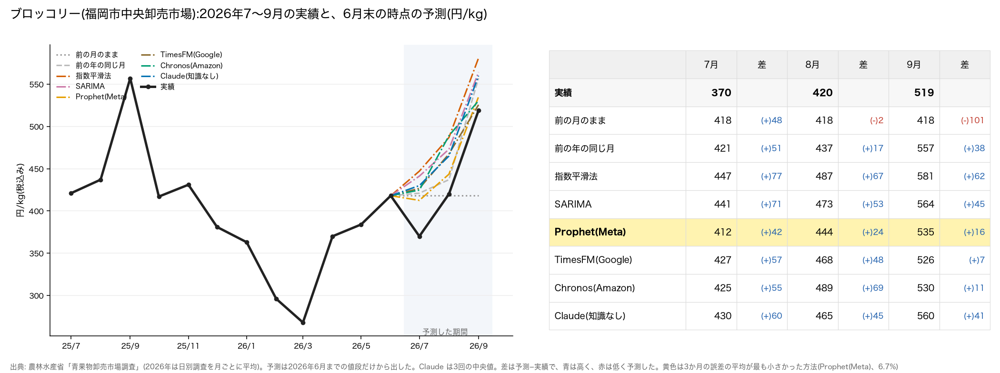

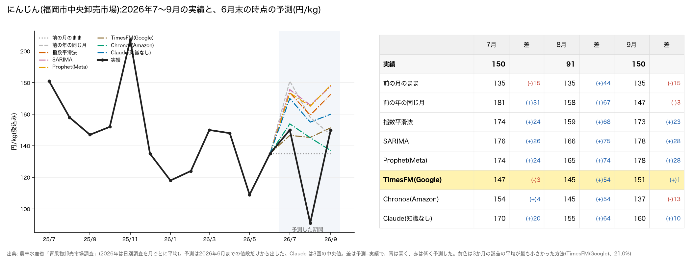

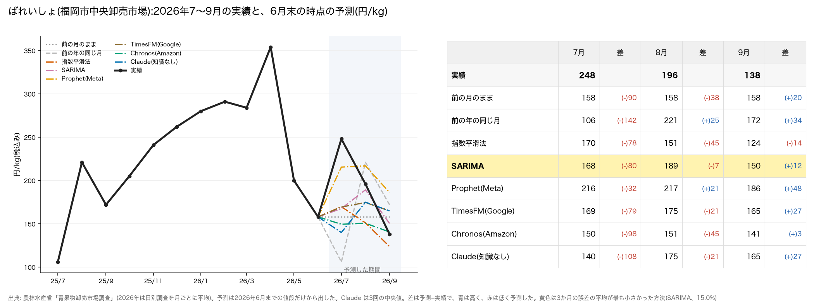

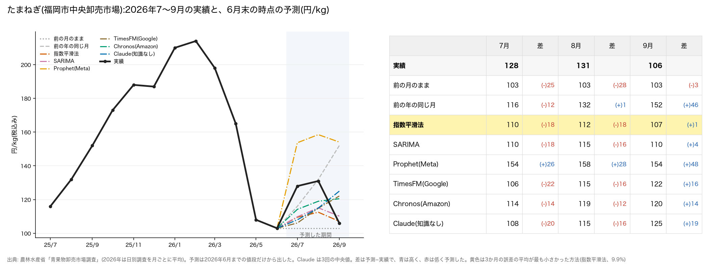

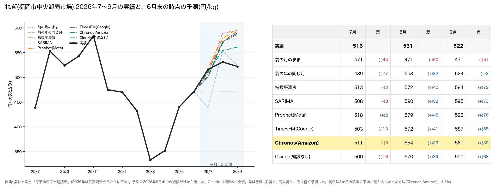

## 当たりやすさを決めていたのは、モデルではなく品目だった

結果を眺めていて、品目ごとの差が大きいことに気づきました。ねぎ、はくさい、なすは、多くの方法で誤差が10%前後でした。にんじん、ばれいしょ、レタスは20〜39%でした。

そこで、値段の動きのうち「毎年同じ月の平均で説明できる割合」を、品目ごとに計算しました。季節の形の強さを表す数字です。

- きゅうり、トマト、はくさい、こまつなは、季節の形が強い品目でした。統計のモデルは、「前の月のまま」より14〜22ポイント当たりました
- キャベツとたまねぎは、季節の形がほとんどありませんでした。産地が季節ごとに入れ替わったり、貯蔵したりするからだと思います。統計のモデルも、「前の月のまま」と変わりませんでした

時系列のモデルが当てていたのは、毎年くり返す季節の形でした。季節の形がない米で外れたのも、同じ理由で説明できます。

もう1つ分かったのは、方法どうしの差が小さいことです。過去10年で一番よく当たったモデルは、年ごとに入れ替わりました。Claude と指数平滑法の差も、偶然の範囲に収まりました。どのモデルが勝つかを前もって決められないなら、いくつかのモデルの平均を使うのが無難です。実際、統計のモデル4つの平均は、2026年にどの単独のモデルよりよく当たりました。

## Claude は、慎重な人間の予測者のように振る舞った

野菜での Claude の予測は、「前の年の同じ月の形を、いまの値段の水準に当てはめる」形に近いものでした。統計のモデルと同じことをしているので、成績も同じくらいになったのだと思います。

米でも野菜でも、知識を使ってよいとした回の予測は、使わない回とほとんど同じでした。Claude は、知っている事実を、予測の数字には反映しませんでした。

米の予測で、Claude は過去にあった下げ幅の範囲から出ませんでした。人間の予測者にも、過去の範囲に引きずられる癖(アンカリング)があると言われます。私が親テーマで確かめたいのは、「AIは人間らしい判断を模せるか」です。今回の Claude は、データを見て慎重に判断する人間の分析者に、よく似ていました。

## 農家と市役所にとって、何が言えるか

最後に、糸島の農家と市役所の立場から、結果を考えてみました。特定の政策を勧めるものではなく、結果から言える範囲です。

農家の経営から見ると、作物を2つに分けて考えられます。

- 季節の形が強い野菜は、3か月先の値段を誤差13〜15%ほどで見込めます。出荷の時期や作る量を考える材料になります。道具は、簡単なモデルをいくつか平均すれば十分でした
- 米と、季節の形が弱い野菜は、過去の値段から見込めません。値段を当てるより、外れたときの備え(収入保険、事前の契約、作物を分けることなど)が判断の中心になります。米の値段を早めに知る手がかりは、在庫、作付けの意向、JA の概算金、先物の値段といった、価格の外にあります

市役所の政策から見ても、同じ分け方ができます。

- 季節の形が強い野菜は、値段の見込みを、幅をつけて情報として出せます
- 米の値段を前提にした計画は、1つの値ではなく、幅で置く必要があります。2024年から2026年には、1年で67%上がり、次の1年で38%下がりました
- 予測の元になる統計は、国や市場が公開しています。一方、糸島の出荷量や直売所の販売量のような地域のデータは、公開されていません
- AIは、予測そのものより、報道や資料から数字を抜き出してまとめる役に向いていそうです。Claude は概算金が下がると知っていたのに、予測には使えなかったからです

ただし、今回の値段は卸売市場の値段で、農家の手取りではありません。2026年の問題も1年分だけです。

## 価格の表の外にあるもの

最後に、私はもう一度、米のグラフを見ました。

統計のモデルの線は、どれも2026年8月の値段より上か、そのあたりを通っています。Claude の線は、それより少し下を通っています。そのずっと下に、実績の黒い線と、先物の緑の点が重なっています。

先物の市場とAIの差は、賢さの差ではないと思います。持っていた情報の差です。そして Claude は、表の外の情報を知っていても、予測に使いませんでした。

次は、季節の形が弱い品目に、入荷量や産地の天候といった、価格の外の情報を足してみます。そうして、誤差がどこまで減るかを確かめるつもりです。

この記事にかかったAIの利用料は、合計で約2ドルでした。コードと記録は、リポジトリに置いています。
https://github.com/h-takeshita-henteco-shoji-com/tried/tree/main/code/rice-price
