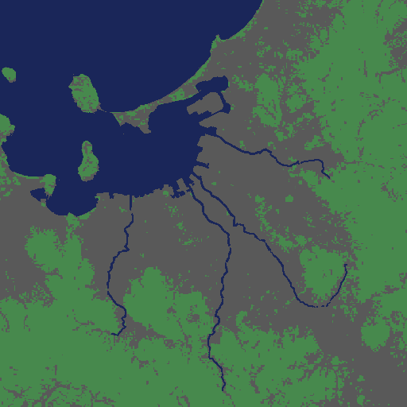

# 出発点のマップ(fukuoka-v2、fukuoka-v3)を作る手順

版: 2(2026-10-19、#77)。版1(2026-10-16、#73)で作った fukuoka-v2 の、高速の結び目を直して fukuoka-v3 にした。
直し方は、末尾の「fukuoka-v3 への直し(#77)」に書いた。

## 結論

高さマップを新しいマップに読み込み、川・高速道路・つなぎ口・森林を、Mod の窓口で順に置く。
途中で一度保存し、最後に「fukuoka-v2」として保存する。元の fukuoka は残す。

## なぜ作り直すか

- 骨格の JR と西鉄の線路に維持費がかかり、週の支出の大半を占めた。骨格から外した
- 川がなく、水と下水の施設を町から遠い海岸に置くしかなかった
- 九州自動車道は手で引いたもので、実際の位置と約300mずれていた。道路は下の地形を平らにするので、後から川を掘るとせき止められる
- 地図の外とのつなぎ口が道路しかなかった。森林もなかった

## 事前の準備(ゲーム不要。済み)

| 作るもの | スクリプト | 出力(`~/.cache/ai-mayor-dem/`) |
|---|---|---|
| 川の線と川底(4本) | `tools/river_line.py all` | `river_<名前>.json` |
| 九州自動車道の線と高さ | `tools/expressway_line.py` | `expressway_kyushu.json` |
| 船の航路 | `tools/ship_route.py` | `ship_route.json` |
| 森林のマス | `tools/forest_mask.py` | `forest_cells.json` |

## エディターでの手順

人の操作と、Claude のコマンドが交互になる。コマンドは `code/ai-mayor/tools/` で実行する。

1. (人)マップエディターで新しいマップを作り、高さマップ `fukuoka_h2_v050_o4.png` を読み込む
2. 川を掘り、水源を置いて、水を流す
   ```bash
   python3 river_trial.py carve all 64 32
   python3 river_trial.py source all 400 1.5 200
   python3 river_trial.py watch all 360
   ```
   - 確かめ: 4本とも途切れがほぼ0、あふれが河口(海の中)だけ
3. (人)一度保存する(例: fukuoka-v2-rivers)
4. 九州自動車道を引く。高さは data(データどおり)か all(ほぼ全線高架)
   ```bash
   python3 lay_expressway.py data
   ```
   - 確かめ: `editor_state` で道路のつなぎ口が入り2・出2(上りと下り)
5. 鉄道・船・飛行機のつなぎ口を置く
   ```bash
   python3 place_connections.py
   ```
   - 確かめ: 鉄道は入り3・出3、船と飛行機は入り1・出1
6. 森林を植える(川と高速道路の後。水と道路の上には植えないため)
   ```bash
   python3 plant_forest_cells.py
   ```
   - 確かめ: 木が約20万本、天然資源の森林が0でない
7. (人)「fukuoka-v2」として保存する

## 作ったときの記録(2026-10-16)

- 新しいマップに高さマップを読み込んだ直後は、海に水がなかった。時間を動かすと、地図の端から海の水が入った
- 川: 途切れは那珂川0、御笠川4、室見川0、多々良川0。あふれは0
- 九州自動車道は3回引き直した
  - 1回目: データの北の端の1区間が逆向きで、つなぎ口の線が地図を横切った(37.6km)。端の向きを約240m内側から測るよう直した
  - 2回目: つなぎ口の線の内側の点も地図の端から50m以内にあり、「外」の印が付いた(入り4・出4)。内側の点を60m以上離した
  - 3回目: 地図の端で上りと下りが寄り集まり、北の端のデータの折り返しで輪ができた。最初の6点を使わず、端の点を中心線から東西15mに置いて解いた
  - 結果: つなぎ口は入り2・出2。高架は19.3km、地上は16.6km(上りと下りの合計)。多々良川は高架でまたぎ、水の中に橋脚は立たなかった
- つなぎ口: 鉄道は入り3・出3、船は入り1・出1、飛行機は入り2・出2
- 森林: 約20万本を植えた。森林の値は、時間を動かしてから更新された(12,081,360。森林のマス100,760)



## その後(ゲーム)

1. (人)fukuoka-v2 から新しいゲームを始める
2. 区画81枚を解放する(`unlock_all_areas`)
3. (人)出発点として保存する

## fukuoka-v3 への直し(#77)

### 何が起きていたか

- fukuoka-v2 の九州自動車道は、福岡インター(3650, 2200 付近)で輪を描いていた。車がそこに集まった
- 原因は `expressway_line.py`。通る地点「福岡インター」を、本線ではなくランプの点に寄せていた。線がランプを回って本線に戻った
- 寄り道を消す処理は「同じ点を2度通ったとき」しか効かず、行きと帰りで別の点を通るこの輪は残った

### 直したこと

- `expressway_line.py`
  - 通る地点は、本線の幅の区間の点にだけ寄せる
  - 線に沿って150m以上進んだのに、40m以内に戻ってきた寄り道も消す
  - 直した後は、全線で25度を超える折れ曲がりがない。変わったのは福岡インター付近の5点だけ
- マップ: 全線は引き直さず、結び目の約250mだけを引き直した(`tools/patch_expressway.py`)
  - 全線を引き直すと、川や森との位置合わせをやり直すことになるため
  - 古い中心線の149番と159番の点は残し、その間を新しい中心線の点で引いた
  - 古い中心線は `~/.cache/ai-mayor-dem/expressway_kyushu.before-77.json` に残した

### 手順

1. (人)マップエディターで fukuoka-v2 を開く
2. 結び目を引き直す
   ```bash
   python3 patch_expressway.py plan   # 消す線と引く線を見る
   python3 patch_expressway.py apply
   ```
   - 確かめ: 上り下りとも、消した区間10・引いた区間6・既存の点につないだ端2。つなぎ口は入り2・出2のまま
3. (人)「fukuoka-v3」として保存する。fukuoka-v2 は残す
4. (人)fukuoka-v3 から新しいゲームを始める
5. 区画81枚を解放し(`unlock_all_areas`)、`save_city` で「fukuoka-v3-start」として保存する

これから新しくマップを作るときは、直した `expressway_line.py` と `lay_expressway.py` で引けば、結び目はできない。

## まだ確かめていないこと

- 船の航路と飛行機の経路で、港と空港が使えるか
- 新しいゲームで、川の水が保たれ、車が橋を渡れるか

## 出典

- 国土地理院 標高タイル(基盤地図情報 数値標高モデル DEM10B)
- 国土地理院ベクトルタイル(河川中心線、道路中心線)
- 国土数値情報(土地利用細分メッシュデータ、令和3年度)。利用条件は国土情報利用約款による(中身は未確認)
