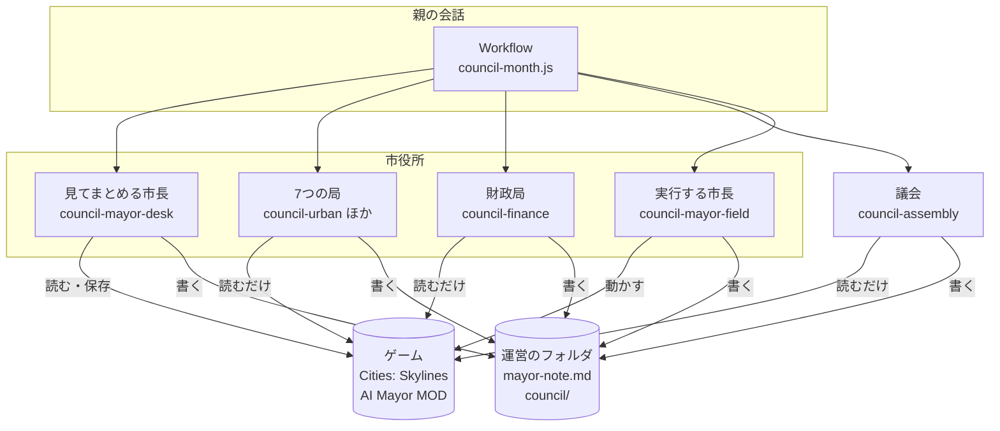
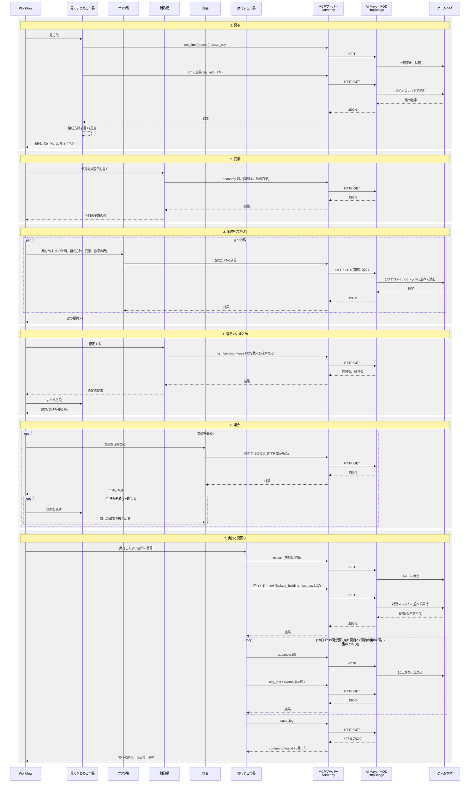

# 市役所と議会のハーネス 設計書

## 0. この文書について

- 目的: 市役所と議会を模したハーネス(AIを動かすための枠組み)を作るため、仕組みと作りを1か所に決める
- 読む人: このハーネスを作る人と、運営の結果を読む人
- 位置づけ: 判断の型(`protocol.md`)、比べ方(`compare.md`)、採点表(`scorecard.md`)の上に乗る。この3つと食い違ったら、この3つを優先する
- 版の決まり: 試運転(12の9)を終えるまでは案(0.x)。本番を始めるときに 1.0 にし、本番が終わるまで変えない(12の「固めるもの」)

### 用語

| 用語 | 意味 |
|---|---|
| ハーネス | AIを動かすための枠組み。ここでは、局・財政局・市長・議会の5種類のAIと、それを順に呼ぶスクリプトの全体 |
| サブエージェント | Claude Code の中で、親の会話から呼ばれて1つの仕事をするAI。定義は `.claude/agents/` に置く |
| Workflow | サブエージェントを決まった順に呼ぶスクリプトを動かす、Claude Code の道具 |
| 月例 | 1か月に1回の重い判断(`protocol.md` の1) |
| 見回り・臨時 | 10日ごとの軽い確かめと、その結果で行う手当て(`protocol.md` の1) |
| 施策 | 1つの目的のための操作のまとまり(`protocol.md` の3) |
| 議案 | 議決が要る施策(4.4) |
| 査定調書 | 財政局が、局の案それぞれに可・減額・不可を付けた書類 |

## 1. 目的

### 1.1 確かめたい問い

実際の市の計画と仕組みを写したAIの市役所は、1人のAI市長より偏らない街を作れるか。

- 計画: 第10次福岡市基本計画と政策推進プランを、ゲームの数字に置き換えた「市の計画」(3.5)
- 仕組み: 福岡市の局の分け方、予算の決め方、議会の権限

### 1.2 背景

4人の市長(#89 基準、#90 お金、#91 人口、#93 住みやす)を、同じ10万人の福岡で12か月ずつ運営しました。

- 1つの数字を追う市長は、その数字で4人の一番になり、捨てた数字で一番悪くなった
- 「捨てるもの」は、AIにとって「壊してよい」という許可として働いた。住みやす市長は工場約130棟と貨物港を壊した
- 壊した港を、品物のためにもう一度建てようとして失敗した。戻せない手がいちばん高くついた
- 性格のない基準の市長は、税にも予算にも1年間触れなかった

### 1.3 方針

- 実際の市の仕組みに寄せる。福岡市の局の分け方、予算の決め方(福岡市予算及び決算規則)、議会の権限を元にする
- 市長は「計画の市長」にする。性格と公約は基準の市長と同じにし、市の計画を読んで、毎月の予算の編成方針で局に重点を示す(3.3)
- 比べる相手は、新しい道具を持って同じ出発点から走らせ直した基準の市長。1年後のゲームの数字で比べる(10)。差がハーネスのおかげか、計画のおかげかは分けない
- 誰も「捨てるもの」を持たない。偏りは、仕組みで減るかを見る
- 決まりは、指示より道具の制限で守らせる。指示だけでは、AIは決まった確認を省きがち(CivBench)

### 1.4 範囲

- 含む: 登場するAIの役目、1か月の流れ、受け渡しの形、サブエージェントの定義、Workflow のスクリプト、確かめのスクリプト、判定のしかた
- 含む: MOD(`src/`、`mcp/`)に足す、読むだけの道具1つ(6.7)
- 含まない: そのほかの MOD の変更

## 2. 全体の構成

### 2.1 構成図



- 親の会話は Workflow を1回呼ぶだけ。1回で1か月を運営する
- 街を動かせるのは、実行する市長だけ(6.2)
- 役どうしは直接話さない。運営のフォルダのファイルと、Workflow への返り値で受け渡す(7)

### 2.2 登場するAI

| AI | 数 | 役目 | 街を動かすか |
|---|---|---|---|
| 局 | 7 | 担当の数字のために、案を1件まで出す | 動かさない |
| 財政局 | 1 | 予算編成要領(今月の枠)を書き、局の案を費用と型の上限で査定する | 動かさない |
| 見てまとめる市長 | 1 | 街を見て編成方針を書き、査定を経た案から施策を3件まで選ぶ | 動かさない(保存と画面の操作だけ) |
| 議会 | 1 | 議案を4つの点で確かめ、可決か否決を出す | 動かさない |
| 実行する市長 | 1 | 選ばれた施策を実行し、見回りと臨時をする | 動かす |

## 3. 登場するAIの仕様

### 3.1 局

#### なぜ局に分けるか

1人の市長では、どの数字を先に追うかを1つの性格で決めるしかありません。
仕事ごとに担当を分ければ、どの数字も誰かが代弁します。

#### 局の一覧

福岡市の組織(2026-04-01)の局を元にします。政令指定都市なので、市長の下は「課」ではなく「局」です。
ゲームで扱える仕事を持つ局は11あります。そのままでは市長が月に打てる3件に対して案が多すぎるので、仕事の近い局をまとめて8つにしました。

| 局 | 英字の名前 | 元の局 | 担当の仕事 | 担当の数字 | 先に見る道具 |
|---|---|---|---|---|---|
| 財政局 | `finance` | 財政局 | 査定、税、融資 | 週の収支、所持金 | `economy`、`economy_breakdown`、`list_loans` |
| 住宅都市みどり局 | `urban` | 住宅都市みどり局 | 区画、地区、公園と木 | 人口、住宅の需要、地価 | `demand_breakdown`、`land_value`、`zone_map` |
| 道路下水道局 | `roads` | 道路下水道局、水道局 | 道路、交差点、上下水道、電気 | 交通の流れ、電気・水・下水が来ない市民 | `traffic`、`junction_info`、`citizens_without_service` |
| 港湾空港局 | `port` | 港湾空港局、交通局 | 貨物港、空港、地下鉄、バス | 港の前で止まった荷物の車、公共交通の路線 | `cargo`、`trade`、`list_transport_lines` |
| 経済観光文化局 | `economy` | 経済観光文化局、農林水産局 | 工場、店、事務所、特産の産業 | 働き口、品物がない店、原料がない工場 | `demand_breakdown`、`cargo`、`building_stats` |
| 保健環境局 | `health` | 保健医療局、環境局 | 病院、墓地と火葬場、ごみ、汚染と騒音 | 健康の平均、体調の悪い市民、困りごとの印(ごみ、汚染、騒音、死体) | `citizens_summary`、`complaints` |
| 教育委員会 | `education` | 教育委員会 | 学校 | 学校の定員と、子ども・10代の数 | `services`、`citizens_summary` |
| 消防局 | `fire` | 消防局 | 消防署、警察署 | 火事と犯罪の印 | `complaints`、`events` |

- 財政局は案を出さず、査定する(3.2)。案を出すのは残りの7つ
- 採点の6項目(人口、財政、暮らしの基盤、健康、教育、交通)は、どれもいずれかの局が担当する
- 幸福度はどの局も担当しない。いくつもの局の仕事が重なって決まる数字のため。議会が響きの書き落としとして拾う(3.4)
- 入れなかった局: 総務企画局、市民局、こども未来局、福祉局、区役所。ゲームに対応する操作がないため

#### 現実とゲームのずれ

ゲームでは市の仕事でも、福岡市では市の仕事ではないものがあります。近い局に預けます。

- 電気: 九州電力の仕事。道路下水道局に預ける
- バス: 民間の西鉄の仕事。市営は地下鉄だけ。港湾空港局(元の交通局)に預ける
- 警察: 福岡県警の仕事。消防局に預ける
- 教育委員会: 市長から独立した組織。ここでは、ほかの局と同じく市長に案を出す

#### 局の決まり

- 受け取るもの: 市の計画(3.5)、市長の編成方針と財政局の予算編成要領(4.1)、今月の数字の表、前の月の施策と議決。前の月の自分の案がどうなったかは、台帳(9.4)の自分の局の行を読む
- 案は1件まで。当月の担当課題から毎月選び直す
- 前月に非採択だった案も、当月に有効なら再提出する。非採択や状況が変わらないことだけを案なしの理由にしない
- 他局の優先順位や、採用されそうかどうかは市長の判断とする
- 案なしなら、検討した候補と当月の根拠を書く。有効な手段なし、実行条件未確認、上限超過、情報取得失敗を区別する
- 効果の量を見積もれなくても、有効性の見込みと確認方法があれば提案できる
- 自分のサービスの予算を増やす・減らす案も出してよい。福岡市の予算要求にあたる
- 担当の数字を代弁する。そのうえで、編成方針の重点と、市の計画のどの施策に当たるかを書く
- 担当の問題に最も効く案を、費用と操作の上限の範囲で選ぶ
- 政策を見落とさないよう、各局は提案前に `list_policies` を必ず呼ぶ。政策名、有効状態、週の費用を確認する
- 担当に関係する政策の有効化・解除を、建設や運用、予算、税の変更と比較する。政策案を必ず出す決まりにはしない
- 取得結果は「見たもの」に記録する。取得できなければ既存の失敗時の決まりに従い、未確認と書く
- 政策一覧にゲームの効果の説明は追加しない。確認した事実と、局が立てる効果の予想は分けて記録する
- 局ごとの立場を保つため、他局への影響評価は市長に任せる。他局への配慮を理由に、案を控えたり弱めたりしない
- ほかの局の案を読まない
- 操作の制限と、取り壊し前の確認は守る。担当外への影響を踏まえた採否は、市長が判断する

### 3.2 財政局

#### なぜ査定役にするか

福岡市では、各局の見積書は市長に直接届きません。財政局長が審査し、局と調整し、査定の書類を市長に出します。
費用の確かめを財政局に任せると、議会は費用以外の点に絞れます。

#### 財政局の決まり

- 案の前に、予算編成要領を書く。中身は今月の予算の枠(建設費の上限、維持費を増やせる幅、税と予算を動かせる幅)。福岡市でも、財政局長が編成方針に沿って要領を作り、各局に伝える
- 7つの案それぞれに「可」「減額」「不可」を付ける
- 査定は、費用と型の上限だけで行う。案の中身のよしあしは見ない。見ると、お金の立場の局になるため
- 上限は `protocol.md` の3のとおり。建設費は所持金の半分まで、維持費の増え分は黒字の範囲、税は±2、予算は±20
- 案を1つずつ見ればすべて「可」でも、合わせると上限を超えることがある。そのときは合わせた額を書き、市長が選ぶときの上限を示す
- 税を変える案は、査定調書に添えて1件まで出せる。福岡市でも税務は財政局の仕事のため

### 3.3 市長

#### なぜ計画の市長にするか

福岡市の局は、市長の予算の編成方針と、その上にある基本計画・政策推進プランの下で仕事をします。
実際の流れを写すため、市長が市の計画を読み、毎月の編成方針で局に重点を示します。

- 定義は `mayors/plan.md`(計画の市長)
- 性格と公約は、基準の市長(`mayors/base.md`)と同じにする(人が決めた)。性格なし。公約は、人口を毎月増やす、電気・水・下水が来ない市民をなくす、赤字を続けない
- 基準の市長と違うのは、市の計画を読むことと、編成方針を書くことだけ。走らせ直した基準の市長(10.2)との差が、ハーネスと市の計画から来るようにするため
- 「捨てるもの」は持たない

#### 編成方針

見る段の終わりに、市長が今月の編成方針を書きます(`council/m<月2桁>-policy.md`)。

- 重点: 市の計画の施策のうち、今月とくに進めたいもの。3つまで
- 理由: 見た数字と、公約の進み具合
- 編成方針は、局の案の向きを決める。重点の外の案も出してよいと、局に伝える。局の声が市長の見方1つにまとまるのを避けるため

#### なぜ2つの定義に分けるか

まとめる段で、うっかり街を動かせないようにするためです。
見てまとめる市長と実行する市長は、同じ `mayors/plan.md` を持ち、使える道具だけが違います(6.2)。

#### 市長の決まり

- 月例では、自分で施策を考えない。査定を経た7つの案から選び、組み合わせ、手直しする
- 施策は3件まで(`protocol.md` の3)
- 「不可」の案は採らない。「減額」の案は、減らした形で採る
- 1つの局の案を組み合わせて2件にしても、同じ分野に3件を寄せてもよい。割り振りの決まりは作らない
- 施策ごとに、市の計画のどの施策に当たるかを書く
- 分からないことの一覧(`protocol.md` の3)は、見てまとめる市長が見る段で更新し、編成方針の「局への伝え」で局に渡す。試しの案は局が出す
- 一覧に項目が残る月は、試しの案を1件採る。試しの案が出なかったら、その旨を市政ノートに書く。市長が代わりに作らない
- 試しの場所に、同じ月のほかの施策を重ねない。重なる案は、場所を分けた形に手直しするか、採らない
- 見回りと臨時は、これまでの型(`protocol.md` の1)のまま、実行する市長が1人で行う
- 臨時では、議決が要る手(4.4)を打たない。議会を通さずに壊せる抜け道になるため、次の月例に回す

### 3.4 議会

#### なぜ確かめ役にするか

立場の声は、局がすでに出しています。議員の多数決にすると、同じ立場が勝ち続け、偏りが残るおそれがあります。
そこで議会は、立場を持たない1人のAIとし、偏りの見張りに回します。

#### 確かめる4つの点

何でも見てよいとすると、議会は自分の好みで否決し始めます。それでは9つ目の立場になります。
否決は、次の4つのどれに当たるかを書いたときだけ認めます。型の上限は財政局が見るので、議会は見直しません。

1. 戻せない手に備えがあるか: 取り壊しは、壊した後に失うものを数字で書き、壊さない代わりの手を比べたかを見る。失うものは、取り壊しの影響を見積もる道具(6.7)で確かめる
2. 響きを書き落としていないか: 採点の6項目と幸福度のうち、悪くなりそうなものが議案に書かれているか
3. 外れた手を続けていないか: 前の月に予想が外れた施策を、理由を書かずに続けていないか。「まだ分からない」が2回続いた施策を、試し直さずに続けていないか(`protocol.md` の3)
4. 市の計画に逆らっていないか: 市の計画の目標を悪くする施策に、理由と代わりの手が書かれているか
   - たとえば、施策8-1(物流・人流のゲートウェイ)に当たる貨物港を壊す議案。#93 で住みやす市長が壊した港にあたる
   - 現実の議会も、基本構想や基本計画を審議する立場にある

#### 議会の決まり

- 確かめるのは、議案(議決が要る施策)だけ。議案がない月は呼ばない
- 案を出さない。出すと9つ目の局になるため
- 読むだけの道具で、議案の数字を確かめてよい(維持費、建物の場所など)
- 可決も否決も、理由を1〜2文で書く

### 3.5 市の計画

#### なぜ計画を置くか

福岡市の局は、10年の基本計画と4年の政策推進プランの下で、毎年の予算を組みます。
計画がないと、局は自分の担当の数字だけを見て案を出します。計画があれば、局どうしが同じ目標を共有したうえで、立場の違う案を出せます。

#### 作り方

`code/ai-mayor/mayor/city-plan.md` に、人が書きます。任期中は変えません。

- 元にするもの: 第10次福岡市基本計画(2025〜2034年度、8つの分野別目標、30の施策)と、政策推進プラン(2025〜2028年度)
- 基本計画の目標と施策のうち、ゲームに当たるものだけを残す。残した施策に、ゲームで測れる数字と、12か月後の目標の値を付ける。値は政策推進プランの成果指標にあたる
- 現実の計画は、主に市民意識調査の割合で進み具合を測る。ゲームでは測れないので、人がゲームの数字に置き換える
- #39 の決まりにより、目標は数字で書き、立場の言葉は使わない。計画は市の行政の文書で、特定の政治家の公約ではない。それでも、現実の政治の比較に見えないよう、施策の名前のほかは計画の文を写さない

#### ゲームに当たる施策(案)

| 施策 | ゲームで当たるもの | 担当の局 |
|---|---|---|
| 1-2 健やかで心豊かに暮らせる社会 | 健康の平均、病院 | 保健環境局 |
| 2-3 自ら学び続ける子どもの育成 | 学校の定員 | 教育委員会 |
| 3-3 安全で快適な生活基盤、災害に強いまち | 電気・水・下水、道路 | 道路下水道局 |
| 3-4 日常生活の安全・安心 | 消防、警察、火事と犯罪の印 | 消防局 |
| 4-1 都市と自然が調和したコンパクトなまち | 区画 | 住宅都市みどり局 |
| 4-2 花や緑による潤い | 公園、木 | 住宅都市みどり局 |
| 4-3 脱炭素社会 | 汚染(近いもの) | 保健環境局 |
| 4-4 資源循環 | ごみ | 保健環境局 |
| 5-1、5-2 観光 | 観光客 | 経済観光文化局 |
| 6-1 都心部の機能強化 | 事務所、建物のレベル | 経済観光文化局 |
| 6-3 公共交通を主軸とした交通体系 | 地下鉄、バス、交通の流れ | 港湾空港局、道路下水道局 |
| 6-4、7-1 企業の立地、地場企業 | 働き口、工場、店 | 経済観光文化局 |
| 7-2 農林水産業 | 特産の産業 | 経済観光文化局 |
| 8-1 物流・人流のゲートウェイ | 貨物港、空港 | 港湾空港局 |

- ゲームに当たらない施策は落とす。ユニバーサル都市、福祉、子育て、地域コミュニティ、MICE(国際会議や展示会など)、スタートアップ、国際協力など
- 財政は、基本計画の施策ではなく、財政運営プランの範囲。財政局の担当の数字と、型の上限で扱う
- 残す施策と、ゲームの数字への置き換え方は、子Issueで人が決める(12)。どれを残すかで市長の色が決まるため、決めた表をこの節に残す

#### 誰が読むか

市の計画は、市長個人のものではなく市のものです。すべての役が読みます。

- 局: 案が市の計画のどの施策に当たるかを書く
- 財政局: 読むが、査定には使わない。査定は費用と上限だけで行う
- 市長: 編成方針の重点を選ぶ(公約と性格は基準の市長と同じ)
- 議会: 4つ目の点(市の計画に逆らっていないか)で使う

## 4. 処理の流れ

### 4.1 1か月の流れ



- MCPサーバーは、Claude Code が起こす。7つの局も市長も、MCPサーバーを通って MOD を呼ぶ。同じプロセスを分け合うかは、試運転で確かめる(12の9)
- MOD は 127.0.0.1:8781 で HTTP の窓口を開き、要求を1つずつ別のスレッドで受ける(`HttpBridge.cs`)
- 読む処理はゲームのメインスレッドの順番待ちに、作る・変える処理は計算スレッドに並べる。同時に届いても、ゲームの中では1つずつ動く
- 待つ時間はメインスレッドが5秒、計算スレッドが10秒(重い処理は延ばす)。計算スレッドで時間切れになり、まだ始まっていなければ取り消す(`executed: false`)
- 道具を呼ぶたびに、MCPサーバーはパネルのログに1行を足す。このログが `command-log.txt` になり、月の終わりの確かめ(9.1)に使う
- `latlon_to_game` だけは MOD を呼ばない。MCPサーバーの中で計算する

| 段 | 誰が | すること |
|---|---|---|
| 1. 見る | 見てまとめる市長 | `set_time(paused=true)`、`save_city`、型の順番で8つの道具を見る。前の月の答え合わせと数字の表を書く。最後に編成方針を書く |
| 2. 要領 | 財政局 | 今月の予算の枠を、予算編成要領に書く |
| 3. 案 | 7つの局 | 市の計画、編成方針、要領、数字の表を読み、案を1件まで出す。並べて呼ぶ |
| 4. 査定 | 財政局 | 7つの案を査定し、査定調書を書く |
| 5. まとめ | 見てまとめる市長 | 施策を3件まで選び、議決が要るものと要らないものに分ける |
| 6. 議会 | 議会 | 議案を確かめる。否決があれば、市長が1回だけ直し、議会がもう一度確かめる。2回目の否決は今月は打たない |
| 7. 実行 | 実行する市長 | 実行してよい施策を、`explain` を出してから実行する。続けて `advance(10)` → 見回り → `advance(10)` → 見回り → `advance(10)` |

- 局が案を出した後に、局が議案へ反論する場は挟まない。市長が7つの案を並べて読む段で、立場はぶつかる
- 編成方針と要領は、福岡市では年に1回だが、ここでは1か月が1回り。毎月書く
- 1回目の議案で否決されなかった施策は、直した議案でも変えない
- 7つとも「なし」の月は、査定とまとめを飛ばして実行の段へ進む

### 4.2 ゲームを止めておく

局、財政局、議会が呼ぶ間も、ゲームは止まっています。見る段で `set_time(paused=true)` にしてあり、`advance` を呼ぶのは実行する市長だけだからです。

### 4.3 止まるとき

次のときは、その段で Workflow を終え、親に返します。人が片づけてから、同じ月を再開します(9.3)。

- ゲームにダイアログが出た(`protocol.md` の8)
- ゲームの窓口につながらない。または同じ道具が3回続けて失敗した

### 4.4 議決が要る施策

福岡市で議決が要るのは、予算と条例です。予算の範囲で建てたり直したりするのは、市長と局の仕事です。
ゲームの操作に当てはめ、次の4つを議案にします。

| 議案にするもの | ゲームの道具 | 現実で当たるもの |
|---|---|---|
| 税を変える | `set_tax` | 市税条例を変える |
| 予算の配分を変える | `set_budget`、`set_transport_line_budget` | 予算を変える |
| 融資を借りる | `take_loan` | 市債を発行する |
| 取り壊す | `bulldoze`、`remove_line`、`remove_transport_line` | (現実では議決は要らない) |

- 取り壊しは、現実では議決が要りません。それでも議案にします。#93 で、戻せない取り壊しがいちばん高くついたため
- 区画、建設、路線を引くこと、政策(`set_policy`)は、議案にしない。市長が実行する

## 5. 書くものの形

### 5.1 なぜ形をそろえるか

市長が案を比べるとき、書き方がそろっていないと、書き方の上手な局の案が通りやすくなります。

#### どの役も書く3つ

判断の根拠を残すと、施策の結果を後から確かめられます。
すべての役のファイルの終わりに、次の3つを書きます。

- 見たもの: どの道具で、どの数字を見たか。道具の名前と値を書く
- 判断の根拠: 確認した数値や条件を挙げ、判断の理由を2〜3文で説明する
- 捨てたもの: 比べて選ばなかったものと、その理由
  - 局: 出さなかった案
  - 財政局: 迷った査定(可か減額か、など)
  - 市長: 採らなかった案(5.4)と、編成方針で重点にしなかった施策
  - 議会: 否決を考えたが可決した議案

この説明は、AIの内部の思考過程を再現した記録ではありません。「見たもの」は、hooks の記録(6.5)と突き合わせて確かめます(9.4)。

### 5.2 局の案

次の7点を書きます。

- 施策: 何を、どこに、どの道具で
- 実行計画: 対象ごとの座標・向き・種類、操作順と引数、設置条件を確認した道具と結果、接続工事、確認済みの予備候補、中止する条件
- 期待する効果: 改善の見込み、今の値と予想値・期限、確認方法、不確かな点。局の予測として書く。効き目が分からない案は、試しの4つ(仮説、測る数、場所、基準)も書く(`protocol.md` の3)
- 費用: 建設費と、週の維持費の増え分
- 戻せるか: 戻せる / 戻せない。取り壊しは「戻せない」と書く
- 前の月の答え合わせ: 自分の案が採られたなら、予想が当たったか
- 市の計画: どの施策に当たるか。編成方針の重点に当たるか

期待する効果は、採否の比較と実施後の答え合わせに使います。
確認方法には、道具と項目、対象の範囲を書きます。
量を見積もれなければ、その旨と確認する変化・期限を書きます。
市長は予測と確認方法を議案と市政ノートに引き継ぎます。
期限前の結果だけで、当たり外れを決めません。

建設場所や接続条件の調査は、提案する局が担います。
確認できた対象だけを案に含め、必要な接続工事の費用も計上します。
市長は確認済みの対象から選び、実行計画を議案に引き継ぎます。
「置いてから確かめる」は、必須条件の確認の代わりにはしません。
局は「実行可否」を書き、確認済みの場合だけ `executionReady: true` を返します。
効果の量の不確かさと、設置・操作の条件の未確認は分けます。
Workflowは、実行条件を確認済みの提案だけを採択対象にします。
未確認の局の案が議案に含まれたら、実行前に止まります。
市長は本文にも未確認の必須条件が残っていないか確認します。
実行する市長は最終確認と操作を担当し、新しい場所を探しません。
条件が違えば指定の予備候補を使い、解決しなければ見送ります。
部分実行は、成功済みの操作と未実行の対象を分けて報告します。

### 5.3 査定調書

7つの案それぞれに、次を書きます。

- 査定: 可 / 減額 / 不可
- 理由: 型の上限のどれに当たるか
- 減額なら、減らした形(建てる数を減らす、予算の増やし幅を減らす など)

最後に、7つを合わせた費用と、市長が選ぶときの上限を書きます。税の案を添えるときは、その中身も書きます。

### 5.4 市長のまとめと議案

局の案は、担当する問題に集中して作ります。
他局への影響を見落とさないよう、市長が各案を評価します。
採点の6項目と幸福度を確認してから、採る案を選びます。
採った案の影響は、施策ごとの「ほかの局への響き」に書きます。
影響を理由に採らなかった案は、採らなかった理由に書きます。

選んだ理由を後から確かめられるよう、施策ごとに記録します。
採る施策ごとに、次を書きます。

- 元にした局の案と、手直しした点
- 採択理由: 確認した数値や条件を挙げ、どの問題に効くと判断したか。1〜2文で説明する
- 今月選んだ理由: ほかの案より優先した理由。緊急性、費用、今月の重点などを1〜2文で説明する
- 議決が要るかどうか(要るなら4.4のどれか)
- どの公約のためか(基準の市長と同じ公約)と、市の計画のどの施策に当たるか
- 予想と、ほかの局への響き
- 試しなら、仮説・測る数・場所・基準と、分からないことの一覧のどの項目か

この2つの理由は、公約とのつながりや予想とは分けます。
末尾の「判断の根拠」だけで済ませません。
最後に、採らなかった案のすべてと、採らなかった理由を書きます。

### 5.5 議会の判断

議案ごとに、可決か否決と、理由を1〜2文で書きます。否決には、3.4の4つの点の番号を添えます。

同じ内容を、hooks が読めるよう `council/m<月2桁>-assembly.json` にも書きます(6.5)。可決した議案の id と種類(税 / 予算 / 融資 / 取り壊し)の一覧です。

### 5.6 市政ノート

雛形は `council-note-template.md` です。`note-template.md` を写し、施策の一覧に列を足しました。
`note-template.md` は、走らせ直す基準の市長が使うので変えません。

- 施策の id(`m<月2桁>-<番号>`)
- 元の局
- 市の計画の施策
- 議決(要らない / 可決 / 否決)

## 6. サブエージェントの定義

### 6.1 定義の一覧

| 定義 | 作り方 |
|---|---|
| `council-<局>`(7つ) | 雛形 `council-agents/bureau.md` に、局の定義 `bureaus/<局>.md` を書き込む |
| `council-finance` | 雛形 `council-agents/finance.md` に、`bureaus/finance.md` を書き込む |
| `council-assembly` | 雛形 `council-agents/assembly.md` をそのまま使う |
| `council-mayor-desk` | 雛形 `council-agents/mayor-desk.md` に、`mayors/plan.md` を書き込む |
| `council-mayor-field` | 雛形 `council-agents/mayor-field.md` に、`mayors/plan.md` を書き込む |

- 作るのは `code/ai-mayor/tools/make_council_agents.py`。`.claude/agents/council-*.md` は手で編集しない。`--check` で作り直しが要るかを確かめる
- 局の定義を本文に書き込むのは、作業の初めにファイルを読ませると、役目が読んだ資料の1つになるため(`compare.md` の2と同じ理由)
- 5種類の定義すべてに、市の計画(`city-plan.md`)を書き込む(3.5)
- モデルは定義ごとに固定する(6.4)。`inherit` だと、親の会話のモデルで変わるため

### 6.2 使える道具

#### なぜ定義で道具を絞るか

指示で「動かすな」と書いても、AIは決まりを省くことがあります。道具が定義にない役は、街を動かせません。

| 定義 | ゲームの道具 | ファイルの道具 |
|---|---|---|
| 局、財政局、議会 | 読むだけの道具 | Read、Write |
| 見てまとめる市長 | 読むだけの道具 + `save_city`、`set_time`、`screenshot`、`move_camera`、`explain` | Read、Write、Edit |
| 実行する市長 | これまでの市長と同じ全部の道具 | Read、Write、Edit |

読むだけの道具は、次のとおりです。

`city_info`、`economy`、`economy_breakdown`、`services`、`citizens_summary`、`complaints`、`citizen_voices`、`events`、`demand_breakdown`、`cargo`、`traffic`、`trade`、`building_stats`、`land_value`、`new_buildings`、`zones_at`、`zone_map`、`buildings_near`、`net_near`、`net_reach`、`junction_info`、`water_trace`、`map_layer`、`list_*`、`height_at`、`latlon_to_game`、`citizens_without_service`、`sim_health`、`preview_bulldoze`、`transport_reach`

- 局には `screenshot` と `move_camera` を入れない。並べて呼ぶと、カメラを取り合うため
- 局、財政局、議会は Edit を持たない。自分のファイルを1回書くだけで足りるため
- 書いてよいファイルは、呼ぶときに1つだけ渡す

### 6.3 本文に書くこと

| 定義 | 本文 |
|---|---|
| 局 | 役目、局の定義(担当の仕事、担当の数字、先に見る道具)、案の7点(5.2)、書くファイル |
| 財政局 | 役目(要領と査定、中身は見ない)、型の上限、要領と査定調書の形(5.3)、税の案を1件まで添えてよいこと |
| 議会 | 役目(確かめるだけ、案を出さない)、4つの点、否決には点の番号が要ること |
| 見てまとめる市長 | 計画の市長の定義、見る段(編成方針を含む)とまとめる段の手順、議決が要る施策の見分け方(4.4)、まとめの形(5.4) |
| 実行する市長 | 計画の市長の定義、実行してよい施策の扱い、見回りと臨時(臨時では議決が要る手を打たない) |

### 6.4 モデル

#### 決め方

前提は2つです。

- 1か月の呼び出し12〜14回のうち、7回が局。局以外を軽くしても、費用はあまり減らない
- 4人の市長は、全員 Opus 5.5 だった。市長のモデルを変えると、4人との差にモデルの違いまで混ざる

ここに書くのは、役目の中身からの見立てです。Sonnet 5.5 と Haiku 4.5 がこのゲームでどこまでできるかは、まだ測っていません。

| 定義 | モデル | 理由 |
|---|---|---|
| 見てまとめる市長 | `claude-opus-5-5`(試運転は `claude-sonnet-5-5`) | 判断の中心。4人の市長とモデルをそろえる。2026-10-24 の試運転で、Opus 5.5 は最初の呼び出しで3回とも API の安全のしくみに止められた(Request ID は #100 の log.md)。人が決めて、試運転は Sonnet 5.5 で続ける。本番のモデルは別に決める |
| 実行する市長 | `claude-opus-5-5` | 座標を決めて置く、空間の仕事。置き間違いはお金と戻せない失敗につながる。4人の市長とモデルもそろえる |
| 7つの局 | `claude-sonnet-5-5`(試運転で Opus、Haiku と比べて決める) | 呼び出しが多く、軽くした効果がいちばん大きい。道具で何段も調べる深さも要る |
| 財政局 | `claude-sonnet-5-5` | 仕事が狭い(枠と上限と足し算と、税の案1件)。上限は hooks でも守る(6.5) |
| 議会 | `claude-opus-5-5` | 響きの書き落としを見抜く、いちばん難しい読み。呼ぶのは月に0〜1回で、軽くしても費用はほとんど減らない |

#### モデルの渡し方

Workflow から呼ぶと、定義の `model` は効かず、親の会話のモデルで動きます(2026-10-24 の試運転で、記録のモデル名から確かめた)。
そのため、`council-month.js` が役ごとのモデルを `opts.model` で渡します。定義の `model` は、親の会話から直接呼ぶときのために残します。

#### 局のモデル

- Haiku は、何段も道具を使う調べ物が浅くなるおそれがある。#93 の港のような因果の連なりを読めないと、浅い案ばかりになり、市長は浅い案から選ぶしかない
- Sonnet は、Opus に近い深さで調べられる見込みがあり、使用量を大きく減らせる
- 1か月の時間への効き目は小さい。局は並べて呼ぶので、時間はいちばん遅い局で決まるため
- 7つの局は、必ず同じモデルにする。強いモデルの局の案ほど説得力が増し、役目ではなくモデルの差で偏るため

#### 議会のモデル

市長と同じモデルの議会は、市長と同じ見落としをするおそれがあります。違うモデルに確かめさせる方が見落としを拾える、という考え方もあります。
ただし、Sonnet と Opus は同じ系統で、この効き目は小さいと見ています。弱いモデルが見落とす方を重く見て、Opus にします。

#### 試運転での比べ方

1か月目を Opus の局で回した後、同じ保存から「案」の段だけを、Sonnet の局と Haiku の局でもう一度回します(追加は14回)。
3つのモデルの案を並べて、次を比べます。結果で、本番の局のモデルを決めます。

- 案の場所と費用が、道具の数字と合っているか
- 担当する問題に対して、最も効く案を出しているか
- 「なし」とした局の数
- 1回あたりのトークン数と時間

### 6.5 hooks

#### なぜ hooks を使うか

道具を絞っても、実行する市長は全部の道具を持ちます。議決のない税変更や取り壊しを、道具の一覧では防げません。
hooks(道具を呼ぶ前後に、決めたスクリプトを走らせる Claude Code の仕組み)なら、その場で止められます。

- サブエージェントの定義(フロントマター)に `hooks` を書くと、その定義の中だけで効く
- MCP の道具(`mcp__cities-skylines__set_tax` など)にも、`PreToolUse` が効く
- 拒否は `permissionDecision: deny` か exit code 2 で返す。拒否の理由は、AIに返る

#### 入れる hooks

| 定義 | いつ | 何をする |
|---|---|---|
| 実行する市長 | 議決が要る道具(4.4)を呼ぶ前 | その月に議会が可決した種類(税 / 予算 / 融資 / 取り壊し)でなければ拒否する |
| 実行する市長 | 同じく、その月の最初の `advance` の後 | 拒否する。臨時で議決が要る手を打たない決まり(3.3)を、道具の手前で守らせる |
| 実行する市長 | `set_tax`、`set_budget` を呼ぶ前 | 今の値を MOD から読み、税±2、予算±20 を超えたら拒否する |
| 全部の定義 | 作る道具を呼ぶ前 | `pay=false`(費用なしの建設)を拒否する |
| 局、財政局、議会 | Write を呼ぶ前 | 渡したファイルのほかへの書き込みを拒否する |
| 局 | 終わる前(`Stop`) | 案のファイルに7点(5.2)がそろっていなければ、終わらせずに書き直させる |

#### hooks が読むもの

- `~/.cache/ai-mayor/council-current.json`: 今の運営のフォルダ、何か月目か、その月に `advance` を呼んだか
  - 運営のフォルダと月は、親の手順(8.2)が Workflow の前に書く。`advance` を呼んだかは、`advance` の後の hook が書く
  - 市長に書かせない。許可の元を、許可を受ける側が書くことになるため
- `council/m<月2桁>-assembly.json`: 議会が可決した議案の種類。議会が Markdown と一緒に書く(5.5)

#### hooks の記録

`command-log.txt` には、道具を呼んだ役が残りません。MCPサーバーには呼び出し元が分からず、7つの局の呼び出しが1本のログに混ざります。
hooks の入力には呼んだサブエージェントの種類(`agent_type`)が入るので、役の記録は hooks で残します。MOD は直しません。

- ゲームの道具(`mcp__cities-skylines__.*`)を呼ぶたびに、`PostToolUse` の hook が `council/m<月2桁>-hooks.log` に1行残す(時刻、定義、道具、成否)
- 拒否も同じファイルに残す(時刻、定義、道具、理由)
- 月の終わりの確かめ(9.1)は、このファイルで、どの役がどの道具を呼んだかを見る
- 4人の市長には hooks がなかった。拒否された回数と道具は、判断の記録として数える(10.5)

### 6.6 skills

サブエージェントには skills を使いません。

- 定義の `skills` で事前に読み込めるが、役目はすでに定義の本文に書き込んでいる
- 7つの局で同じ部分(案の7点など)は、定義を作るスクリプトがそろえる。skill に分けても得るものがない

skill は、親の会話が毎月の手順を回すときにだけ使います(8.2)。

### 6.7 MOD と MCP

#### 確かめたこと

この設計を動かすのに、MOD と MCP で必ず足すべき機能はありません。2026-10-24 に、次を確かめました。

- 7つの局を同時に呼ぶこと: MOD は読む要求をメインスレッドの順番待ちに並べ、1つずつ処理する。待つのは5秒まで(`HttpBridge.cs`)。#93 のログ(10万人の街、416行)では、読む道具は最も遅い `cargo` で0.5秒、多くは0.1秒以下だった。7つが同時に読んでも5秒に収まる
- カメラ: 道具の前にカメラを寄せるのは、作る・変える道具だけ(`server.py` の `FOCUS`)。読むだけの道具はカメラを動かさないので、局を並べて呼んでも取り合わない
- 財政局と hooks が読む数字: 所持金、週の収支、建設費、維持費、政策の費用、融資、今の税と予算は、今の道具で読める。hooks は MOD の窓口(`/economy`)を直接読む

#### 足す道具: 取り壊しの影響を見積もる

- なぜ: 議会の1つ目と4つ目の点は、取り壊しで何を失うかを数字で見る必要がある。#93 では、工場や店を壊すたびに、その建物を伝って電気を受けていた家や処理場が停電した。#93 の記録には「どの建物が電気を伝えているかを前もって知る道具がない」とあり、今もない
- 何を: 読むだけの道具。指定した範囲を実際には壊さず、壊すと何が起きるかを返す。停電・断水する建物、失う働き口、品物の流れへの響き(取れれば)
- 誰が使うか: 局、議会、見てまとめる市長、実行する市長。読むだけの道具の一覧(6.2)に足す
- 4人の市長は、この道具なしで運営した。比べ方は1年後の数字を並べる形(10.3)なので、条件の違いは記録に残す
- 試運転の前に足し終え、本番の間は固める(12)

#### 港の詰まり

4人の市長は、出発点の貨物港の詰まりを解けませんでした。2026-10-24 に原因を調べました(写真は #100 の `assets/harbor-*.jpg`)。
初めは「航路が港に届いていない」と結論しましたが、ゲーム本体のコードを読んで、誤りと分かりました。誤りの経緯も残します。

分かったこと(2026-10-24、ゲーム本体のコードと試しから):

- 港は、区間ではなく見えない車線のつなぎで航路につながる。船着き場の端が行き止まりなら、いちばん近い航路の車線へつなぎを張る(`ShipDockAI.UpdateLaneConnection`)。航路から船着き場までのまっすぐな線が全部水の上なら、距離は問わない
- 元の港には船が来ていた。船で着いた荷は、港から出発するトラックに付け替えられる(`CargoShipAI.ArriveAtTarget`)。港の中で止まっていた約1,400台は、このトラック
- 詰まりの場所は港の出口。出口の Harbor Road(片側1車線、建物の一部で太くできない)が混み具合100で、その先の道は29〜39だった。#89 の基準の市長が見つけた詰まりと同じ
- 街の輸入の多くが港1か所に集まり、出口から出しきれない、と見ている。トラック1台ずつの止まった理由までは確かめていない
- 港を壊すと詰まりは消えるが、輸入は道路に移り、品物の不足は減らない(#89、この調べ)
- 品物が届かない店はほぼ西側だけ(西24%、東0.8%)。東西を結ぶ道の容量が有力な候補。因果は確かめていない

誤った経緯:

- 区間だけをたどって、港が航路につながっていないと判断した。見えない車線のつなぎを見落とした
- 港の中のトラックを、来ない船を待つトラックと読んだ
- 航路を区間で港までつなぐ試しで荷が流れたのは、新しい港だったため(元の港の注文を引き受けておらず、出口が詰まる前だった)。区間でつながない港21548にも、同じ時期に船が着いていた
- 区間でつないだ `fukuoka-grow-100k-v2` を作ったが、元の港の詰まりは43日たっても1,250〜1,300台で変わらなかった

扱い:

- 出発点は直さない。元の `fukuoka-grow-100k` を使う。港の出口の詰まりは、市長がゲームの中で取り組める問題(港を足して荷を分ける、など)。前の4人と同じ街から比べられる
- `fukuoka-grow-100k-v2` は使わない。誤った見立てに基づく試しの記録として、保存は残す
- 道具の穴として、港が外へつながっているか(見えない車線のつなぎを含む)を見る `transport_reach` を足す(12の3)

#### 出発点のほかの穴

港と同じく、#73 で作ったまま確かめていなかったものを、2026-10-24 に出発点の街で洗い出しました。

| 種類 | 分かったこと | 扱い |
|---|---|---|
| 線路 | 地図の端に、つなぎ口の短い線路が3本だけある。線路(Train Track)は解禁前で、駅か貨物駅を1つ建てると解禁された(MOD の `place_building` で置いても解禁された) | 市長がゲームの中の手で使える。直すものはない |
| 飛行機 | 経路は地図の南東の端から北の端まで1本。空港を置くと、外のつなぎ口までの線(Airplane Line)が自動でできた。港ではこの線ができなかった | 経路はつながる見込みが高い。空港が実際に動くかは、道路と水のある場所で確かめる |

線路の扱いには、道具の穴がありました。`list_net_types` は、ふだん解禁済みの線だけを返します。
そのため市長たちには線路が見えず、駅を建てれば解禁されることも分かりませんでした。#93 の住みやす市長が「線路も引けない」と書いたのは、このためと見ています。
`list_net_types` が解禁前の線も解禁の条件つきで返すように直します(12の3)。

#### MOD に足したこと

- `build_line` に高さ `y` を足した(2026-10-24)。指定すると、地面の代わりにその高さで線を引く。v2 を作るときに、船の航路を水面(40m)に引くために足した。v2 は使わないが、引数は残す。省いたときの動きは変わらない

#### あるとよいもの

- 観光客の数: 市の計画の施策5-1、5-2を測る数字。今は返す道具がない。`economy_breakdown` の観光客からの商業収入で代えられる。直接の数で測るなら `city_info` に足す
- パネルに今の段を出すこと: 動画で「いま財政局が査定中」と分かるようにする。動かすだけなら要らない

## 7. 受け渡し

### 7.1 なぜ2本立てにするか

ファイルだけだと、スクリプトは「議決が要る施策があるか」を読み取れません。
返り値だけだと、人が後から判断を読み返せません。

- ファイル: 人が読む記録。正はこちら
- 返り値: Workflow が分かれ道を決めるための要約。ファイルと食い違ったら、ファイルを正とする

### 7.2 ファイル

運営のフォルダに、次を置きます。

| ファイル | 書く人 |
|---|---|
| `mayor-note.md` | 市長(2つとも) |
| `council/m<月2桁>-<局>.md` | 7つの局 |
| `council/m<月2桁>-policy.md` | 見てまとめる市長(編成方針) |
| `council/m<月2桁>-guide.md` | 財政局(予算編成要領) |
| `council/m<月2桁>-finance.md` | 財政局(査定調書) |
| `council/m<月2桁>-bill.md`(直したら `-bill-2.md`) | 見てまとめる市長 |
| `council/m<月2桁>-assembly.md`(2回目は `-assembly-2.md`) | 議会 |
| `council/m<月2桁>-assembly.json` | 議会 |
| `council/m<月2桁>-hooks.log` | hooks のスクリプト |
| `command-log.txt` | 実行する市長(`save_log`) |
| `assets/` | 市長(2つとも) |
| `council/m<月2桁>-run.json` | 親の手順(Workflow の返り値をそのまま写す) |
| `council/ledger.jsonl` | `make_council_ledger.py`(9.4) |
| `council/m<月2桁>-minutes.md` | `make_council_minutes.py`(9.5) |
| `transcripts/m<月2桁>-<役>.md` | `extract_transcript.py`(9.2) |

局どうしが互いの案を読まないよう、局には自分のファイル名だけを渡します。

### 7.3 返り値の形

返り値は、Workflow の `schema`(JSON Schema)で形を決めます。

| 段 | 名前 | 主な項目 |
|---|---|---|
| 見る | `SEEN` | `gameDate`、`saveName`、`priorities`(編成方針の重点)、`stop`、`stopReason` |
| 要領 | `GUIDE` | `buildCap`、`upkeepCap`、`taxRange`、`budgetRange` |
| 案 | `PROPOSAL` | `bureau`、`hasProposal`、`executionReady`、`noProposalReason`、`title`、`buildCost`、`upkeepPerWeek`、`reversible` |
| 査定 | `ASSESSMENT` | `assessments`(局、可 / 減額 / 不可、理由)、`taxProposal`(あるか、中身)、`totalCap` |
| まとめ | `BILL` | `measures`(id、元の局、名前、`needsVote`、`voteKind`: 税 / 予算 / 融資 / 取り壊し) |
| 議会 | `RULING` | `rulings`(施策の id、可決 / 否決、否決した点の番号、理由) |
| 実行 | `DONE` | `executed`、`failed`、`patrols`、`emergency`、`stop`、`stopReason`、`report` |

## 8. 動かす仕組み

### 8.1 なぜ Workflow にするか

1か月の呼び出しは12〜14回、12か月で約160回です。親の会話が回すと、次の2つが起きます。

- 呼ぶ順や渡す物を取り違える
- 親の会話の文脈が、局の案や査定調書の要約でふくらむ

| 回し方 | よい点 | 困る点 |
|---|---|---|
| 親の会話が呼ぶ | 4人の市長と同じ | 手順が固定されず、呼び出しが多いと崩れやすい |
| Workflow | 順番と分かれ道をスクリプトに固定できる。並べて呼べる。途中から再開できる。4人と同じ Claude Code の中で動く | 呼ぶたびに人の許可が要る。月の中で市長を続けて呼べない |
| Claude Agent SDK | いちばん自由 | API の課金が要る。4人と動く場所が変わる |

Workflow を選びます。うまく動かないときは、親の会話が同じ順で呼ぶ形に戻します。

### 8.2 1回の Workflow で1か月

- 月ごとに人が報告を読み、止めるかを決める(`protocol.md` の8と同じ)
- 親の会話は、毎月の手順を `/council-month <運営のフォルダ> <月>` で回す。置き場所は `.claude/commands/council-month.md`(`/start-day` などと同じ)

#### `/council-month` の手順

1. `~/.cache/ai-mayor/council-current.json` に、運営のフォルダと月を書く。`advance` を呼んだかの印は消す
2. `set_panel_title` で `AI Mayor - City Council` を出す
3. Workflow で `council-month.js` を回す
4. Workflow の返り値を `council/m<月2桁>-run.json` に写す
5. `check_council_month.py` で、月の終わりの確かめをする(9.1)
6. `extract_transcript.py` で、会話の記録を役ごとに抜き出す(9.2)
8. `make_council_ledger.py` で台帳に足し、`make_council_minutes.py` で議事録を作る(9.4、9.5)
8. 段ごと、局ごとのトークン数と時間を市政ノートに書く
9. 人に報告する(止まった理由、施策、議案と議決、hooks の拒否、型から外れたこと)

#### なぜ skill にするか

- 毎月の9つの手順を、取り違えずに回すため
- Workflow ツールの決まりでは、利用者が呼んだ skill の指示で Workflow を呼ぶことが、明示の同意として扱われる。毎月「Workflow で回して」と言い添えなくてよい

### 8.3 スクリプトの骨組み

`council-month.js` の骨組みです。引数は、運営のフォルダ(`runDir`)と何か月目か(`month`)です。

```js
export const meta = {
  name: 'council-month',
  description: '市役所と議会のハーネスで、街を1か月運営する',
  phases: [{ title: '見る' }, { title: '要領' }, { title: '案' }, { title: '査定' }, { title: 'まとめ' }, { title: '議会' }, { title: '実行' }],
}
const { runDir, month } = args
const m = String(month).padStart(2, '0')
const BUREAUS = ['urban', 'roads', 'port', 'economy', 'health', 'education', 'fire']

phase('見る')
const seen = await agent(`見る段。運営のフォルダ ${runDir}、${month}か月目`, { agentType: 'council-mayor-desk', schema: SEEN })
if (!seen || seen.stop) return { stoppedAt: '見る', seen }

phase('要領')
const guide = await agent(`予算編成要領を書く。${runDir}/council/m${m}-guide.md`, { agentType: 'council-finance', schema: GUIDE })

phase('案')  // 財政局が7つの案を一度に読むので、全部そろうまで待つ
const proposals = await parallel(BUREAUS.map(b => () =>
  agent(`案を出す。読む: m${m}-policy.md、m${m}-guide.md。書くファイル ${runDir}/council/m${m}-${b}.md`, { agentType: `council-${b}`, phase: '案', schema: PROPOSAL })))

let allowed = []
let bill = null
let assessed = null
let ruling = null
if (proposals.some(p => p && p.hasProposal && p.executionReady === true)) {
  phase('査定')
  assessed = await agent(`査定する。読む案 ${runDir}/council/m${m}-*.md`, { agentType: 'council-finance', schema: ASSESSMENT })

  phase('まとめ')
  bill = await agent(`まとめる段。${runDir}、${month}か月目`, { agentType: 'council-mayor-desk', schema: BILL })
  allowed = bill.measures.filter(x => !x.needsVote).map(x => x.id)

  if (bill.measures.some(x => x.needsVote)) {
    phase('議会')
    ruling = await agent(`議案を確かめる。${runDir}/council/m${m}-bill.md`, { agentType: 'council-assembly', schema: RULING })
    const rejected = ruling.rulings.filter(r => r.verdict === '否決')
    if (rejected.length) {  // 直せるのは1回だけ
      bill = await agent(`議案を直す。否決: ${JSON.stringify(rejected)}`, { agentType: 'council-mayor-desk', schema: BILL })
      ruling = await agent(`直した議案を確かめる。${runDir}/council/m${m}-bill-2.md`, { agentType: 'council-assembly', schema: RULING })
    }
    allowed = allowed.concat(ruling.rulings.filter(r => r.verdict === '可決').map(r => r.measureId))
  }
}

phase('実行')
const done = await agent(`実行と見回り。${runDir}、${month}か月目。実行してよい施策: ${allowed.join(', ') || 'なし'}`,
  { agentType: 'council-mayor-field', schema: DONE })
return { seen, guide, proposals, assessed, bill, ruling, allowed, done }
```

- `SEEN` などの形は、7.3の表をそのまま JSON Schema にする
- 実行の段は、実行してよい施策の id だけを受け取る。施策の中身は、市長が `council/` のファイルから読む

### 8.4 Workflow を使うことで変わること

- 月の中で、市長を続けて呼べない。段ごとに新しく呼び、市政ノートと `council/` のファイルで受け渡す。月をまたぐ記憶がノートだけなのと同じ考え方
- Workflow のサブエージェントには「最後の文が返り値になる」という指示が足される。4人の市長にはなかった指示なので、記録に残す

## 9. 確かめと記録

### 9.1 月の終わりの確かめ

#### なぜスクリプトでも確かめるか

議決のない税変更や取り壊しは、hooks がその場で止めます(6.5)。それでも、hooks の書き損じや、hooks が見ない所は残ります。
そこで、月の終わりにもう一度、記録から確かめます。

#### `check_council_month.py` が見るもの

- 議決が要る道具(4.4)の呼び出しを、`command-log.txt` から拾う
- 拾った呼び出しが、可決した議案に対応するかを、`council/m<月>-assembly*.md` と照らす
- 臨時の時間帯に、議決が要る道具を呼んでいないか
- 局、財政局、議会が、渡されたファイルのほかに書いていないか(`git status`)
- `council/m<月>-hooks.log` の拒否を数える

見つけたものは、市政ノートに「型から外れたこと」として書きます。運営はやり直しません。
どの役が道具を呼んだかは、`command-log.txt` には出ません。hooks の記録(6.5)で見ます。

### 9.2 会話の記録と費用

- 会話の記録: Workflow の記録の置き場所は、これまでのサブエージェントと違う。`extract_transcript.py` を、Workflow の記録も読めるよう直す
- 役ごと・月ごとに `transcripts/m<月2桁>-<役>.md` へ抜き出す(時刻、道具、引数、結果の要約、役の発言)
- 生の記録は、これまでどおりリポジトリの外(`~/ai-mayor-transcripts/council/`)に置く。手元の絶対パスを含むため
- 費用: 段ごと、局ごとのトークン数と時間を、市政ノートに書く

### 9.3 止まったときの再開

- Workflow は、止まった段で返る。人がダイアログなどを片づける
- 同じ月を、`resumeFromRunId` で再開する。終わった段は記録から返り、止まった段から動く
- 街を月の初めに戻したいときは、人が `<運営の名前>-m<月>` を読み込み、その月を最初から回す

### 9.4 台帳

#### なぜ台帳を作るか

1か月の記録は、10ほどのファイルに分かれます。1つの案が、査定、採否、議決、実行、翌月の答え合わせとどう進んだかを追うには、ファイルを渡り歩く必要があります。
台帳があれば、10.5の数えることをスクリプトで出せます。局が月をまたいで自分の案の行方を知る材料にもなります。

#### 形

`council/ledger.jsonl` に、案1件ごとに1行を足します。

| 項目 | 中身 | どこから |
|---|---|---|
| `month`、`id`、`bureau`、`title` | 何か月目、案の id、局、名前 | `run.json` の `proposals` |
| `plan` | 市の計画の施策の番号、編成方針の重点に当たるか | 局の案のファイル |
| `assessment` | 可 / 減額 / 不可と、理由 | `run.json` の `assessed` |
| `adopted` | 採ったか。採らなかった理由 | `run.json` の `bill`、議案のファイル |
| `vote` | 要らない / 可決 / 否決と、否決の点の番号 | `run.json` の `ruling` |
| `executed` | 実行の結果、費用 | `run.json` の `done` |
| `review` | 翌月の答え合わせ(当たった / 外れた、理由) | 翌月の局の案と市政ノート。翌月に埋める |

- 書くのは `make_council_ledger.py`。AIには書かせない。返り値とファイルから作るので、書き漏れがない
- 「なし」とした局も、1行残す(`title` は空)

#### 見たものの確かめ

`make_council_ledger.py` は、各役のファイルの「見たもの」(5.1)に書かれた道具を、hooks の記録(6.5)と突き合わせます。
呼んだ記録のない道具を「見た」と書いていたら、台帳のその行に印を付けます。

### 9.5 議事録

#### なぜ議事録を作るか

人が1か月の会議を1本で読めるようにするためです。note の記事や実況動画の台本の材料にもなります。#98 では、台本の材料を記録から拾いました。

#### 形

`council/m<月2桁>-minutes.md` を、`make_council_minutes.py` が作ります。時間の順に、次を並べます。

1. 市長: 見た数字と、編成方針の重点
2. 財政局: 今月の枠
3. 7つの局: 案と、見たもの・判断の根拠・捨てたもの(要約)
4. 財政局: 査定
5. 市長: 採った施策と採らなかった案
6. 議会: 可決と否決
7. 実行する市長: 実行の結果、見回り、臨時
8. hooks の拒否と、型から外れたこと

- 議事録は、各役のファイルと台帳をつなぐだけ。新しい判断は書かない
- AIに要約させない。要約で細部が消えるため(`protocol.md` の6、Claude Plays Pokémon)。長い欄は、元のファイルへのリンクにする

## 10. 比べ方と判定

### 10.1 なぜ先に決めるか

結果を見てから「偏らない」の意味を決めると、都合のよい見方になります(`compare.md` と同じ理由)。

### 10.2 条件

- 出発点: `fukuoka-grow-179k`(2050-01-01、人口178,872)。`fukuoka-grow-100k` を #107 で育てた街。10万人の街では差が小さく見えるおそれがあるため25万人を目指したが、伸びが止まったところで人が出発点に決めた(2026-10-25)
- 比べる相手: 同じ出発点から12か月を走らせる基準の市長(#104)
- 前の4人の結果(#89〜#93)とは出発点が違うため、数字を並べない
- 任期: 12か月
- 型: `protocol.md` v1.4。上限も同じ。基準の市長も v1.4 で走らせる
- モデル: 市長は `claude-opus-5-5`(4人と同じ)。局、財政局、議会は6.4のとおり

#### 出発点の数字(2050-01-01、`fukuoka-grow-179k`、運営の前に読むだけの道具で測った)

| 項目 | 値 | 道具 |
|---|---|---|
| 人口 | 178,872 | `city_info` |
| 所持金 | 2,082,287 | `city_info` |
| 週の収支 | +9,965(収入 342,140、支出 332,175) | `city_info` |
| 需要(住宅/商業/働く場所) | 23 / 2 / 60 | `city_info` |
| 幸福度 | 85 | `city_info` |
| 電気・水・下水が来ない市民 | 0 / 0 / 0 | `city_info` |
| 働き口(空き) | 86,175(3,215) | `demand_breakdown` |
| 失業 | 7,911(大学卒 7,720)。住民の数えでは 6,584、長い失業 5,729 | `demand_breakdown`、`citizens_summary` |
| 健康の平均 | 78 | `citizens_summary` |
| 子ども / 10代 / 高齢者 | 11,344 / 22,372 / 44,914 | `citizens_summary` |
| 学校の定員(小 / 高 / 大) | 14,268 / 24,360 / 36,540 | `services` |
| 交通の流れ | 51%(道の上で止まった車 1,007) | `traffic` |
| 品物が届かない店 / 原料が届かない工場 | 228 / 24 | `cargo` |
| 貨物駅28755の敷地の中で止まったトラック | 492 | `cargo` |
| 困りごとの印 | 341棟(品物228、死者52、汚染32、ごみ15、騒音7、火事4、犯罪3) | `complaints` |
| 満ちた埋立地 | 7 | `services` |
| 電気・水・下水の使用 | 70% / 80% / 80% | `services` |
| 事務所のレベル3 | 3,227(全部 3,979) | `building_stats` |
| 住宅(高密度)の地価の平均 | 58 | `building_stats` |
| 公園など(Beautification) | 81 | `buildings_near` |
| 今いる観光客 | 1,646 | `city_info` |
| 道に面した空きマス | 住宅・事務所・工業は0。高密度の店だけ189 | `zone_summary` |

### 10.3 街の採点

`compare.md` の3のまま付けます。公約の達成(基準の市長と同じ公約)と、基準との比べの点(6項目、基準の市長を5点)です。

- 走らせ直した基準の市長と、1年後のゲームの数字を並べて比べる。物差しは `compare.md` の3を使う。基準の市長の5点は、走らせ直した結果に置き直す
- 1回の本番では、差の原因をハーネスと市の計画に分けない
- 分けるには、ハーネスを固定したまま、市の計画だけを替えて走らせる(13)
- 市の計画の目標の達成も、施策ごとに数字で書く。公約の達成とは分けて書く

### 10.4 判定

- 偏らずに良くした: 6項目すべてで5点以上、かつ3項目以上で6点以上
- 偏らないが動かなかった: 6項目すべてで5点以上だが、6点以上は2項目以下
- 偏った: 4点以下の項目が1つ以上ある

### 10.5 判断の記録で数えること

- 採られた施策の、元の局の内訳。1つの局に寄っていないか
- 編成方針の重点と、採られた施策が重なった割合。局の案が重点にどれだけ寄ったか
- 査定の「減額」「不可」の数と、どの上限に当たったか
- 議案の数と否決の数。否決は4つの点のどれに当たったか
- 取り壊しの数。#93 の住みやす市長(工場約130棟と貨物港)と比べる
- 市長のまとめの「ほかの局への響き」が当たったか
- 「見たもの」に、呼んだ記録のない道具が書かれた数(9.4)
- 型から外れたこと(9.1)の数
- hooks が拒否した回数と、拒否された道具(6.5)

10.5の数は、台帳(9.4)からスクリプトで出します。

### 10.6 見せる情報の線

本番(#104、#105)では、ゲームの式をそのまま見せる情報を、市長にも市役所にも渡しません(人の判断、2026-10-24)。

なぜ線を引くか: 現実の市長と市役所は、完全な情報も理論もないまま、統計と過去の経験で決めています。
式が見えると、誰でも答えを読めます。立場を分けると気づく人が増えるか(#100 の港湾空港局)という問いの差が、消えるおそれがあります。

道具とその戻り値を、現実の市役所にあるかどうかで3つに分けます。

- 統計(本番で使う): 現実にも調査や台帳がある数
  - 人口、学歴、失業、所持金、収支、税と予算(`city_info`、`citizens_summary`、`economy`、`economy_breakdown`、`services`)
  - 建物の数とレベル、家と働き口の数、地価(`building_stats` の levels・homes・jobs・averageLandValue、`land_value`、`new_buildings`)
  - 交通、物流、輸出入(`traffic`、`cargo`、`vehicles_stuck`、`trade`、`list_transport_lines`、`transport_line`、`transport_depots`)
  - 市民の声と困りごと(`citizen_voices`、`complaints`、`events`、`citizens_without_service`)
  - 地図と現地の調べ(`zone_map`、`zones_at`、`zone_summary`、`map_layer`、`buildings_near`、`net_near`、`net_reach`、`junction_info`、`water_trace`、`transport_reach`、`preview_bulldoze`)
  - 働き口の数と空き、学歴ごとの失業(`demand_breakdown` の jobs・emptyJobs・byEducation)
- 式の開示(本番では外す): ゲームの計算の中身で、現実には誰も知らない
  - `building_levelup` の全部(進み具合0〜15、次のレベルに要る点、項目ごとの満点、学歴の点)
  - `building_stats` の levelUp の欄(何で止まっているか、いちばん足りない項目)
  - `demand_breakdown` の residential と workplace の欄(需要の項の分解、切る前の値)
- 説明文に書いたゲームの決まり(本番では外す): 道具の説明や型の文書に、逆コンパイルで知った決まりを書いたもの
  - 例: 「停留所は乗客がいなくても周りに点を配る」(`create_transport_line`、#107)、「学歴のない人は学歴の要らない働き口しか探さない」(`citizens_summary`)
  - 操作の約束ごと(引数、失敗の理由、費用、解禁の条件)は残す。ゲームの画面でも分かることだから

育てる期間(#107)は、この線の外です。出発点の街を作るだけで、誰がどう育てたかは比べの公平さに響かないためです。
ただし、育てる期間に分かった決まりを本番に持ち込みません。

- `grow-note.md` の申し送りは、本番の市長と市役所に渡さない
- 親は、逆コンパイルで知った決まりを、本番の市長と市役所に伝えない
- 本番の2つの運営は、同じ道具の一覧と同じ説明文を使う

前の運営(#82〜#100)は、式の開示を含む道具で走らせた。前の記録は直さない。

### 10.7 撮り方(#103。17.9万人の街)

`compare.md` の「動画のための撮り方」に従う。定点の写真の場所だけを、広がった街に合わせて決め直した(2026-10-25、親が画面で確かめた)。

- 撮るのは、毎月の月例の前。ゲームを止めたまま `move_camera` で決まった値にして撮る。`screenshot` の `max_width` は 1512
- ファイル名は `<運営のフォルダ>/assets/fixed/m<月(2桁)>-<場所>.jpg`
- 街は東西に約9km、南北に約5kmあり、引きの上限(4000)では2枚に分けても全体は入らない。街の中心の西と東に、問題の場所2つを足した

| 場所 | 写るもの | x | z | size | pitch | yaw |
|---|---|---|---|---|---|---|
| west | 天神の側の住宅と事務所、博多湾 | −2000 | −1000 | 4000 | 60 | 0 |
| east | 博多と東の住宅、東の事務所 | 2200 | −600 | 4000 | 60 | 0 |
| cargo | 貨物駅28755 と、駅の中で待つトラック | 3300 | −1450 | 1000 | 45 | 0 |
| center-east | 東の中央の渋滞と、品物・死者の印の多い場所 | 1900 | 350 | 1500 | 50 | 0 |

- パネルは画面の左上を覆う。4か所とも、左上は海か空き地か、人が見なくてよい場所になるように置いた

録画は OBS で行う(2026-10-25 に決めた)。`compare.md` の画面収録(1時間で約35GB、6か月ごとに圧縮)は使わない。

- OBS はゲームの窓だけを録る(macOS 画面キャプチャのウィンドウ。カーソルは映さない)。ほかの窓が重なっても映らない
- 横1920・毎秒30コマ、6000kbps、断片化 MP4。1時間で約2.7GB。圧縮もつなぎ直しも要らない
- 親が `code/ai-mayor/tools/obs_record.py` で始める・止める。パスワードは OBS の設定ファイルから読み、リポジトリに置かない

```bash
uv run --with obsws-python python code/ai-mayor/tools/obs_record.py start ~/ai-mayor-recordings/base
uv run --with obsws-python python code/ai-mayor/tools/obs_record.py status
uv run --with obsws-python python code/ai-mayor/tools/obs_record.py stop
```

- 始めた実時間とファイル名を、市政ノートの「人が手を入れたこと」に書く
- 6か月目の後に止めるときも、録画は止めて新しいファイルで始め直す(1本が長くなりすぎないように)
- ゲームを起動し直したら、OBS のソースの窓を選び直す(窓の番号が変わる)。`obs_record.py status` と試し録りで確かめる
- OBS が使えないときは、`code/ai-mayor/tools/record_screen.sh`(ffmpeg で画面を切り抜いて録る)を使う。こちらはゲームの窓の上にほかの窓を重ねない

### 10.8 費用と録画の見積もり(17.9万人の街)

10万人の街での実績(#100)に、育てる期間の重さの伸び(10万人の頃の約1.5倍)を掛けた見積もり。

- 基準の市長(#104): 12か月で約3時間、約250万トークン(10万人で約1時間51分、約158万)
- AI市役所(#105): 12か月で約12時間、約1,000万トークン(10万人の見積もりで約8時間、約660万)
- 録画は OBS で1時間 約2.7GB(10.7)。基準の市長で約8GB、AI市役所で約33GB。ディスクの空き(2026-10-25 に約266GB)に収まる
  - 前の画面収録(1時間で約35GB)のままでは、AI市役所で約420GB になり、空きを超えていた


## 11. 費用の見積もり

住みやす市長の12か月は、約2時間17分、約161万トークンでした(#93)。
このハーネスでは、1か月の呼び出しが1回から12〜14回に増えます。局、財政局、議会は見る道具が少ないので、1回は軽くなります。
1か月を約40分・約55万トークンとすると、12か月で約8時間・約660万トークンになります。1人の市長の約4倍です。
この見積もりは、全部を Opus で動かした場合です。局と財政局を Sonnet にすると、使用量は減ります。どれだけ減るかは、試運転で測ります。

## 12. 作る順番

それぞれを子Issueにします。

1. 市の計画(`city-plan.md`)と、計画の市長の定義(`mayors/plan.md`)。残す施策、ゲームの数字への置き換え、12か月後の目標の値を人が決める。市長の公約と性格は基準の市長と同じ
2. 出発点の穴を洗い出す(6.7)。2026-10-24 に済んだ。出発点は直さない
3. 読む道具を足す・直す(6.7)。2026-10-24 に作り、ゲームで確かめた(`transport_reach` の車線のつなぎは、作り直した後に確かめる)
4. 基準の市長を `fukuoka-grow-100k` で、新しい道具を持って12か月走らせる。比べる物差しにする。3人の市長は、要るときに走らせ直す
5. 局の定義8つ(`bureaus/`)、5つの雛形(`council-agents/`)、`make_council_agents.py`。雛形にモデルと hooks を書く
6. `council-month.js` と、返り値の形
7. hooks のスクリプト、`/council-month`、`check_council_month.py`、`extract_transcript.py` の手直し、ノートの雛形の列
7. `make_council_ledger.py` と `make_council_minutes.py`
9. 1か月の試運転。確かめるのは次のとおり
   - 7つの局を並べて呼んで、ゲームの窓口が耐えるか。#93 のログの時間からは5秒に収まると見ている(6.7)
   - 返り値の形どおりに返るか
   - 1か月の費用と時間
   - hooks が、議決のない税変更や取り壊しを止めるか。止めた後に、市長がどう動くか
   - 各役が「見たもの・判断の根拠・捨てたもの」を書くか。議事録が1本で読めるか
   - 局のモデルは、試運転では Sonnet 5.5 だけで走らせる(人が決めた)。比べるのは、ハーネスが動いた後に要れば行う(6.4)
10. 12か月の本番と、走らせ直した基準の市長との比べ

### 固めるもの

試運転を終えてから本番の12か月が終わるまで、次を変えません(`compare.md` の2と同じ考え方)。

- MOD(`src/`、`mcp/`)、`protocol.md`、`note-template.md`
- この設計書、`city-plan.md`、`mayors/plan.md`、`bureaus/`、`council-agents/`、`council-month.js`、作った定義

### ファイルの置き場所

```
code/ai-mayor/mayor/
  council-design.md             この設計書
  council-interfaces.md         受け渡しの形(名前、ファイル、返り値、hooks の呼び方)
  council-note-template.md      ハーネス用の市政ノートの雛形
  city-plan.md                  市の計画(3.5)
  mayors/plan.md                計画の市長の定義
  bureaus/<局>.md               局の定義。8つ(人が書く)
  council-agents/               サブエージェントの雛形。5つ
  council-month.js              1か月を回す Workflow のスクリプト
code/ai-mayor/tools/
  make_council_agents.py        雛形と定義から .claude/agents/ を作る
  check_council_month.py        月の終わりに、議決と実行を突き合わせる
  make_council_ledger.py        台帳に足す(9.4)
  make_council_minutes.py       議事録を作る(9.5)
  council_hooks/                hooks のスクリプト(6.5)
.claude/commands/
  council-month.md              親の会話が毎月の手順を回す(8.2)
.claude/agents/
  council-<局>.md               7つ
  council-finance.md
  council-assembly.md
  council-mayor-desk.md
  council-mayor-field.md
```

### 12.1 #105 の1回目で見つけた穴と、作り直し(2026-10-25)

#105 の1回目(6か月)で、2つの穴が見つかった。人の判断で、6か月目の後に止め、直して最初からやり直す。1回目の記録は運営のフォルダの `attempt1/` に残す。

1. 調査を施策として出す枠がない
   - 局の案は「街を変える施策」か「案なし」の二択だった。原因が分からない問題(品物が届かない店など)には、毎月「案なし」が続いた
   - 現実の市役所は、原因が分からなければ調べる。調査の委託や実証実験にあたる手が要る
   - 直し: 局は施策とは別に「調査」を1件まで出せる。調査は街を変えず、見る道具だけを使う。実行する市長が見回りと月末に決めた道具を呼び、`council/m<月>-survey-<局>.md` に書く。翌月、局が読んで次の手を決める。市長は施策とは別に3件まで採れる。査定と議決はいらない
2. 局は道具の引数を確かめられず、建設が通らない
   - 局と見てまとめる市長は見る道具だけを持つ。一方で「道具の引数を確かめていない案は実行可にしない」決まりがあった。道路下水道局の4車線化は5か月続けて未確認で外れた。予算・政策・取り壊しは通り、建設は通らない偏りが出た
   - 直し: 街を作る・変える道具の説明と引数を `tool-reference.md`(`tools/make_tool_reference.py` が `mcp/server.py` から作る)にまとめ、局と市長が読む。実行計画に道具の名前と引数の値を書けば、引数は確かめたことにする。道具が実行のときに断ったら、実行する市長が「中止する条件」に従う

変えた部品: `council-month.js`(局の返り値に調査、議案に調査、実行に調査)、`council-agents/bureau.md`、`council-agents/mayor-desk.md`、`council-agents/mayor-field.md`、`tool-reference.md`(新規)。`protocol.md` と基準の市長の部品は変えていない(#104 の条件を保つため)。

## 13. まだ決めていないこと

2026-10-24 に人が決めたこと: 1か月目は1回だけ走らせる(たまたまの差は測らない)。基準の市長の走らせ直しと試運転の記録は、#100 のフォルダの `runs/` に置く。


- 市の計画を替えて比べるか: ハーネスを固定し、市の計画だけを替えて12か月ずつ走らせると、計画の効果とハーネスの効果を分けられる
  - 「計画なし」(公約は基準の市長の3つだけ)を1本に入れる。単独の基準の市長(#89)との差が、ハーネスの効果になる
  - 「福岡市の計画」との差が、計画の効果になる
  - ほかに、重みを意図して偏らせた計画(例: 8-1 と 6-4 だけを残す)を入れると、計画の偏りがハーネスを通って街にどこまで出るかを見られる
  - 1本あたり約8時間。福岡市の計画の本番を終えてから決める

- 局の `explain`: 局の案をゲーム画面に出すと、動画で会議の様子が見える。並べて呼ぶとパネルの表示が混ざるので、出すなら査定の後に、市長がまとめて出す
- Workflow が使えない場合に、親の会話が同じ順で呼ぶ手順を書いておくか

## 付録. 参考にした福岡市の資料

- [組織一覧 - 福岡市](https://www.city.fukuoka.lg.jp/soshiki/index.html)
- [福岡市予算及び決算規則](https://www.city.fukuoka.lg.jp/d1w_reiki/reiki_honbun/q003RG00000299.html)
- [会議と運営・定例会の流れ・委員会 - 福岡市議会](https://gikai.city.fukuoka.lg.jp/council/flow)
- [第10次福岡市基本計画(PDF)](https://www.city.fukuoka.lg.jp/soki/kikaku/shisei/fukuokashikihonkosokihonkeikaku/documents/dai10jikihonkeikaku.pdf)
