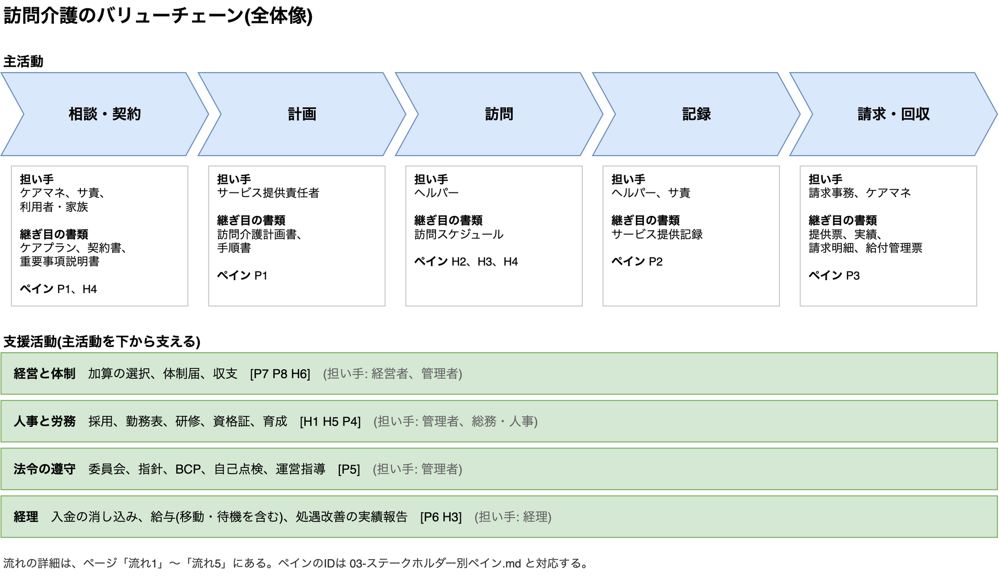
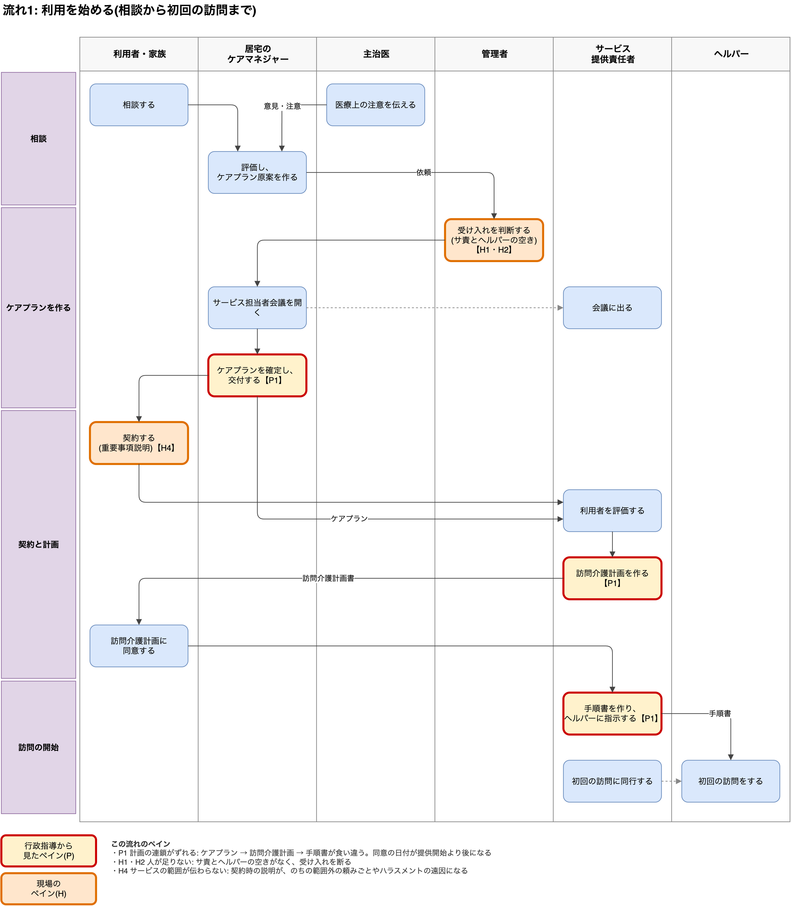
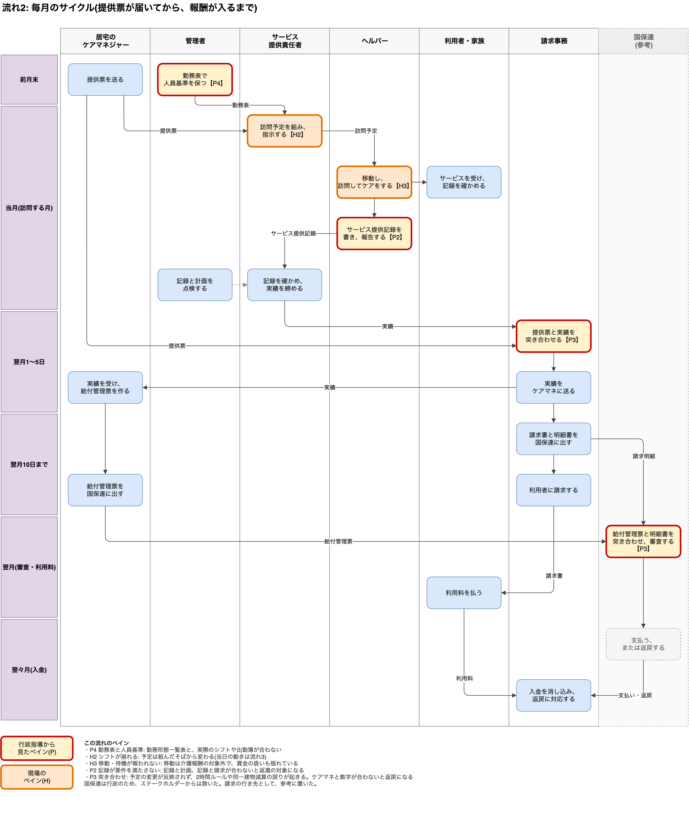
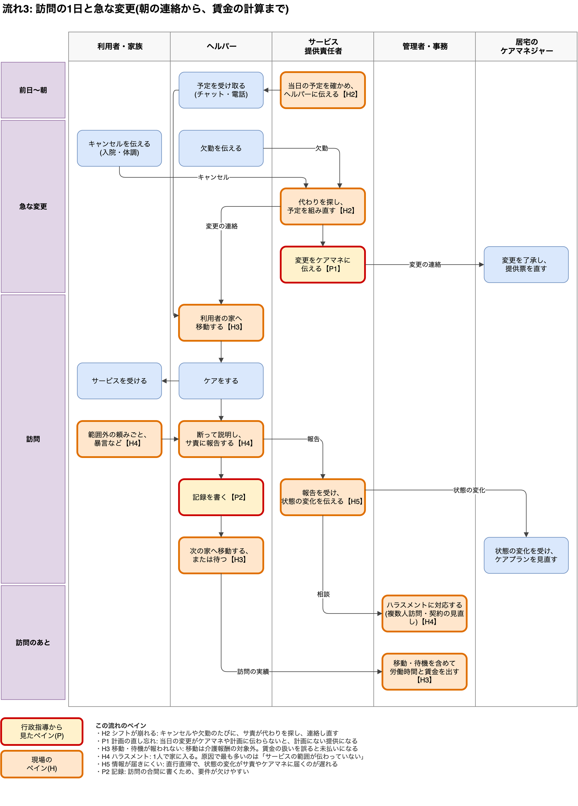
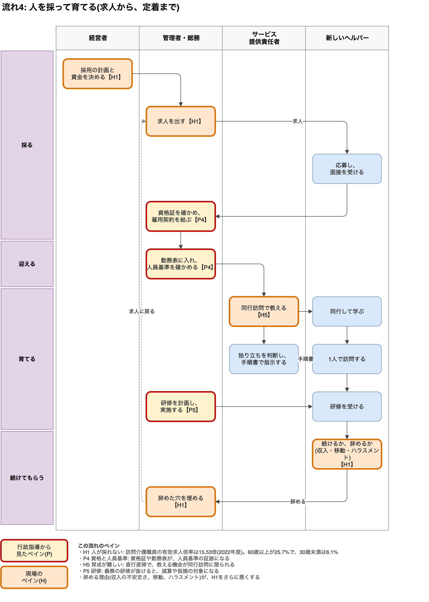
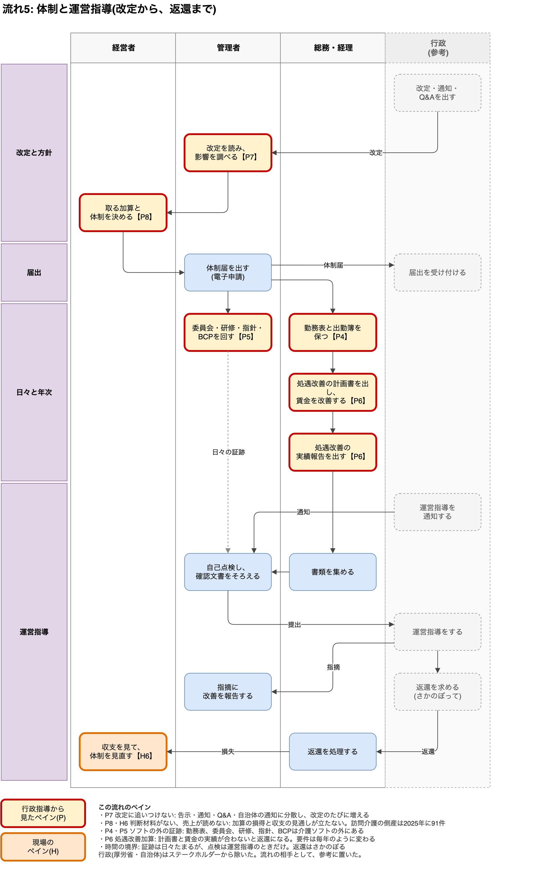

# 訪問介護のバリューチェーン

作成日: 2026年11月8日

## この資料の結論

- 価値を生む本線は「相談・契約 → 計画 → 訪問 → 記録 → 請求・回収」の5段。
- 業務の流れは5枚に分けて描いた。利用開始、毎月、訪問の1日、採用と育成、体制と運営指導。
- ペインは2色で示した。赤は行政指導から見たペイン(P)、橙は現場のペイン(H)。IDは `03-ステークホルダー別ペイン.md` と対応する。

業務の中身は `06-訪問介護の業務一覧.md` にある。

## 図の元ファイル

図は draw.io で描いた。元は `07-訪問介護のバリューチェーン.drawio` で、ページが6つある。

- 全体像
- 流れ1 利用を始める
- 流れ2 毎月のサイクル
- 流れ3 訪問の1日と急な変更
- 流れ4 人を採って育てる
- 流れ5 体制と運営指導

PNGは、このファイルから書き出したもの。PNGにも図のデータを埋め込んであり、draw.io で開いて直せる。図を直したら、PNGも書き出し直す。

## 図の見方

- 縦の帯が、ステークホルダーのレーン。上から下へ時間が進む
- 左の紫の帯は、時期の区切り
- 矢印に書いた言葉は、受け渡す書類や連絡
- 赤い枠: 行政指導から見たペイン(P1〜P8)
- 橙の枠: 現場のペイン(H1〜H6)
- 灰色の点線のレーン: 行政(国保連・厚労省・自治体)。ステークホルダーから除いたが、流れの相手として参考に置いた

## 流れを5枚に分けた理由

最初の2枚(利用開始と毎月)には、現場のペインが出てくる場面がなかったため。

- シフトの崩れ、移動、ハラスメントは、訪問の当日に起きる → 流れ3
- 採用と育成は、本線の外で人を回す流れ → 流れ4
- 改定・届出・運営指導は、年単位の流れ → 流れ5

---

## 全体像

本線(主活動)を、4つの支援活動が下から支える。

| 活動 | 主に担う人 | 継ぎ目になる書類 | ペイン |
|---|---|---|---|
| 相談・契約 | ケアマネ、サービス提供責任者、利用者・家族 | ケアプラン、契約書、重要事項説明書 | P1、H4 |
| 計画 | サービス提供責任者 | 訪問介護計画書、手順書 | P1 |
| 訪問 | ヘルパー | 訪問スケジュール | H2、H3、H4 |
| 記録 | ヘルパー、サービス提供責任者 | サービス提供記録 | P2 |
| 請求・回収 | 請求事務、ケアマネ | 提供票、実績、請求明細、給付管理票 | P3 |
| 経営と体制 | 経営者、管理者 | 体制届 | P7、P8、H6 |
| 人事と労務 | 管理者、総務・人事 | 勤務形態一覧表、資格証、研修記録 | H1、H5、P4 |
| 法令の遵守 | 管理者 | 議事録、指針、BCP、自己点検シート | P5 |
| 経理 | 経理 | 給与台帳、処遇改善の実績報告書 | P6、H3 |

---

## 流れ1: 利用を始める

相談から初回の訪問までの流れ。計画の連鎖(ケアプラン → 訪問介護計画 → 手順書)が、ここで作られる。

この流れのペイン:

- **P1 計画の連鎖がずれる。** ケアプラン・訪問介護計画・手順書が食い違う。同意の日付が提供開始より後になる
- **H1・H2 人が足りない。** サ責とヘルパーの空きがなく、受け入れを断る
- **H4 サービスの範囲が伝わらない。** 契約時の説明が、のちの範囲外の頼みごとやハラスメントの遠因になる

---

## 流れ2: 毎月のサイクル

提供票が届いてから、報酬が入るまでの流れ。訪問した月の翌々月に入金される。

この流れのペイン:

- **P4 勤務表と人員基準。** 勤務形態一覧表と、実際のシフトや出勤簿が合わない
- **H2 シフトが崩れる。** 予定は組んだそばから変わる。当日の動きは流れ3
- **H3 移動・待機が報われない。** 移動は介護報酬の対象外で、賃金の扱いも揺れている
- **P2 記録が要件を満たさない。** 記録と計画、記録と請求が合わないと、返還の対象になる
- **P3 突き合わせ。** 予定の変更が反映されず、2時間ルールや同一建物減算の誤りが起きる。ケアマネと数字が合わないと返戻になる

---

## 流れ3: 訪問の1日と急な変更

朝の連絡から、賃金の計算までの流れ。現場のペインの多くが、この1日に集まる。

この流れのペイン:

- **H2 シフトが崩れる。** キャンセルや欠勤のたびに、サ責が代わりを探し、連絡し直す
- **P1 計画の直し忘れ。** 当日の変更がケアマネや計画に伝わらないと、計画にない提供になる
- **H3 移動・待機が報われない。** 賃金の扱いを誤ると、未払いになる
- **H4 ハラスメント。** 1人で家に入る。原因で最も多いのは「サービスの範囲が伝わっていない」
- **H5 情報が届きにくい。** 直行直帰で、状態の変化がサ責やケアマネに届くのが遅れる
- **P2 記録。** 訪問の合間に書くため、要件が欠けやすい

---

## 流れ4: 人を採って育てる

求人から定着までの流れ。辞めた穴を埋めるために、求人に戻る輪になっている。

この流れのペイン:

- **H1 人が採れない。** 訪問介護職員の有効求人倍率は15.53倍(2022年度)。60歳以上が25.7%で、30歳未満は6.1%
- **P4 資格と人員基準。** 資格証や勤務表が、人員基準の証跡になる
- **H5 育成が難しい。** 直行直帰で、教える機会が同行訪問に限られる
- **P5 研修。** 義務の研修が抜けると、減算や指摘の対象になる
- 辞める理由(収入の不安定さ、移動、ハラスメント)が、H1をさらに悪くする

---

## 流れ5: 体制と運営指導

改定から返還までの、年単位の流れ。日々の証跡と、年1回の点検の間に「時間の境界」がある。

この流れのペイン:

- **P7 改定に追いつけない。** 告示・通知・Q&A・自治体の通知に分散し、改定のたびに増える
- **P8・H6 判断材料がない、売上が読めない。** 加算の損得と収支の見通しが立たない
- **P4・P5 ソフトの外の証跡。** 勤務表、委員会、研修、指針、BCPは介護ソフトの外にある
- **P6 処遇改善加算。** 計画書と賃金の実績が合わないと返還になる。要件は毎年のように変わる
- **時間の境界。** 証跡は日々たまるが、点検は運営指導のときだけ。返還はさかのぼる

---

## まだ描いていない流れ

- **計画の見直し:** 状態の変化 → ケアマネへの報告 → ケアプランの変更 → 訪問介護計画の変更。流れ1と流れ3の一部で代えている
