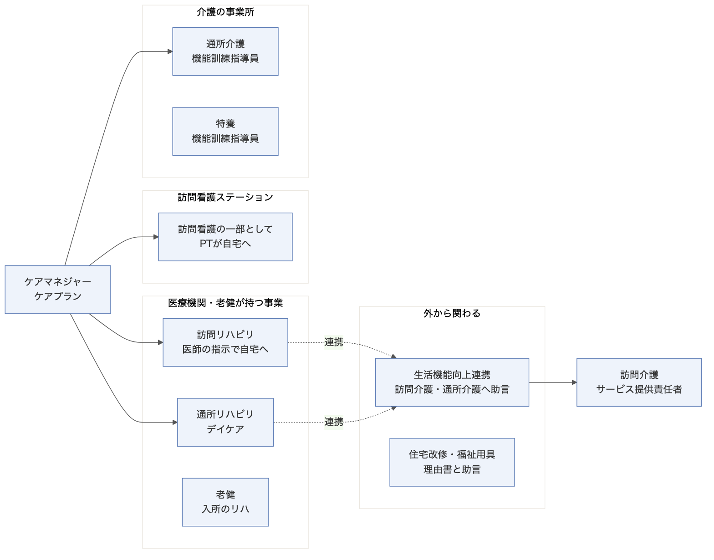
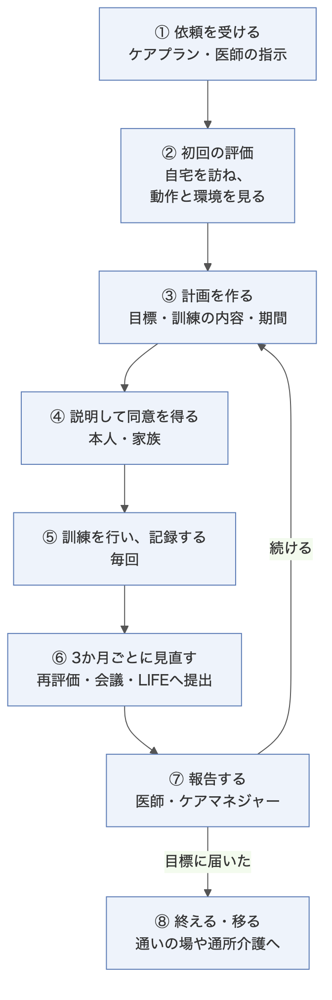
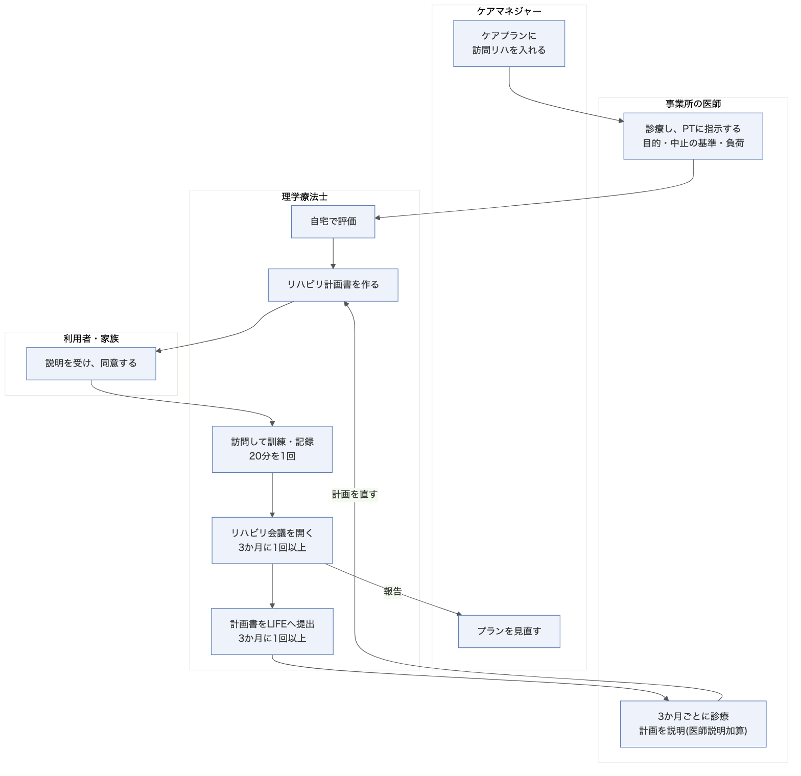
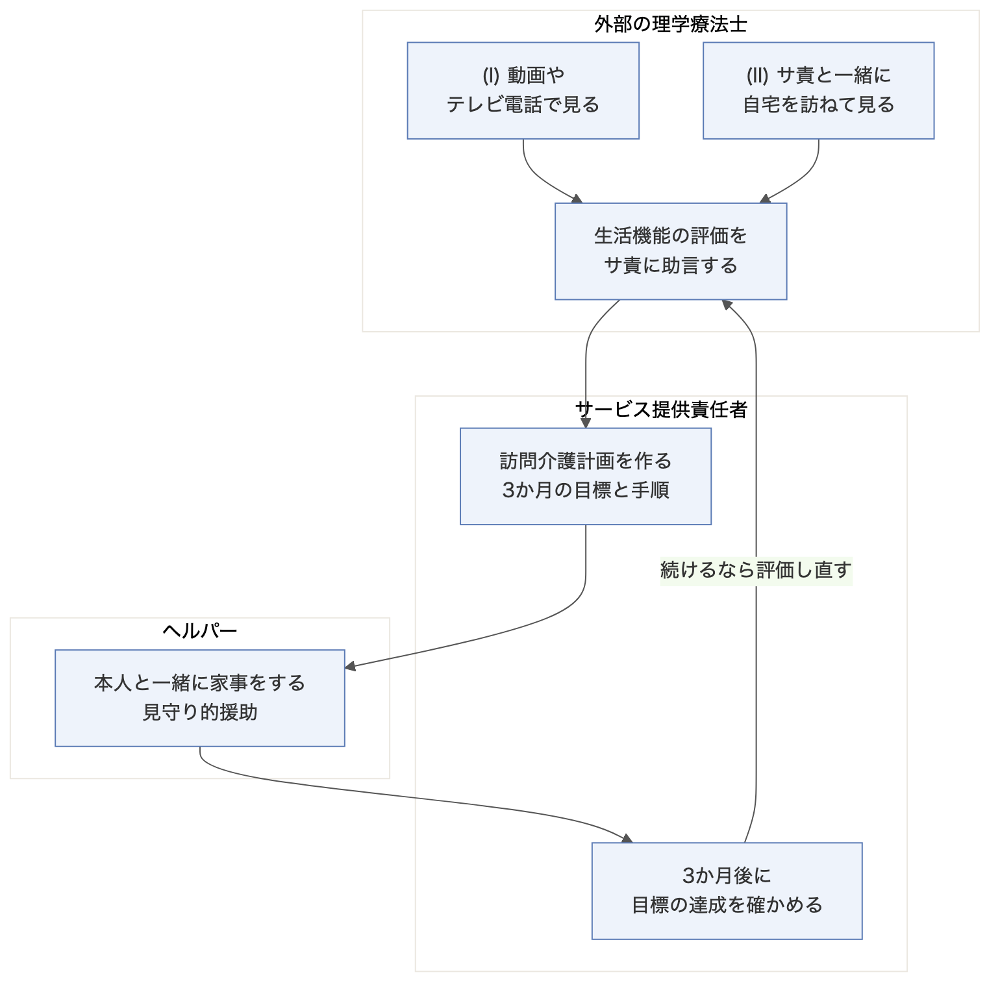

# 理学療法士の介護事業所での業務フロー

作成日: 2026年11月9日

## この資料の結論

- 介護保険で理学療法士(PT)が働く場は、大きく4つある。医療機関や老健の事業、訪問看護ステーション、介護の事業所、外からの連携。
- どの場でも、業務は同じ型で回る。依頼 → 評価 → 計画 → 同意 → 訓練と記録 → 3か月ごとの見直し → 報告 → 終了。
- 3か月ごとの見直しに、会議・LIFEへの提出・医師の診療・居宅訪問が集まる。加算と減算の要件も、ここに集まる。
- 訪問介護との接点は、生活機能向上連携加算だけ。PTの評価をもとに、サービス提供責任者が訪問介護計画を作る。

単位数と要件は、主に民間の解説と自治体の資料で確かめた。厚労省の告示・通知の原文は、まだ当たっていない。テーマにする前に原文で確かめる(末尾の「確かめていない点」)。

図はMermaidで描いた。元のファイルは `12-mmd/` にある。PNGは次のコマンドで書き出し直せる。

```bash
cd 12-mmd && mmdc -i 2-サイクル.mmd -o ../12-2-サイクル.png -c cfg.json -b white -s 2
```

---

## PTが働く場

介護保険でPTが関わるサービスは、制度上の立場がそれぞれ違う。同じPTでも、誰の指示で動くか、どの書類を書くかが変わる。



| 場 | PTの立場 | 誰の指示・依頼で動くか | 主な書類 | 主な加算・減算 |
|---|---|---|---|---|
| 訪問リハビリ | 事業所の職員 | 事業所の医師の指示、ケアプラン | リハビリ計画書、診療録 | リハマネ加算イ・ロ、医師説明加算、長期利用の減算 |
| 通所リハビリ | 事業所の職員 | 事業所の医師の指示、ケアプラン | リハビリ計画書 | リハマネ加算イ・ロ・ハ、短期集中の加算 |
| 老健 | 施設の職員 | 施設の医師 | 施設サービス計画、リハビリ計画書 | 短期集中の加算、在宅復帰の評価 |
| 訪問看護ステーション | 看護職員の代わりの訪問 | 主治医の指示書、ケアプラン | 訪問看護計画書・報告書(看護と一体) | PT等の訪問が多いと減算 |
| 通所介護 | 機能訓練指導員 | ケアプラン | 個別機能訓練計画書 | 個別機能訓練加算Iイ・Iロ・II |
| 特養 | 機能訓練指導員 | 施設サービス計画 | 個別機能訓練計画書 | 個別機能訓練加算 |
| 外からの連携 | 外部の助言者 | 訪問介護・通所介護の事業所 | 助言の記録(計画は相手が作る) | 生活機能向上連携加算I・II(相手が算定) |
| 住宅改修・福祉用具 | 理由書の作成者・助言者 | ケアマネジャー、本人 | 住宅改修が必要な理由書 | — |

- 機能訓練指導員は、PTに限らない。OT・ST・看護職員・柔道整復師・あん摩マッサージ指圧師・はり師・きゅう師もなれる。
- 住宅改修の理由書は、原則はケアマネジャーが書く。PTが書けるかどうかは市町村が決める(神戸市・杉並区は可)。

---

## どの場でも同じ型で回る

場は違っても、PTの業務は8つの段の繰り返しになる。



| 段 | 何をするか | 継ぎ目になる書類 | 頻度 |
|---|---|---|---|
| ① 依頼を受ける | ケアプランや医師の指示を受け取る | ケアプラン、医師の指示書 | 契約時 |
| ② 初回の評価 | 自宅を訪ね、動作・身体機能・家の環境を見る | 評価表(ADL、転倒の危険など) | 契約時 |
| ③ 計画を作る | 目標・訓練の内容・期間を決める | リハビリ計画書、個別機能訓練計画書 | 契約時、見直しのたび |
| ④ 説明と同意 | 本人と家族に計画を説明し、同意をもらう | 同意の署名 | 計画のたび |
| ⑤ 訓練と記録 | 訓練をして、毎回記録する | 実施記録 | 毎回 |
| ⑥ 3か月ごとの見直し | 再評価し、会議を開き、LIFEへ出す | 会議録、LIFEのデータ | 3か月ごと |
| ⑦ 報告 | 医師とケアマネジャーに経過を伝える | 報告書 | 3か月ごと、変化のたび |
| ⑧ 終える・移る | 目標に届いたら、通いの場や通所介護へ移す | 終了時の記録 | 随時 |

---

## 流れ1: 訪問リハビリ

医師・PT・ケアマネジャーの3者で回る。PTの業務のうち、書類と期限が一番多い流れ。



- 事業所の医師が、PTに指示を出す。リハマネ加算イでは、目的に加えて、留意事項・中止の基準・負荷のうち1つ以上を指示する。
- PTは1回20分以上を1回と数え、週6回まで算定できる。
- リハビリ会議を3か月に1回以上開き、計画書をLIFEに3か月に1回以上出す。LIFEへの提出はリハマネ加算ロの要件。
- 医師が3か月に1回以上計画を説明すると、医師説明加算(月270単位)を毎月算定できる。
- 利用が12か月を超えると、1回30単位を減算する。3か月ごとの会議とLIFEへの提出の両方を満たせば、減算しない。
- 2024年度の算定率は、リハマネ加算ロが2.3%、医師説明加算が2.2%(第259回介護給付費分科会)。要件が重く、ほとんど取られていない。

---

## 流れ2: 訪問看護ステーションのPT

PTの訪問は、制度上は「看護職員の訪問の一部を代わりに行うもの」と扱われる。計画書と報告書は看護職員と一体で作る。

- 1回20分以上を1回と数え、週6回まで。
- 2024年度から、次のどちらかに当たると、PT等の訪問1回につき8単位を減算する。
  - 前年度にPT等の訪問回数が、看護職員の訪問回数を超えた。
  - 前6か月に、緊急時訪問看護加算・特別管理加算・看護体制強化加算をどれも算定していない。
- 回数は、PTが続けて2回(20分×2)訪問したら1回と数える(Q&A Vol.1 問28)。
- 介護予防訪問看護では、利用が12か月を超えると、さらに1回15単位を減算する。

---

## 流れ3: 通所介護の機能訓練指導員

通所介護では、PTは機能訓練指導員として働く。医師の指示は要らず、ケアプランに沿って訓練する。

- 個別機能訓練加算Iイは機能訓練指導員1人の配置で1日56単位、Iロは理学療法士等をもう1人置いて1日76単位。
- 3か月に1回以上、利用者の自宅を訪ね、生活の様子を確かめ、計画の進み具合を説明する。訪ねる人はPTでなくてもよい。
- 加算IIは、計画書をLIFEに出し、返ってきた情報で計画を直すと算定できる。

---

## 流れ4: 外部のPTとして訪問介護と連携する

訪問介護とPTの唯一の接点。PTは計画を作らず、サービス提供責任者(サ責)に助言する。加算は訪問介護の事業所が算定する。



- 助言できるPTは、訪問リハ・通所リハの事業所、またはリハビリをしている医療提供施設に勤める人。病院は200床未満などに限る。訪問看護ステーションのPTは除かれる。
- 加算(I)は、PTが動画やテレビ電話で動作を見て助言する。初回の月に1回、100単位。
- 加算(II)は、PTとサ責が一緒に自宅を訪ねて評価する。初回の月から3か月、毎月200単位。
- サ責は、評価をもとに3か月の目標と手順を訪問介護計画に書く。3か月を超えて続けるなら、評価し直して計画を直す。
- ヘルパーは、本人と一緒に家事をする(自立支援の見守り的援助)。この援助は身体介護として算定できる。

構想の架空事業所は、この加算を「取らない」設計にしている(`10-架空の訪問介護事業所の設計.md`)。PTのテーマを入れるなら、この設定を変える。

---

## 流れ5: 住宅改修と福祉用具

手すりや段差の解消を介護保険で行うには、理由書を市町村に出す。PTは、動作の評価から改修の中身を提案する。

- 理由書の根拠は、介護保険法施行規則第75条。
- 書けるのは原則ケアマネジャー。PT・OT・福祉住環境コーディネーター2級以上などを認めるかは、市町村ごとに違う。

---

## PTの困りごとの候補

下は、業務の流れから見た仮説。公開資料でまだ確かめていない。テーマにする前に、運営指導の指摘資料や国の調査で裏を取る。

| 候補 | 業務の段 | 仮説 |
|---|---|---|
| 3か月ごとの書類が重い | ⑥ | 会議・LIFE・医師の説明・居宅訪問が同じ時期に重なる。算定率の低さ(2%台)が裏付けになりうる |
| 計画と実施がずれる | ③⑤ | 計画の目標と、毎回の実施記録がつながらない。運営指導で指摘されている可能性がある |
| 連携の書類が届かない | ⑦、流れ4 | PTの評価が、サ責やケアマネジャーの計画に反映されない。生活機能向上連携加算の算定率も低いとされる |
| 訪問看護の回数を数え違える | 流れ2 | 「続けて2回は1回」などの数え方を間違えて、減算の判定を誤る |
| 理由書の要件が市町村ごとに違う | 流れ5 | 書ける人と様式が自治体で違い、差し戻しが起きる |

---

## 確かめていない点

- 単位数と要件は、厚労省の告示・解釈通知・Q&Aの原文で確かめていない。民間の解説の間で数字が食い違う箇所もあった(個別機能訓練加算IIが月か日か)。
- 通所リハのリハマネ加算ハ、老健のリハの要件は、詳しく調べていない。
- 生活機能向上連携加算の算定率は、数字を確かめていない。
- 住宅改修の理由書についての国の通知(平成12年老企第42号など)の原文は、まだ読んでいない。

## 出典

- [第259回 社会保障審議会 介護給付費分科会 資料4 訪問リハビリテーション(厚生労働省、2026年6月29日)](https://www.mhlw.go.jp/content/12300000/001716096.pdf)
- [令和6年度介護報酬改定に関するQ&A(Vol.5)(PT-OT-ST.NET)](https://www.pt-ot-st.net/index.php/topics/detail/1604)
- [理学療法士等の訪問看護の減算、「訪問回数」の解釈を明示(PT-OT-ST.NET)](https://www.pt-ot-st.net/index.php/topics/detail/1578)
- [令和6年度介護報酬改定の施行時期について(石川県)](https://www.pref.ishikawa.lg.jp/ansin/documents/r615houmonkango.pdf)
- [リハマネ加算・計画書情報加算の算定要件(医療・介護マニュアルサポート)](https://medicalcare-support.jp/articles/reha-management-keikakusho-johou-kasan)
- [訪問介護の生活機能向上連携加算とは?(houmon-reha.com)](https://houmon-reha.com/helper-7354/)
- [個別機能訓練加算 I・II・IIIの違いと算定要件(医療・介護マニュアルサポート)](https://medicalcare-support.jp/articles/kobetsu-kinou-kunren-kasan-2)
- [「理由書」の作成(神戸市)](https://www.city.kobe.lg.jp/documents/7458/jyukairiyu202301.pdf)
- [住宅改修が必要な理由書 記入例(杉並区)](https://www.city.suginami.tokyo.jp/documents/8540/310419kinyurei-riyusyo.pdf)
