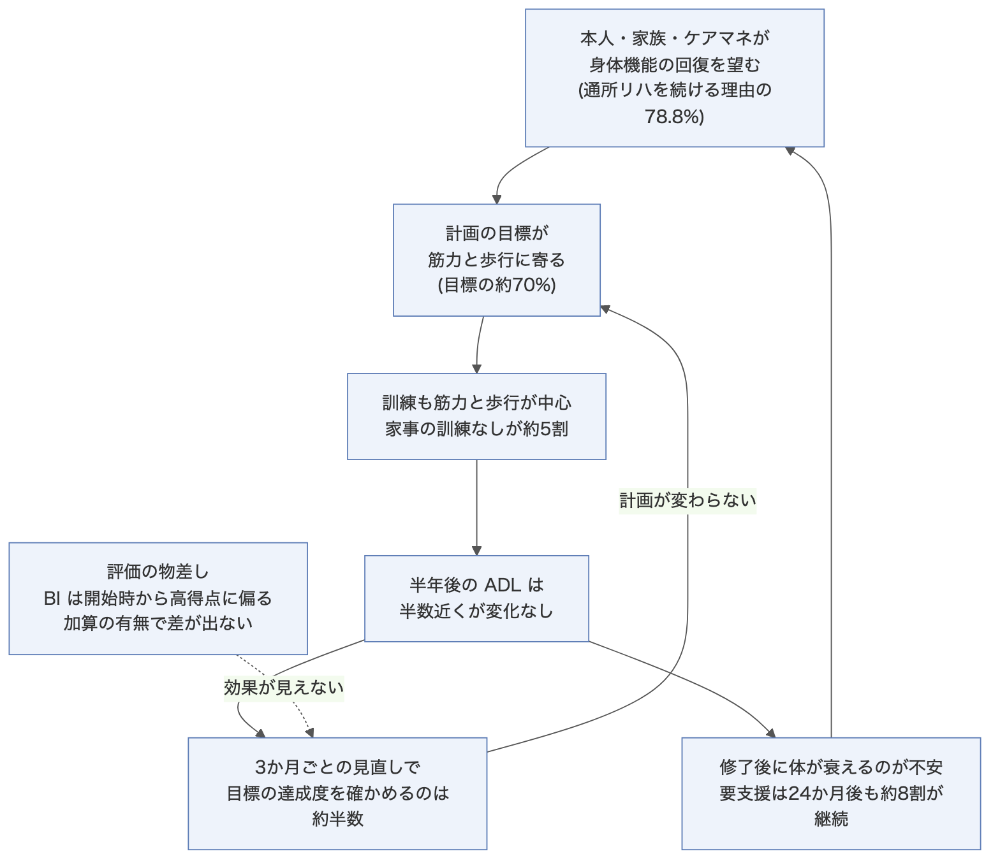

# 見直しが形だけになる・訓練が筋力と歩行に偏る(RH4・RH5の深掘り)

作成日: 2026年11月9日

## この資料の結論

- 2つのペインは、別々の問題ではない。「目標が身体機能に寄る → 訓練も寄る → 見直しで目標を問い直さない → 計画が変わらない」という1つの循環になっている。
- 偏りは新しい問題ではない。国は2004年、2015年、2026年と、20年以上同じ課題を挙げ続けている。
- 効かないのはリハそのものではない。ADL・IADLの練習をした人では、6か月後に向上した割合が高い。IADLの向上は、練習ありで59.9%、なしで33.1%(訪問リハ・要介護1-2)。
- 「加算の有無で効果に差がない」のは、加算を取っても中身(練習の内容)が変わらないから、と読める。物差しのBarthel Indexが開始時から高得点に偏り、変化を拾いにくいことも効いている可能性がある。
- 偏りの根には、本人・家族・ケアマネジャーの希望がある。身体機能の回復を望み、修了後に衰えるのを不安に思うため、筋力と歩行の訓練が続く。

元の調査は、全国デイ・ケア協会の「通所・訪問リハビリテーションの適切な在り方についての調査研究事業」(令和7年度 老人保健健康増進等事業、474ページ)。分科会の資料は、この調査の抜粋。

---

## RH5 訓練が筋力と歩行に偏る

### 計画の目標

訪問リハビリ計画書の目標(複数回答)。数字は図から読んだ概数。

| 目標 | 要支援(n=118) | 要介護(n=763) |
|---|---|---|
| 歩行・移動能力の向上 | 約70% | 約74% |
| 身体機能の向上 | 約71% | 約72% |
| 転倒予防 | 約62% | 約55% |
| ADLの改善 | 約40% | 約45% |
| 家事動作や役割など(IADL)の改善 | 約41% | 約17% |
| 自宅での入浴動作の改善 | 約15% | 約14% |
| 地域での社会参加の促進 | 約10% | 約10% |

出典: 第259回 資料4 p.41。資料の文言は「運動機能の改善を目標にしている割合は約70%、ADLの改善やIADLの改善を目標にしているのは20〜40%」。

### 計画に書いた訓練

LIFEに出された訪問リハビリ計画(リハマネ加算あり n=34,666)。概数。

- 筋力増強訓練 約70%、歩行訓練 約57%、関節可動域訓練 約45%
- ADL訓練 約22%、IADL訓練 約7%
- 加算なし(n=3,245)でも、ほぼ同じ形

出典: 第271回 資料4 p.11(介護DBのLIFEデータ、R7.10〜12審査分)。通所リハでも同じ傾向(第270回 資料3 p.11)。

### 実際にした訓練

訪問リハ・要介護の利用者票。報告書の本文の数字。

| 訓練 | 要介護1-2(n=421) | 要介護3-5(n=416) |
|---|---|---|
| ADL訓練の実施なし | 28.0% | 23.3% |
| 階段昇降訓練 | 42.3% | 26.2% |
| 移乗訓練 | 18.1% | 36.8% |
| 入浴訓練 | 18.3% | 15.4% |
| IADL訓練の実施なし | 47.7% | 58.4% |
| 外出訓練 | 34.7% | 22.1% |
| 調理・洗濯・掃除・買い物の訓練 | 各4〜8% | 各4〜8% |
| ADL・IADLとも実施なし | 22.6% | 18.8% |
| 社会参加への支援の実施なし | 約8割 | 約8割 |

出典: 報告書 p.260–264(図6-3-23、6-3-24、表6-3-11)。

一方で、福祉用具の評価・選定(約65%)、家族への助言(52〜62%)、家屋の評価(42〜46%)は多い。環境への働きかけはしているが、本人が家事などを練習する時間は少ない。

### 練習をした人は伸びている

これが一番大事な結果。

- ADLが6か月で向上した割合は、ADL練習・IADL練習ありで4割を超え、なしでは22.4%
- IADLが向上した割合は、IADL練習ありで59.9%、なしで33.1%
- 利用を修了した人では「外出訓練」が41.8%と高い

出典: 報告書 p.261、p.427(考察、表6-4-4・6-4-5、訪問リハ・要介護1-2)。

**注意:** 練習を受けた人が、もともと状態のよい人だった可能性がある。報告書も「利用開始時のADL点数が高い利用者」で向上が多いと書いている。因果ではなく、関連として読む。

### 20年以上、同じ課題

| 年 | 資料 | 書かれたこと |
|---|---|---|
| 2004 | 高齢者リハビリテーション研究会 報告書 | 身体機能に偏ったリハへの問題提起(2015年の報告書が引用) |
| 2015 | 高齢者の地域における新たなリハビリテーションの在り方検討会 報告書 | 「『身体機能』に偏ったリハビリテーションが実施され、…バランスのとれたリハビリテーションが依然として徹底できていない」。リハ職の目的は「心身機能の維持・回復」が62.9% |
| 2026 | 第271回 介護給付費分科会 資料4 | 「筋力増強訓練や歩行訓練が多く、ADL訓練やIADL訓練の実施は一部にとどまる」 |

2015年の報告書は、2004年の課題が「現在もなお、残っている」と書いた。2026年の資料も同じ文を繰り返している。

---

## RH4 見直しが形だけになり、効果が見えない

### リハ会議で何を話しているか

訪問リハのリハ会議の内容(要介護 n=328)。概数。

- 生活状況の確認・共有、リハの内容、目標の確認・共有: いずれも8割超
- 目標達成度と取り組み効果の確認: 約57%(要支援は約48%)
- 多職種協働に向けた支援方針: 約40%
- 他サービス事業所との役割分担: 約22%

出典: 第259回 資料4 p.40。報告書の考察は、この傾向が令和4年度調査と同じで「検討内容の充実が引き続き課題」と書く(p.372)。

会議で目標を立てても、達成したかを確かめない利用者が4割を超える。確かめなければ、計画は変わらない。

### 会議を充実させた人は練習が変わる

- リハ会議で「アセスメント結果の共有」「目標達成度と効果の確認」「多職種協働の方針」を話した利用者では、ADL練習・IADL練習・応用歩行訓練の実施割合が高い(報告書 p.434)
- 同じ利用者では、ケアマネジャーや他の事業所との情報共有も、すべての項目で高い(p.266–268)

会議の中身が、練習の中身を変える入口になっている。

### 加算の有無で差が出ない

リハマネ加算の有無で、6か月後のADL・IADLの変化に違いはなかった。

| 6か月後の変化(訪問リハ) | 加算あり(n=361) | 加算なし(n=474) |
|---|---|---|
| BIが5点以上向上 | 36.5% | 31.4% |
| BIが変化なし(0点) | 43.2% | 47.5% |
| BIが低下 | 13.0% | 14.8% |
| FAIが1点以上向上 | 43.5% | 40.7% |

出典: 第271回 資料4 p.13(報告書の抜粋)。BIはBarthel Index(日常の動作を100点で表す指標)、FAIはFrenchay Activities Index(家事や外出の頻度を45点で表す指標)。向上の割合は、図の区分を足して求めた。

差がない理由として、資料から読めることが2つある。

1. **中身が同じ。** 加算の有無にかかわらず、計画も訓練も筋力と歩行が中心(上の RH5)。加算は「管理していること」を評価するが、何を練習するかは変えていない。
2. **物差しが変化を拾いにくい。** 開始時のBIは80〜95点が43.0%、100点が4.9%で、上に詰まっている。満点に近い人は、伸びる余地が少ない。FAIは逆に0〜9点が80.0%で、下に詰まっている。

2つ目は資料からの推測で、報告書が言っていることではない。

### フィードバックが使われない

LIFEに出したデータは、事業所にフィードバック票として返ってくる。これが見直しに使われていない。

- 訪問リハ・要支援で、フィードバック票を活用しているのは11.4%(12月以下)、14.8%(12月超)(報告書 p.4)
- 通所リハで未活用の理由は「活用方法がわからない」64.6%、「時間がない」46.5%(n=127、報告書 p.41)

データを出す手間はかかるが、見直しには返ってこない。現場から見ると、LIFEへの提出は「出すだけの作業」になっている。

---

## なぜ偏るのか

資料が挙げる理由は、次の4つ。

| 理由 | 根拠 |
|---|---|
| 本人・家族が身体機能の回復を望む | 通所リハを続ける理由は「身体機能を治したい」78.8%、「筋力や体力をつけたい」75.4%。「家事ができるようになりたい」は36.3%(2014年調査、2015年報告書で引用) |
| ケアマネジャーも同じ課題を挙げる | ケアマネジャーが考える課題は「身体機能の維持・向上」が最多。計画の目標は、本人・家族の希望とケアマネジャーの課題に沿っている(報告書 p.436–437) |
| 訪問では活動の練習を頼まれにくい | ヒアリングで「訪問では、身体機能の改善を主体にされる方が多く、活動などへの介入を希望されるケースは少なく」(報告書 p.363) |
| 修了後に衰えるのが不安 | 本人・家族が修了後の身体機能やADLの低下を懸念し、修了を難しくしている(報告書 p.428、令和4年度調査の再掲)。要支援では24か月後も約8割が継続 |

計画が希望に沿っていること自体は、手順として正しい。問題は、本人の暮らしに要る動作(入浴、家事、外出)が希望として言葉にならず、目標にも上がらないこと。

---

## 国の対応案

第271回 資料4 p.14は、次をリハマネ加算の算定要件にすることを提案している。

1. リハ会議で、居宅での活動と参加の状態を共有し、活動と参加の目標と、それを踏まえたADL訓練・IADL訓練を含む計画を立てる
2. リハ会議で、目標の達成状況を報告し、必要に応じて計画を見直す

要件になれば、計画と会議録に「活動・参加の目標」「ADL・IADLの訓練」「達成状況」が書かれているかが、運営指導で確かめられるようになる。

---

## AIで試せそうな形(案)

検証テーマの種。まだ裏付けは取っていない。

| 案 | AIにさせること | 測るもの |
|---|---|---|
| 計画の偏りを見つける | 架空のリハ計画書と生活状況のメモを読ませ、心身機能・活動・参加の釣り合いを判定させる。足りない活動・参加の目標を提案させる | 仕込んだ偏りを見つけた割合。提案がICFの3要素と暮らしに沿うか |
| 希望を言葉にする | 架空の本人の語り(「また孫に料理を作りたい」など)から、活動・参加の目標とADL・IADLの練習を書かせる | 語りにある活動を目標に拾えた割合 |
| 会議録を点検する | 架空のリハ会議録から、目標の達成度を確かめたか、計画を見直したかを判定させる | 対応案の要件(上の1と2)を満たすかの判定の正解率 |

3つとも、国の対応案(2026年10月)が要件にしようとしている中身と重なる。

---

## 出典

- [第271回 介護給付費分科会 資料4 訪問リハビリテーション(R8.10.19)](https://www.mhlw.go.jp/content/12300000/001760334.pdf) p.11–14
- [第270回 資料3 通所リハビリテーション(R8.10.14)](https://www.mhlw.go.jp/content/12300000/001758861.pdf) p.11–13
- [第259回 資料4 訪問リハビリテーション(R8.6.29)](https://www.mhlw.go.jp/content/12300000/001716096.pdf) p.40–41・46
- [令和7年度 通所・訪問リハビリテーションの適切な在り方についての調査研究事業 報告書(全国デイ・ケア協会)](https://day-care.jp/wp/wp-content/uploads/af444edae7f265802fb47e3e26143939.pdf)
- [同 サマリ(訪問リハビリテーション)](https://day-care.jp/wp/wp-content/uploads/16ae127738c4961da9228d4ddd47fd57.pdf)
- [高齢者の地域における新たなリハビリテーションの在り方検討会 報告書(厚生労働省、平成27年3月)](https://www.mhlw.go.jp/file/05-Shingikai-12601000-Seisakutoukatsukan-Sanjikanshitsu_Shakaihoshoutantou/0000081253.pdf)

報告書のページは、印字されたページ番号。
